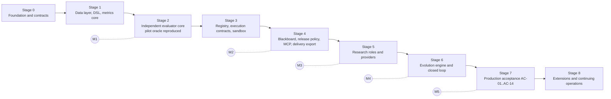

# Hybrid v1 — Aligned Development Plan

**Revision 2.1 · October 27, 2026 · Planning specification. Nothing here claims an implemented system, a live-provider run or a production acceptance.**

**System.** Supervisor–worker coordination + shared research blackboard + evolutionary factor development, supported by parallel specialists, iterative review and standardized artifact preparation, with a strictly independent, deterministic evaluation service.

**Delivery form.** One Docker Compose bundle for macOS on Apple Silicon (ARM64), first on the Mac Studio with its existing Docker Desktop, and for Linux AMD64 after separate native validation. Container images are `linux/arm64` and `linux/amd64`; the Linux ARM64 engine inside Desktop is not a substitute for Apple host acceptance. A standard MCP front door on the host's loopback. A host agent (Codex or any conforming MCP client) normalizes a folder, a file, a standalone idea, factor, model or strategy into a typed input bundle and submits it. Internal research agents run on independently configured online LLM providers; Kimi, GLM and DeepSeek are mandatory in the first production release. Jobs run on demand until a frozen exit gate passes; there is no default elapsed-time or generation ceiling.

**First fixture.** The P0/P1 A-share industry-rotation packages (Appendix A), preserved and reproduced byte-exactly, labelled as previously inspected history.

---

## 0. How to use this plan

**Authority order when documents disagree:** the owner's current instructions → the Hybrid v1 architecture in the brainstorm's Final Recommendation → `docs/PLAN_ALIGNMENT.md` (the owner's requirements and reconciliation contract, revision 1.2) → this plan → `docs/LOCAL_IMPLEMENTATION_REFERENCE.md` (the detailed technical chapters) → Appendices A and B.

**Document map.**

| Document | Role | Read when |
|---|---|---|
| `PLAN_ALIGNMENT.md` | Requirements R1–R6, reconciliation decisions, provider/intake/MCP/lifecycle/Docker contracts, acceptance checklist AC-01–AC-14 | Before any stage; whenever a conflict appears |
| This plan | The single ordered build plan: product definition, architecture, contracts, stages with entry and exit gates, verification | Every stage |
| `LOCAL_IMPLEMENTATION_REFERENCE.md` | Detailed specifications: DSL grammar and operators, metric formulas, database tables, API routes, invariants and named tests, defaults for the `stock_daily_v1` profile, local work-package IDs | When implementing the component it specifies |
| `DEPLOYMENT_TARGETS.md` | Derived host/container evidence matrix and Apple-first, then Linux AMD64 acceptance order | Deployment, CI handoff and target acceptance |
| `appendix-a-pilot-case-industry-rotation.md` | The P0/P1 fixture: folder taxonomy, data assets, business rules, baseline definitions, golden evidence, lessons | Stages 1–3 and 7 |
| `appendix-b-research-notes.md` | Historical research notes with sources; Claude-specific items are superseded and marked | When a design choice needs its evidence |
| `examples/llm-profiles.example.json` | Illustrative four-level provider/model/role/task configuration | Stage 0 schemas, Stage 5 adapters |
| `DEVELOPMENT_KICKOFF_PROMPT.md` | The prompt that starts development and the per-stage continuation template | Start of every stage |

**What changed from revision 1.x.** The product is MCP-client independent (no Claude runtime, SDK or client dependency anywhere), Docker-based, generic-input, multi-provider and on-demand with an independent exit gate. Revision 2.1 corrects deployment to macOS/Apple Silicon first on the Mac Studio's existing Docker Desktop, with Linux AMD64 accepted separately later; host OS/CPU and container platforms are distinct. Vocabulary is unified on the local reference's package, service, database and test names. Development is organized as nine stages with explicit entry conditions, work packages mapped to both plans' IDs, and exit gates. Pilot history is labelled previously seen everywhere; sealing changes access, not evidential independence.

**Keywords.** MUST and MUST NOT are enforced by tests. SHOULD is the default; deviations are recorded in `docs/decisions.md`. MAY is optional.

**Working rule.** Build and prove the deterministic parts (data layer, evaluator, registry, release policy, MCP) against the original machine-readable oracles before any production LLM research runs. Small offline supervisor/worker/blackboard experiments with scripted models may run alongside the early stages to prove evidence sharing and justified revisions; they establish nothing about financial performance or production readiness.

---

## 1. Product definition

### 1.1 Goal

An on-demand system that accepts a research objective with an idea, factor, model, strategy or mixed package, and runs an auditable loop of **propose → publish → independently evaluate → read released feedback → propose again** over a population of immutable research artifacts. The system delivers what a frozen exit gate requires, with evidence a skeptical reader can verify, and never lets the proposing side touch the measuring side.

### 1.2 Requirements inherited from the owner (R1–R6)

| ID | Requirement | Where this plan satisfies it |
|---|---|---|
| R1 | Hybrid v1 multi-agent research and evolution, with the research/evaluation boundary, roles, blackboard, population, lineage and released-feedback loop preserved | Sections 3, 6, 7; invariants INV-1 to INV-12 |
| R2 | macOS on Apple Silicon first, using the Mac Studio's existing Docker Desktop; Linux AMD64 remains a supported follow-on target; same-computer agent access through standard MCP | Sections 3.3, 5.1, 8; Stages 0, 3, 4, 7; target-specific ARCH and MCP test suites |
| R3 | Work on call until deliverables pass an exit gate; no compulsory schedule; no default total elapsed-time or generation ceiling | Section 2; JOB and DLV test suites |
| R4 | Accept packages and standalone ideas, factors, models or strategies; missing information stays explicit | Section 4.1; execution contracts in 7.3; INT test suite |
| R5 | Online, heterogeneous, tunable LLMs through an OpenAI-compatible boundary; Kimi, GLM and DeepSeek required in the first production release | Sections 4.7, 6.1, 6.3; PRV test suite; AC-05, AC-06 |
| R6 | Optimize the existing plans rather than rewrite the goal; keep both plans' useful detail and record conflict resolutions | This revision; reconciliation table in `PLAN_ALIGNMENT.md` section B |

### 1.3 Non-goals for v1

- Real-money or broker trading. Forward simulated tracking on newly arriving data is a module; brokers are not.
- Automated acquisition of licensed data. New data is a human-authorized step producing a new dataset version.
- Autonomous parallel research lanes and autonomous discovery of new factor-composition strategies (Hybrid v2). Importing, evaluating and revising an existing model or strategy under a declared contract is in scope.
- A mandatory web UI. MCP is the required interface; the dashboard is an optional operator feature.
- Local LLM hosting, GPU or CUDA dependencies, or a compulsory always-on deployment.
- Proving alpha. A run that ends with "no candidate clears the hurdle", with evidence, is a successful run.

### 1.4 The governing principle, made operational

**Separation of proposal and measurement**, enforced four ways rather than by prompt text:

1. **By construction.** Research roles have no tool, endpoint or credential that can start, configure, prioritize, cancel or read unreleased evaluation work. The evaluator is deterministic code with no LLM, no network egress and no wall-clock dependence (INV-1, INV-8).
2. **By storage and service identity.** Three databases (`research_db`, `registry_db`, `eval_db`) with least-privilege roles (`research_rw`, `registry_app`, `eval_rw`, `feedback_ro`), separate Compose services, private networks, role-specific credentials and mounts. Research reaches official evidence only through the GET-only Feedback API (INV-2, INV-4, INV-5).
3. **By data zones.** Research containers mount only the research-zone snapshot, truncated by date. All later windows live only in the evaluation zone (INV-6, INV-9).
4. **By release policy.** What the evaluator publishes back is coarsened, gated, rationed and version-linked, so iterating against feedback cannot quietly become fitting the test set (INV-7, INV-12).

---

## 2. Operating model: on-demand jobs and exit gates

**Deployment lifecycle.** The operator starts the Compose bundle. An idle deployment starts no research, fetches no licensed data, runs no forward simulation and spends nothing (AC-13). Durable state lives in named volumes; the operator may stop the deployment without deleting them.

**Job lifecycle.** `received → validating → ready → running → awaiting_evaluation → validating_delivery → completed`, with explicit side states `needs_input`, `paused`, `budget_paused`, `waiting_for_data`, `failed` and `cancelled`. Research generation state (local state machine: PENDING … CLOSED) and evaluator run state are separate records. A closed generation is not a completed job. Research can await evaluator work through released status but cannot drain, accelerate or cancel the evaluator queue.

**No default ceilings.** `max_wall_clock` and `max_generations` are unset by default. The controls that remain mandatory are per-call timeouts, sandbox resource limits, authorized spend with atomic reservations, evaluator quotas and release budgets. Budget exhaustion checkpoints work and enters `budget_paused`; it never counts as completion and never silently renews an allowance.

**Exit gates.** The brief freezes an exit-gate specification before execution: required deliverables and schemas, applicable protocol and checks, reproducibility criteria, evidence-release requirements, allowed conclusion types and any human sign-off. An **independent deterministic delivery checker** validates it and issues an immutable, signed receipt linked to exact artifact, data, protocol, configuration and report versions. The supervisor may propose completion; it cannot accept its own work.

- `research_delivery` (default) passes with a supported positive or negative result, including an empty shortlist, when the frozen brief allows that conclusion and every required check and artifact is present. A data-blocked report counts only if the brief explicitly permits it. Budget exhaustion, a crash, an unresolved required input or a missing evaluator report cannot be relabelled success (AC-09, AC-10).
- `investment_promotion` is a separately selected gate. It retains the applicable private holdout, prospective forward evidence and human approval. Historical replay cannot substitute for forward incubation; a job that needs new observations stays `waiting_for_data` with no hidden cutoff.

**Crash recovery.** Completed tool results, LLM responses, artifacts and state are checkpointed before dependent work starts. Leases and fencing prevent duplicate commits; local side effects are idempotent. A provider timeout after a request was accepted may still have incurred cost, so an `outcome_unknown` attempt is preserved and retried under a bounded policy rather than claiming exactly-once billing. A client session is never the only copy of progress (AC-08).

**After delivery.** When a valid receipt exists, the job creates no further research tasks and closes task-owned work. Results stay retrievable; other jobs and any separately authorized forward campaign are unaffected.

---

## 3. Architecture

### 3.1 Zones and components

Names in brackets are the brainstorm's hybrid-architecture nodes. Implementation names follow the local reference.

| Component | Zone | Responsibility | Implemented as | Stage |
|---|---|---|---|---|
| Host agent + portable intake guide | Host (user's machine) | Inventory and interpret supplied material, preserve originals, prepare the InputBundle, resolve missing fields with the owner, submit, poll, export | Codex or any MCP client following `qfr_mcp` intake instructions | 4 |
| MCP front door (`mcp-api`) | Research edge | Validate bundles, register datasets and baselines, propose protocols, submit/poll/pause/resume/cancel research, read registry and released reports, answer checkpoints, export deliveries | Standard Python MCP server, `qfr_mcp` | 4 |
| Research API (`research-api`) | Research | Programs and charters, durable job admission and control, blackboard views, checkpoint answers, delivery export; wrapped by MCP | FastAPI, `qfr_research` | 4–5 |
| Research orchestrator (`research-worker`) | Research | Deterministic generation state machine, agent calls, leased job queue, feedback sync | Python worker, `qfr_research` | 5 |
| Supervisor [S] | Research | Plans a generation, allocates research budget within authorization, respects evaluator quotas, proposes completion; cannot pass its own gate | LLM planner + deterministic validator and fallback | 5 |
| Specialists [W] | Research | Hypothesis researcher, factor engineer, critic, report analyst, interpretation reviewer, optional data engineer and literature researcher | Typed closed-tool loops | 5 |
| Evolution engine [E] | Research | Islands, archive, fitness, selection, operators, bandit, lineage; LLM variation goes through the engineer | Deterministic module + prompts | 6 |
| Workbench | Research | Research-zone metrics with the evaluator's own metric definitions | `qfr_core` facade | 1, 5 |
| Packager [P] | Research | Final validation, canonical hashing, manifest assembly, publication | Deterministic code | 5 |
| Blackboard [B] | Research | Hypotheses, tasks, candidates, reviews, population, lineage, cached released reports, interpretations, knowledge | `research_db` | 4 |
| Registry [A] | Shared, write-once | Immutable, content-addressed artifact versions with lineage | `registry-api` + `registry_db` | 3 |
| Data ingest and zone builder | Evaluation | Import adapters, as-of slicing, research-zone and full snapshots | `qfr_eval` ingest module + CLI | 1 |
| Intake and scheduler [C] | Evaluation | Poll registry by sequence cursor, eligibility, dedup, quotas, fair enqueue | `eval-scheduler` | 2–3 |
| Screening and quality checks [Q] | Evaluation | Static checks, coverage, prefix-invariance probe, perturbation, determinism, runtime limits, type-specific checks | `eval-worker` | 2–3 |
| Backtest engine [T] | Evaluation | Deterministic replay under a frozen protocol, paired against baselines | `eval-worker` | 2 |
| Statistics | Evaluation | Bootstrap, trial ledger, DSR, PBO, step-down intervals, minimum detectable effect, placebos | `qfr_core` metrics + `qfr_eval` | 2 |
| Official records [O] | Evaluation | Insert-only records, period ledgers, receipts, hashes | `eval_db` | 2 |
| Release engine [L] + Feedback API [F] | Evaluation edge | Release policy, coarsening, Ladder, batching, quotas; GET-only serving of released reports and public cards | `release-worker`, `feedback-api` | 4 |
| Delivery checker | Evaluation | Validates the frozen exit-gate specification and issues the signed receipt | `qfr_eval` module + CLI | 4, 6 |
| Simulated tracking [M] | Evaluation | Forward incubation on new data; replay mode for tests only | `sim-engine` | 8 (schema from Stage 2) |
| Final acceptance [G] | Evaluation + human | Holdout check, acceptance cases, approver decision, library, monitoring | `eval-admin-api`, acceptance service | 8 |
| Dashboard | Optional UI | Role-gated views for the three human roles | Next.js, optional | 8 |

### 3.2 Trust boundaries

| From | To | What crosses | Mechanism |
|---|---|---|---|
| Host agent | MCP | InputBundle, upload or import-mount references, job controls, reads of released material | Authenticated MCP tools; server validates; neither filenames nor host prose authorize execution or policy changes |
| Research | Registry | New artifact versions | `POST /v1/artifacts` with the publisher token, write-once, idempotent on publish key and content hash |
| Evaluation | Registry | Versions since the intake cursor | GET with the evaluator token |
| Evaluation | Research | Released reports, public protocol and policy cards, library membership | Feedback API, GET only, `feedback_ro` role on released views |
| Evaluation | Research | Research-zone snapshot | Read-only volume produced by the zone builder, truncated by date |
| Humans | Research | Charters, budgets, start and pause, checkpoint answers | Research API with the research-lead token |
| Humans | Evaluation | Protocol freeze, policies, quotas, epochs, confirmation queries, acceptance decisions | Eval admin API and evaluator CLI with the evaluation-owner or approver token |
| Research | Evaluation | Nothing else: no job submission, priority hints, cancellation, configuration or simulation control | None exists; BND-01, BND-02, BND-05 |

Host peer authentication across containers is not assumed. Separation comes from service identities, networks, mounts and database roles; no shared superuser credential is exposed; import-linter is a code-level check, not the runtime boundary.

### 3.3 Runtime topology (Compose)

One PostgreSQL 16 instance hosts the three databases; the boundary comes from roles, credentials, networks and mounts, and must pass the boundary tests before production. Services, roles, reachability, secrets and mounts follow the local reference section 5.4: `mcp-api`, `research-api`, `research-worker`, `registry-api`, `eval-scheduler`, `eval-worker` (replicas), `release-worker`, `sim-engine`, `feedback-api`, `eval-admin-api`, `data-ingest`, optional `dashboard`. Only `research-worker` holds LLM keys and has egress to provider endpoints. No evaluation container holds LLM keys; only `data-ingest` has internet egress on the evaluation side, and only when a human authorizes a fetch. The MCP service listens on its container interface while Compose maps only `127.0.0.1:<port>` on the host; private remote access is a separate setting with TLS and authentication.

Images are built for `linux/arm64` (the existing Docker Desktop on macOS/Apple Silicon) and `linux/amd64` (Linux AMD64) from the same source and dependency locks with platform-specific digests and native/emulated build mode recorded. Apple host acceptance includes the real Mac's host tools, imports, permissions, MCP access and Desktop lifecycle; a Linux container pass alone is insufficient. Native Linux AMD64 acceptance follows separately and does not gate the first Apple release. No local LLM weights, Ollama, GPU or CUDA. Databases, immutable artifacts, checkpoints and authorized datasets persist in named volumes, never in writable image layers. No credentials or licensed pilot data are baked into images or committed as fixtures.

### 3.4 One full cycle, end to end

1. The user gives the host agent an idea or source assets. The portable intake guide produces an InputBundle and a proposed brief, naming unresolved fields and preservation constraints, and preserves originals.
2. Through MCP the host agent creates the project, validates the bundle, registers datasets and baselines when the objective needs them, and proposes a protocol. Files arrive through a finalized authenticated upload or a declared read-only import mount. The evaluation owner freezes the protocol separately. `submit_research_brief` admits a durable job and returns its id promptly. Missing required inputs leave the job in `needs_input` or `waiting_for_data` rather than inventing a runnable contract.
3. The zone builder materializes the research-zone slice. The research service writes the brief to the blackboard. The supervisor produces a validated generation plan.
4. Specialists work tasks in parallel: hypotheses, drafts checked on the workbench, critic review with bounded rounds. The packager freezes approved candidates into immutable versions and publishes them.
5. The evaluator polls the registry on its own schedule, screens, runs the frozen protocol, writes official records and the trial ledger in one transaction, and the release engine applies the policy at its batch time. Released views now show the policy-permitted scalar and flags, or the profile's coarsened metric set, for the new versions.
6. The report analyst interprets released results; the interpretation reviewer challenges a sample; the evolution engine updates fitness, archive and bandit state and proposes the next generation; the supervisor re-plans or proposes completion.
7. At configured checkpoints the user reads status and summaries through MCP and may pause, redirect or answer questions. Evaluation of already-published versions continues regardless.
8. When the supervisor proposes delivery, the delivery checker validates the frozen exit gate and issues the signed receipt. Only then is the job `completed`. Investment promotion, if selected, follows its own evaluator and approver gates.

### 3.5 Case profiles

The product contract is generic; numerical rules belong to named profiles bound to a job at protocol freeze. Thresholds and fitness weights are never copied between profiles by name alone.

| Aspect | `pilot_industry_v1` (first fixture) | `stock_daily_v1` (optional supported profile) | Generic factor / model / strategy case |
|---|---|---|---|
| Universe and grain | 31 Shenwan level-1 industry indices; weekly snapshots, monthly and quarterly cycles with monthly review | CSI 300 point-in-time constituents; daily bars from the Qlib-format community dataset, fetched only on authorization | Declared by the InputBundle and frozen protocol |
| Primary metric | Extreme-group recall (top-7 and bottom-7 hit rates), Rank IC, 10 bps net excess versus equal-31 | Daily RankIC mean, IR, Newey–West t, long-short net Sharpe, turnover | Declared metric identity, sampling unit, period count, cost basis, baseline |
| Windows | Candidate research protocol: development 2020–2022, validation 2023–2024, confirmation 2025 to data end; all previously inspected | W0 research to 2019-12-31, W1 feedback, W2 validation, W3 private holdout, W4 forward, with embargoes | Declared per case |
| Release policy | One Ladder-gated scalar per lineage plus pass/fail flags | Coarsened multi-metric W1 reports, W2 pass/fail with Ladder, nothing from W3 | Declared; bound to the fitness profile |
| Fitness profile | Single released scalar plus flags, incremental contribution and diversity | Weighted percentile formula over the released W1 metric set | Must read only what its release policy releases |
| Baselines | Frozen P0 and accepted P1; P2–P4 optional provenance, never executed by the fixture | Classic seed expressions (optional) | Optional unless the objective needs them |
| Oracle | Original machine-readable ledgers and 24 reference CSVs per package | Synthetic planted, null and decay worlds | Declared reproduction evidence |

---

## 4. Contracts (schema-first)

All contracts are Pydantic v2 models in `qfr_core` (public) or `qfr_eval` (private official records), with generated JSON Schema shared by MCP tools, databases and agents. Build them in Stage 0; change them only through the schema.

### 4.1 InputBundle (generic intake)

| Field | Contract |
|---|---|
| `schema_version`, `input_kind` | Versioned envelope; kind is `idea`, `factor`, `model`, `strategy` or `bundle` |
| `objective`, `requested_deliverables` | Requested research or change, frozen-baseline preservation rules, required files and evidence |
| `source_assets` | Immutable upload or mounted-import references with hashes, media type, provenance and intended use; source text and code are data, never service instructions |
| `definition` | Type-specific: formula, model specification and weights with entry point, strategy rules, or natural-language hypothesis; no fake executable for an idea |
| `data_refs`, `data_requirements` | Existing authorized dataset ids, or required fields, universe, frequency and availability; may be unresolved at intake |
| `baseline_refs` | Exact versions, required only when the comparison objective needs them |
| `execution_contract` | For executable inputs: runner or image digest, dependency lock, command or function interface, input and output schemas, seeds, resource limits |
| `exposure_and_quality` | Previously inspected periods, training and tuning history, PIT limitations, licence constraints, unknowns |
| `job_config` | Role-profile references, permitted data and provider access, cost authorization, stop and pause policy, proposed exit gate, human checkpoint policy |
| `protocol_proposal_ref` | Non-authoritative draft; the evaluation owner freezes the official protocol |

Rules: an idea may be admitted for clarification before data exists and becomes runnable only when its data and evaluation requirements are resolved. A factor needs no model; a model needs no factor decomposition; a strategy is not reduced to an expression. Missing prices, labels, weights, calendars or business rules yield `needs_input` or `waiting_for_data` with a `blocked_on_data` reason, never invented values. Unsupported executable formats are rejected explicitly. Unsafe deserialization and source code are inspected or executed only in the approved sandbox. Imported packages stay quarantined until inventory and schema checks pass.

### 4.2 Research brief and job record

The brief is the human-approved statement of the job; the job record freezes it with its configuration.

| Field | Notes |
|---|---|
| `project_id`, `job_id`, `input_bundle_ref` | Identities and the admitted bundle |
| `objective`, `constraints`, `success_criteria` | Plain-language objective; machine flags such as allowed feature families, no data fetch, PIT constraints; the hurdle definition the supervisor aims at (7.6) |
| `universe`, `benchmarks`, `decision_cycles`, `selection_rule`, `eligibility_rule`, `cost_levels_bps` | Public evaluation objectives proposed to the protocol; frozen by the evaluator |
| `windows` and `exposure` | Proposed public windows with the minimum detectable effect per cycle (7.9); prior exposure of every period, with pilot history marked `previously_seen` |
| `baseline_artifact_ids` | Versions for paired comparison, when the objective needs them |
| `role_profiles`, `task_overrides` | References to frozen provider/model/role configuration (4.7) |
| `budgets` | Authorized spend, token and concurrency limits, evaluator quota references; optional generation and wall-clock limits, unset by default |
| `exit_gate` | Gate type, required deliverables and schemas, checks, reproducibility criteria, allowed conclusions, human sign-off |
| `human_checkpoints` | Intake approval, protocol freeze, optional periodic review, before any confirmation query, final delivery sign-off if selected |

Effective settings are frozen and hashed at admission; a change creates a new job or configuration revision and never relabels an existing result.

### 4.3 Dataset manifest, PIT grades and data zones

A dataset version is a set of canonical Parquet tables with pinned schemas plus a manifest; its id is a hash over table hashes and the manifest. Each table carries a physical SHA-256 (transfer integrity) and a logical hash over canonically sorted rows and schema (identity), because Parquet bytes are not reproducible across writers. The manifest records source, licence, grain, date range, row counts, the point-in-time cutoff used, and three separate quality labels: **timing** (`pit_grade` A exact availability timestamps; B availability set by a documented regulatory-deadline rule; C approximate dates usable only with an extra-lag sensitivity; D restated, backfilled or unknown), **value vintage** (`vintage_status` verified or unknown), and **membership** quality. Observation dates alone never earn a blanket clean-PIT label; the pilot's index history before the December 2021 Shenwan scheme carries a `reconstructed` note and `vintage_status=unknown`.

Pilot canonical tables: `calendar`, `universe`, `prices_daily`, `panel_weekly`, `fundamentals` (grade B availability rule), `membership` (grade D). Stock-profile tables follow the local reference section 6.3. Both are produced by import adapters behind one as-of contract.

**As-of slicing and zones.** `slice(dataset_version, upto)` returns rows with `date ≤ upto` and `available_date ≤ upto`. The zone builder writes a date-truncated research snapshot and a full snapshot with distinct snapshot ids; research containers mount only the former (BND-06). The evaluator builds per-cutoff slices for prefix tests. Record any data already exposed to the host agent; later restriction cannot make it unseen.

### 4.4 Artifact manifest (common) and implementations

Immutable and content-addressed. Semantic kind is separate from representation.

| Field | Notes |
|---|---|
| `artifact_version_id`, `content_hash` | Registry-assigned opaque id; SHA-256 of the canonical manifest and payload digests excluding server-assigned ids and timestamps; implementation fingerprints (DSL canonical hash, behavioral fingerprint) are separate |
| `family_id`, `version_no`, `parent_version_ids`, `relation`, `operator` | Lineage: seed, mutation, crossover, revision, repair, human seed |
| `kind` | `factor`, `model`, `strategy`, `research_note`, `data_product` |
| `implementation` | `qfr-dsl/1` expression; constrained Python with a fixed function signature over as-of context views; fixed composite of existing versions; declared package runner with image digest, dependency lock and interface |
| `definition`, `parameters`, `declared` | The payload; named numeric parameters the evolution engine may mutate; declared expected sign, horizon or cycles, fields used and maximum lookback, checked against the parsed implementation |
| `data_requirements` | Tables, columns, lookback, minimum PIT grade |
| `rationale` | Hypothesis, mechanism, falsification, change summary; plus a five-field `mechanism_card` (event, context, qualities, direction, output) used for hypothesis-level crossover and the diversity requirement |
| `complexity` | AST node count or statement count; a niche dimension and a cap |
| `provenance` | Source hashes, program, generation, island, task, agent runs with provider, endpoint, exact model id, effective settings, prompt template id and hash, fallback events, research snapshot id, model knowledge exposure (known or unknown), dependency locks, `qfr_core` version |
| `self_assessment` | Research-side workbench numbers, labelled non-official; never used by the evaluator |
| `review` | Critic verdict id and rounds |

Publication is idempotent on content hash; any edit creates a new version and a new trial; there is no retraction. P0 and P1 are preserved as frozen baselines; the accepted P1 is never overwritten or automatically replaced. Fitting weights or training is allowed only inside an explicitly frozen case contract and training slice.

### 4.5 Protocol, official record and released report

**Protocol** (versioned YAML, immutable once activated): id and version; supported kinds and profile; universe and eligibility; label and horizons or decision cycles with publication, execution, exit and review rules; preprocessing; windows or epoch reference; metric identity with sampling unit, period count, cost basis and baseline; bootstrap settings; multiple-testing family and method; release policy reference; diagnostics (leave-one-year-out, placebo shifts, prefix cutoffs, neighbourhood rule); PIT requirements; runtime limits; fingerprint seed. The evaluator derives a public protocol card; window dates, holdout rules and acceptance thresholds stay private.

**Official record** (insert-only): pinned artifact version id and content hash, protocol id and version, epoch or window set, data snapshot id, evaluator code version and image digest, seed; full-precision metrics, series files, a results hash; the trial-ledger row in the same transaction (INV-5, INV-7).

**Released report** (policy projection): identity references; quality-check outcomes as enum codes; coverage ledger; the policy-permitted metric content (pilot: one gated scalar, hurdle component flags, rank bucket; stock: coarsened W1 set); multiple-testing context (trial count, adjusted interval or hurdle, rank in family); diagnostic flags from a fixed vocabulary; release metadata; a report card (one-row signal-documentation summary, model-card sections, backtesting-protocol checklist). Never released: holdout metrics, per-period series beyond permitted aggregates, private window dates, free text or timings produced by executing artifact code (INV-6, INV-12). A re-released lineage best is labelled with its originating version id and is never assigned as the current child's measurement.

### 4.6 Blackboard records and events

Tables follow the local reference section 13.2: programs, islands, generations, tasks, hypotheses, candidates, reviews, population members, archive cells, lineage edges, report cache and links, feedback cursor, interpretations and challenges, knowledge items, bandit state, budget ledger, agent runs, jobs, events; plus the production records `input_bundles`/`source_assets`, `research_jobs`, `provider_profiles`/`role_profiles`, `llm_attempts` and `delivery_refs`. Every write is also an append-only event with principal, request id and timestamp (INV-10). Agents are activated by events (new released report, task assigned), which is the brainstorm's blackboard-as-dispatcher pattern.

### 4.7 Provider, model, role and task configuration

Four levels: **provider endpoint → model capability profile → role profile → task override**. Required fields per group follow `PLAN_ALIGNMENT.md` section D: connection (vendor, endpoint, base URL, API dialect, secret reference, timeouts, retry and concurrency limits); capabilities (exact model id, context and output limits, modalities, tool calling, structured-output mode, streaming, reasoning settings, compatible sampling parameters, optional batch or cache); role/task policy (provider and model profile, prompt template version, tool allowlist, sampling and reasoning settings, output-token limit, tool-turn cap, context allocation and compaction, pricing snapshot, budget reservations, fallback allowlist); audit (requested and effective settings, override sources, capability-test revision, actual provider/model/endpoint, prompt and config hashes, usage and cost with unknowns explicit, retry and fallback events).

Rules: unset is distinct from zero; different roles may use the same model with different settings or through different endpoints; invalid combinations fail preflight with field-specific reasons; no global override may collapse all roles to one model; fallback only within an operator allowlist meeting the role's capability and data-sharing policy; never a silent switch to an unapproved provider, a local model or an endpoint lacking required tools. Secrets are references injected into `research-worker` only. The illustrative configuration is `examples/llm-profiles.example.json`.

### 4.8 Delivery receipt and export bundle

The receipt records job id, gate specification hash, artifact, report, configuration, data and protocol references, result, reason codes and the evaluator's signature. The export bundle contains frozen artifact payloads with checksums, dependency and configuration references, source and data manifests, public protocol cards, **released** reports, provenance and the receipt. Full private protocols, unreleased records, holdout data and secrets never enter it (AC-12). The evaluator may provide a separate authenticated operator export outside the research MCP surface.

---

## 5. Interfaces

### 5.1 MCP front door

**Transport.** Streamable HTTP inside the Compose bundle, published on the host loopback by default, bearer authentication and project/role checks on every call. An optional stdio bridge only transports requests; losing it does not affect durable jobs. Pin a maintained Python MCP SDK (FastMCP optional) and test the actual supported protocol generations with Codex and a second independent client; no single vendor client's behaviour defines the product (AC-01).

**Tool families** (logical names; a consistent namespace is applied in the exported schema): project setup and input validation; dataset and baseline registration; protocol proposal; research submit, status, pause, resume, cancel; registry reads; released-report reads; blackboard reads; human checkpoint answers; delivery and shortlist export. A factor-only job may omit baseline registration. Not exposed through MCP, by design: protocol activation, evaluation scheduling or cancellation, private holdout reads, official-record writes, promotion.

**Behaviour.** Stable job ids and caller-supplied idempotency keys; the same key with a different payload is a conflict. Submission returns promptly after admission with job id, status, next action and polling guidance; no tool call waits for research. Application job state is independent of connection or session state; disconnecting or cancelling a status request never cancels a committed job; repeating a lost submit with the same key recovers the same job. Tools declare JSON schemas, return concise structured results mirrored into short text, and reference large bodies through paginated resources (`report://`, `artifact://`, `blackboard://`). Annotations describe real semantics and grant nothing; handlers enforce access. Optional protocol task features are added only after capability negotiation; submit-and-poll is always available.

**Files.** Same computer does not mean same filesystem namespace. Files reach the container through an explicit read-only import mount with a declared path mapping, or an authenticated upload endpoint whose finalized upload id is passed to MCP, with size and hash limits, chunking, checksum verification, staging then atomic finalization, and path, symlink and archive-expansion validation. Never an arbitrary host path, a `../` escape, an undeclared URL fetch, or a model package base64-encoded into tool or model context.

### 5.2 Internal APIs

Registry API (publish and read, write-once), Feedback API (GET only, released views and public cards), Research API (programs, charters, durable jobs, blackboard views, checkpoint answers, export; wrapped by MCP) and Eval admin API (protocols, policies, quotas, runs, records, acceptance, library) follow the local reference sections 13.4–13.8. v1 uses static bearer tokens per principal mapped to roles; every request logs principal and request id. No API may mark a job completed without an independent passing receipt.

### 5.3 Portable host intake guide

An agent-neutral guide shipped in the repository: classify sources with the Appendix A.2 taxonomy; extract business rules; identify prior evidence and exposure; preserve originals; prepare InputBundle, brief and manifests; resolve required missing fields with the owner; submit in order; read status and export. A client-specific wrapper MAY exist but can never become a required SDK or harness dependency. The server validates contracts and never executes uploaded instructions as policy.

---

## 6. Research plane

### 6.1 Runtime

Typed closed-tool loops with structured outputs, orchestrated by a deterministic generation state machine persisted in Postgres with a leased queue. The LLM abstraction is PydanticAI over OpenAI-compatible adapters, with a thin OpenAI SDK adapter where a provider capability is not represented correctly. Both `openai_chat_completions` (portable baseline for the three required providers) and `openai_responses` (enabled per endpoint after testing) sit behind one normalized request and result interface. Adapters normalize text, tool-call ids and arguments, tool results, structured-output validation, usage, finish reasons, errors and streaming completion; provider-specific continuation state stays in that provider's session record and is never passed to another provider. Schema validation is always local, including after provider-native structured output; bounded repair attempts consume budget. Caching, batch submission, hosted tools and server-side conversation state are optional capabilities, never foundations. No Anthropic SDK, Claude harness or local model is part of the system. An optional step-checkpoint library (DBOS) MAY back research checkpoints after a compatibility spike; it is never an evaluator dependency.

Long tasks use external durable memory: versioned brief, current plan, evidence references, accepted decisions, unresolved questions and checkpoint summaries, with per-role context allocation and compaction that preserves citations and retrieval of originals.

### 6.2 Roles and tools

| Role | Tools (closed set) | Capability profile | Output |
|---|---|---|---|
| Supervisor | blackboard read/write (plans, tasks), feedback read, budget read, human checkpoint | reliable planning, tool use, long context, durable-task reasoning | GenerationPlan, validated deterministically with one repair attempt then fallback |
| Hypothesis researcher | blackboard, knowledge search, similarity search, registry read | financial reasoning | Hypothesis objects: generic mechanism, expected sign, horizon or cycles, fields, falsification, novelty note |
| Factor engineer | DSL validate and explain, workbench evaluate on the research zone, similarity search, registry read | fast, structured output | CandidateDraft objects with parameter rationale and change summary |
| Critic | candidate, hypothesis, workbench summary, similar factors | independent scrutiny | ReviewVerdict with alignment, plausibility, parsimony, originality and lookahead-risk scores; approve, revise or reject |
| Report analyst | released reports, population, registry read | evidence-grounded synthesis | ReportInterpretation restating only released values; KnowledgeItem |
| Interpretation reviewer | interpretations and cited reports | critic prompt in interpretation mode | InterpretationChallenge on a sampled share |
| Research-data engineer (optional) | manifest and schema read, research-zone queries | structured data reasoning | `data_product` proposals |
| Literature researcher (optional) | authorized search and fetch | separate external-data authorization | KnowledgeItem |
| Evolution engine | deterministic; LLM variation through the engineer | not applicable | GenerationProposal |
| Packager | DSL validate, registry publish | deterministic; a helper model may draft the hypothesis card | Manifest and publication |

The tool layer checks the calling role on every invocation and logs it; a snapshot test proves no research tool can affect evaluation (BND-02). Write scopes per role follow the local reference section 11.3. Prompting rules: state the separation and coarsening explicitly; never justify with tickers, company names, specific dates or events; prefer simple expressions and justify every window; treat research-zone numbers as optimistic; return only the output schema with uncertainty; generate the DSL reference card from the operator registry.

### 6.3 Providers, budgets and conformance

The first production release MUST support online Kimi (Moonshot), GLM (Z.ai) and DeepSeek and MUST demonstrate all three in one job with at least two role profiles using different effective settings (AC-05, AC-06). An OpenAI profile is supported by design but not required. Owner-supplied model names are capability examples, not fixed assignments or invented API ids. Each provider passes a conformance suite against its configured online endpoint: text, multi-turn tools, schema validation, supported streaming, effective-setting verification, error and usage handling; offline mocks are reported separately. Unsupported settings fail preflight; allowed fallback is visible; unavailable provider, rate limit, malformed JSON and context overflow recover within policy without inventing evidence (AC-07).

Budgets: every call reserves cost atomically and reconciles actual usage; unknown prices or usage stay unknown and require a conservative configured reservation; per-run usage limits, per-generation caps and the authorized job spend are enforced in code; `budget_paused` is a job state, not an exit. Every call logs role, provider, endpoint, exact model id, prompt template id and hash, tokens, cost, latency, run and task ids. Tests never call real models.

### 6.4 Generation workflow

States PENDING → SYNCING → PROPOSING → PLANNING → DEVELOPING → SELECTING → PUBLISHING → CLOSED, with FAILED and ABORTED terminal, persisted after every step, idempotent and resumable (local reference section 11.6). A failed task never fails a generation. Research cannot drain the evaluator; it may await released status before proposing delivery. Generation CLOSED is not job `completed`.

### 6.5 Research-side workbench

Research roles compute freely on the research-zone snapshot with deterministic tools: evaluate a candidate and return Rank IC series, hit rates, turnover, coverage and correlation to population members, using the evaluator's own metric definitions; run the prefix test on the research zone; profile tables. These numbers are in-sample and non-official; they never enter official records or reports.

### 6.6 Evolution engine

The 2025–2026 evidence (Appendix B.2) says in-sample gains mostly vanish out of sample and after costs, "replace the best on any small improvement" overfits, LLM mutation without real selection collapses to templates while classical subtree mutation does not, and the loop and evaluator matter more than the model. The engine therefore mixes classical operators with LLM rewrites, forces mechanism diversity, and rewards marginal contribution to the pool.

- **Population and archive.** Islands by mechanism theme (the stock profile defaults to six; the pilot uses decision cycle × mechanism family × complexity bucket niches) with a MAP-Elites archive; official members have a released report, provisional members have workbench numbers only and may parent at most one child per generation. The `rejected_idea` and knowledge records act as veto memory.
- **Fitness.** Bound to the job's release policy at freeze. The pilot uses the single released scalar with hurdle flags, incremental contribution and diversity; the stock profile uses its weighted percentile formula over released W1 metrics (local reference section 12.2). Selectors MUST NOT read metrics the policy withholds, substitute zeros, or infer from a lineage-best score belonging to another version.
- **Selection.** Weighted parent rule (sigmoid of robust score distance divided by one plus child count) or the stock profile's tournament/explore mix; inspirations are one elite and one diverse member; at least one baseline and one random alive member per generation; crossover pairs parents of low behavioural similarity.
- **Operators.** Parameter mutation, operator mutation within a class, subtree crossover, LLM mutation targeted at released flags, LLM crossover of mechanism cards, repair; a default mix tuned by what produces published children; every child records its operator on a lineage edge and counts as a trial.
- **Diversity.** Children per generation span at least three mechanism themes; structural (largest common subtree) and behavioural (fingerprint correlation) novelty gates before publication; exploration floor rises when archive coverage or top-member similarity degrades; Thompson-sampling slot allocation across islands with stagnation rules and ring migration.
- **Throughput.** Few children per generation (the stock profile publishes at most twelve); research-side filters remove duplicates, correlated, leaky or over-complex candidates before publication so the official trial count grows slowly.
- **Stopping.** Lineage stagnation triggers reseeding or review. A job completes only when its frozen delivery gate passes; budget exhaustion pauses; cancellation ends as cancelled; elapsed-time and generation limits are optional and unset by default.
- **What the engine never sees.** Per-period details, private holdout results, unrounded metrics, evaluator configuration, or anything from an optional diagnostic window beyond its labelled flags.

### 6.7 Human roles and checkpoints

Research lead (charters, budgets, start and pause, blackboard and released reports), evaluation owner (protocols, policies, quotas, epochs, baselines, records, retirement), approver (promotion decisions with rationale). One principal SHOULD NOT hold research lead and approver together; the system warns. Human decisions are required for unresolved material intake choices, protocol freeze, new data or spend outside authorization, private confirmation queries and investment promotion. Existing authorization persists; periodic summaries need not pause a run; optional review checkpoints and final sign-off are set in the frozen brief. Checkpoints are blackboard tasks of type `human`, surfaced through status and answered through MCP.

---

## 7. Evaluation plane

### 7.1 Principles

Deterministic, reproducible, boring. No LLM, no network and no wall-clock dependence in the measurement path. Everything is a function of artifact version, protocol, dataset snapshot and evaluator code version, and every record carries all four. Reproduction is hash-exact within a pinned runtime where the source promised it; across CPU architectures, exact identifiers, ranks, membership, counts and schemas plus declared floating tolerances are predeclared, and native-host evidence is recorded separately from emulated builds. A failing P0/P1 oracle is never weakened to pass.

### 7.2 Intake, dedup and quotas

While an authorized job or campaign is active, the scheduler polls the registry by sequence cursor (no push path exists, INV-3): schema and kind checks; exact dedup on canonical hash; behavioural dedup on fingerprint similarity (duplicates are not evaluated and not trials, but are logged); evaluator-owned quotas with deferral and expiry; fair round-robin across families. Research cannot influence priority. Idle deployments create no evaluation work.

### 7.3 Execution contracts and sandbox

DSL factors run in the evaluator's interpreter. Constrained Python, declared package runners, imported models and strategies execute only in an isolation backend proven through the actual deployment on the target host OS and CPU: macOS/Apple Silicon with the existing Docker Desktop first, native Linux AMD64 separately. The owner-approved Docker-native backend uses the existing engine with explicitly accepted shared-kernel risk and an evaluator-only Docker controller; retained gVisor profiles remain historical alternatives, not a deployment prerequisite; an unavailable backend fails readiness for that artifact kind rather than falling back to unsafe execution, and a DSL-only deployment is not production-ready for a requested model or strategy scope (AC-11). Decision S3-26 authorizes only this Docker API grant and backend revision. Actual Mac controls and Registry P0/P1 execution remain unrun until independently validated; no new VM, host permission or additional security setting is implied. Controls from the first executable release: no network, read-only root filesystem, dropped capabilities, no new privileges, non-root user, memory, CPU and process limits, in-memory scratch only, external wall-clock timeout, one size-capped result file, pinned interpreter image. In-process restricted-Python and WebAssembly sandboxes are rejected (published escapes, Appendix B.4). Neither research, MCP nor artifact sandboxes receive a Docker socket; evaluator code, protocol files, scoring data and signing keys are never mounted into any sandbox except as read-only slices.

Each kind has an evaluator plugin declaring eligibility, ordered stages, a run function per stage producing an official-record payload, and a release mapping. Model artifacts are reproduced from frozen weights and preprocessing with declared inference interfaces; strategy artifacts are replayed with their own position, cost and rebalance rules; research notes and data products receive deterministic completeness, citation, released-value, schema and temporal checks.

### 7.4 Lookahead defences

By construction: per-cutoff slices in read-only mounts; the DSL has no date or identifier access and only backward operators. By test: the prefix-invariance probe (recompute at seeded historical cutoffs and compare), the perturbation test (alter post-cutoff rows, assert pre-cutoff outputs unchanged), the determinism re-run, declared-versus-parsed consistency, coverage and degeneracy checks. Knowledge lookahead is separate: provenance records the proposing model's documented knowledge cutoff or `unknown`; reports label exposed windows; only genuinely prospective evidence supports an unseen-performance claim. Prefix tests certify nothing by their silence; reports say "lookahead tested, not certified".

### 7.5 Metrics, uncertainty and multiple testing

Metric identity is declared per protocol (3.5). Pilot metrics follow Appendix A.4 (extreme-group recall, Rank IC, action Rank IC, three-class accuracy, returns and net excess at each cost level, turnover, coverage ledger, immature slots kept as nulls). Stock metrics follow the local reference section 8.5 (RankIC statistics with Newey–West errors, decay, quantile returns, long-short net Sharpe, turnover, library correlation, size-neutral diagnostic).

- **Trial ledger first.** Every evaluated version, including failures and withheld results, is a trial written with its official record (INV-7). Missing metrics are null with reasons, never zero. Duplicates are excluded only with matching artifact, data and protocol semantics. A new lineage or protocol name cannot reset exposure history.
- **Uncertainty.** Paired circular or stationary block bootstrap on per-period deltas with automatic block length recorded and at least ten thousand draws for official reports (the pilot oracle's fixed 2,000 and 4,000-draw settings are reproduced exactly in the golden tests); paired studentized bootstrap for child-versus-parent; HAC errors where horizons overlap.
- **Family-wise accounting.** Deflated statistics with an effective trial count from behavioural clustering, per-cohort probability of backtest overfitting (CSCV), step-down adjusted intervals against the baseline, the Harvey–Liu–Zhu hurdle where the metric allows, the version's rank in its family, and the trial count at report time. Insufficient data yields `not_applicable` or `insufficient_data` with the frozen policy's consequence; it is never an automatic pass. A planted lookahead oracle is known to pass these statistics, so structural defences come first.
- **Placebos and diagnostics.** Calendar-shift placebo with its resolution stated (never a zero p-value), within-date permutation, leave-one-year-out, neighbourhood robustness for hurdle-passing candidates (non-selectable, still logged, with predeclared multiple-testing treatment), **incremental contribution** (residual Rank IC after controlling for the baseline pool), maximum correlation to the pool, and the fold-majority flag.

### 7.6 Hurdles and gates

The brief's success criteria become protocol hurdles reported as flags, never promotions. Pilot hurdle: paired primary-metric improvement over the designated baseline on the validation window with a family-adjusted interval excluding zero at the primary cost level; positive incremental Rank IC; improvement in a strict majority of yearly folds with all leave-one-year-out point estimates positive; placebo percentile above threshold; maximum pool correlation below the novelty threshold; turnover within cap; weekly is the primary cycle (7.9). Stock-profile W1, W2, holdout and acceptance gates follow the local reference sections 8.8 and 10.3. Evaluation runs as a cascade: quality checks, research-window sanity, validation, with the sealed confirmation or holdout window computed last and stored locked.

### 7.7 Release policy

Two published results govern (Appendix B.3): leaking more fields per query costs held-out performance more than precision does, and detailed feedback roughly doubles evaluator-gaming attempts by agents. The release engine is a versioned, tested, evaluator-owned component. Each policy declares exactly which metrics and flags are available, their precision, batch timing, per-family and per-program quotas and leakage budgets, and is bound to a compatible fitness profile at job freeze.

- **Pilot policy.** One Ladder-gated scalar per lineage: a new version's primary metric is released only if it exceeds the lineage best by at least one step (one block-bootstrap standard error, values rounded to the step); otherwise the lineage best is re-released, labelled with its originating version. Alongside: hurdle component flags, quality flags and a rank bucket. Secondary metrics in full only for hurdle-passing versions and in family-level aggregate at generation end. Per-lineage release budgets; excess versions are evaluated but `withheld:budget`. The confirmation window is computed and locked; a human may spend one query per protocol version, receiving a decision and a human-only interval, after which the window is burned for that protocol and further evidence comes only from forward tracking.
- **Stock policy.** Coarsened W1 report set at batch intervals, W2 pass/fail with a Ladder on the family best, advancement as one bit after a delay, nothing from W3, enum-only diagnostics and reason codes, quotas and burn meters (local reference sections 9.2–9.4). Optional Thresholdout mode for W2 is a Stage 8 extension.
- **Common rules.** Ladder, coarsening and quotas reduce information release; they do not guarantee that a noise candidate can never improve. Mechanism invariants and statistical error behaviour are tested on declared synthetic seeds (REL-06, DLV-04); the inherited fixed-seed null benchmark is a regression test, not universal proof.

### 7.8 Records, receipts and signing

Each run writes a JSON record, a Markdown rendering, period ledger files and a receipt with hashes of protocol, dataset manifest, artifact, evaluator code and ledger. A second run of the same inputs must produce the same results hash (`qfr eval reproduce`). The evaluator signs released reports, receipts and delivery receipts with a key only its service identity can read; the MCP server verifies signatures before labelling anything official.

### 7.9 Detectability and the pilot's windows

With 31 industries, a single period's Rank IC has a no-skill standard deviation near 0.18 and a single period's top-7 hit rate near 14 percentage points. Using the pilot's full history (about 354 weekly, 82 monthly and 27 quarterly periods), the smallest mean effects detectable at t = 2 or 3 are roughly 0.019 / 0.029 Rank IC weekly, 0.040 / 0.060 monthly and 0.070 / 0.105 quarterly; P1's one-point edge over P0 is detectable for weekly decisions only. Consequences: weekly is the pilot's primary cycle; every released report and the supervisor's planning context carry the minimum detectable effect per window and cycle; the candidate research windows (development 2020–2022, validation 2023–2024, confirmation 2025 to data end, no diagnostic window) are a configuration to confirm at protocol freeze, labelled `previously_seen` throughout; the golden-number tests reproduce the package's own windows separately (Appendix A.6, B.3).

### 7.10 Forward tracking and promotion (opt-in)

In an explicitly authorized forward campaign, newly imported data produce timestamped signals from frozen definitions and later observations settle them; uploading a later historical snapshot cannot retroactively create prospective predictions, and missed decisions are labelled replay. The frozen pilot starts no campaign. Investment promotion follows the stock profile's holdout check, incubation, acceptance gates (DSR, PBO, HLZ, forward consistency, novelty, operations) and approver decision (local reference section 10); a research-delivery job does not inherit these unless its frozen gate requires them.

---

## 8. Technology stack

| Concern | Choice | Rejected |
|---|---|---|
| Language and toolchain | Python 3.12, `uv` workspace, pinned locks; ruff, mypy (strict for `qfr_core`), pytest, hypothesis, import-linter | mixed-language services |
| Numerics | Polars + NumPy (+ pyarrow, scipy); pandas allowed in tests and pilot parity comparisons against the original CSV oracle | pandas as the core |
| DSL | Lark grammar, typed AST, canonicalizer, operator registry with naive reference implementations | ad-hoc expression strings |
| Agents and LLM access | PydanticAI typed roles over OpenAI-compatible Chat Completions and Responses adapters; thin OpenAI SDK adapter where needed | Anthropic SDK or Claude Agent SDK; local model hosting |
| MCP | pinned maintained Python MCP SDK (FastMCP optional), Streamable HTTP on loopback, bearer tokens, tested against Codex and a second client | hand-rolled protocol; deprecated SSE transport; Claude-only assumptions |
| Services | FastAPI + uvicorn for registry, research, feedback and eval-admin APIs; typer CLIs | one monolithic service with shared credentials |
| Persistence | PostgreSQL 16, three databases and four roles, SQLAlchemy 2 with psycopg 3, Alembic per database; insert-only tables protected by triggers | one shared schema or superuser |
| Durability | deterministic state machines, Postgres queues with `FOR UPDATE SKIP LOCKED`, leases and fencing, persisted step results; optional DBOS research checkpoints after a spike | mandatory workflow servers (Temporal, Hatchet), LangGraph as a second agent framework |
| Data | content-addressed Parquet snapshots on read-only mounts; physical and logical hashes | panels in the database |
| Artifacts | content-addressed payload store (sha256-named, OCI-compatible digests) + insert-only Postgres index | DVC, lakeFS, MLflow registry |
| Sandbox | Docker/OCI containers with a per-host-validated isolation backend (gVisor candidate), offline, non-root, read-only, resource-limited, externally timed | in-process restricted Python or WebAssembly; silent fallback when isolation is unsupported |
| Signing | Ed25519 (minisign-style) signatures by the evaluator identity, verified by MCP | unsigned shared files |
| Statistics | `arch` for block bootstraps, automatic block length and stepwise tests; `statsmodels` for multiple-testing corrections and HAC; PSR/DSR/PBO implemented in-repo with tests against worked examples | stale or copyleft overfitting packages as dependencies |
| Observability | structlog JSON logs with request, run, generation and record ids; optional OpenTelemetry and Prometheus metrics; token and cost ledger in Postgres; hash-chained events | heavy multi-service tracing stacks in v1 |
| Deployment | Docker Compose on macOS/Apple Silicon with existing Docker Desktop first, then Linux AMD64; `linux/arm64` and `linux/amd64` container images; named volumes; per-service networks, credentials and mounts | Kubernetes in v1; privileged or socket-mounted containers |
| Dashboard (optional) | Next.js, TypeScript, role-gated server-side tokens | Streamlit (weak roles) |

---

## 9. Repository layout and `AGENTS.md`

### 9.1 Layout

```text
qfr/
  AGENTS.md
  pyproject.toml                  uv workspace root
  justfile                        check, test, up, down, seed, bench, build-images
  .importlinter                   boundary contracts
  configs/
    protocols/                    pilot_industry_v1.yaml, cn_csi300_daily_v1.yaml
    release_policies/             pilot_single_scalar_v1.yaml, default_v1.yaml
    quotas/  epochs/  research/   quotas, window definitions (evaluation-only mount), charters, models.yaml
    jobs/                         input bundles, authorized spend, exit-gate instances
  prompts/                        versioned prompt templates (research only)
  packages/
    qfr_core/                     public schemas, DSL, operators, metrics, statistics, data readers, workbench facade
    qfr_registry/                 registry API and database models
    qfr_research/                 agents, tools, blackboard, generation workflow, evolution, packager, feedback sync, research API, provider adapters
    qfr_eval/                     ingest and zone builder, intake, screening, backtest, statistics, release engine, feedback API, delivery checker, acceptance, admin API, private record schemas
    qfr_mcp/                      MCP front door, InputBundle validation, upload/import handling, portable intake guide
  apps/dashboard/                 optional Next.js
  infra/
    docker-compose.yml            services, networks, volumes, loopback port mapping
    images/                       multi-platform Dockerfiles and sandbox image
    postgres/init/                databases, roles, grants, triggers
  fixtures/
    pilot/                        manifests, hashes and golden-evidence references; raw licensed data gitignored and mounted locally
    generic/                      idea, factor-only, model-only, strategy-only and mixed-bundle fixtures with declared runners
    negative/                     lookahead, network, filesystem-escape, non-deterministic, oversize artifacts
  tests/
    boundary/ e2e/ benchmarks/ conformance/
  docs/
    HYBRID_V1_DEVELOPMENT_PLAN.md  PLAN_ALIGNMENT.md  LOCAL_IMPLEMENTATION_REFERENCE.md  appendices  decisions.md
```

Import contracts (import-linter): `qfr_research` and `qfr_eval` never import each other; `qfr_registry` imports neither; `qfr_core` imports no other `qfr_*` package; `qfr_mcp` imports `qfr_core` and calls the research, registry and feedback APIs only. Official-record schemas live in `qfr_eval` so research code cannot construct them.

### 9.2 Rules for `AGENTS.md`

Create `AGENTS.md` in Stage 0 from the local reference's section 18.1 block, reconciled with these rules (never overwrite existing instructions silently):

1. Research code never invokes, configures, prioritizes or cancels evaluation and never touches simulated accounts; no such tool, endpoint or credential exists on the research side.
2. Published artifact versions are immutable; any change is a new version. The evaluator pulls on its own schedule; there is no push or trigger from research.
3. Research reads feedback only through the GET-only Feedback API; every official record and released report references artifact version id, content hash, protocol version, snapshot id and evaluator code version.
4. Holdout and confirmation numbers never leave the evaluation zone; only decisions and reason categories do. Every evaluated version is a trial. Released diagnostics are enum codes only.
5. Official measurement has no LLM, no network and no wall-clock dependence; results reproduce within the pinned runtime; cross-architecture checks follow predeclared tolerances.
6. Research processes read only the research-zone snapshot. Every write is attributed and logged append-only. Promotion requires an approver after automated gates.
7. Never update golden expected values to make a test pass; an evidence-backed protocol or oracle change requires a recorded decision in `docs/decisions.md`.
8. Contracts are schema-first: change the schema, regenerate JSON Schema, then code. Every tunable lives in `configs/*.yaml`; no magic numbers.
9. No LLM call without a budget reservation and a frozen profile; no LLM output consumed without local schema validation; tests never call real models.
10. Model identifiers, endpoints and settings come from configuration; never invent variants; never route silently to an unapproved provider or a local model.
11. The DSL only gains backward-looking operators, each with a causality property test and a naive reference implementation.
12. Do not start a stage before the previous stage's exit gate is green; do not pull later-stage features forward.
13. Never replace a missing provider, an elapsed-time wait, a budget pause or a failed exit gate with a silent fallback or success state.
14. Chinese text in fixtures is data; do not translate or normalize it in code.
15. Read `docs/PLAN_ALIGNMENT.md` first in every session; preserve v1 scope; surface material scope or goal changes to the owner before incorporating them.

---

## 10. Development stages

### 10.0 Stage map

Stages keep the repository phase numbers (0–8) so IDs in `PLAN_ALIGNMENT.md` section J and in this plan's history stay valid; the local work-package IDs (P0.x–P8.x) are mapped into each stage. A stage starts only when its entry condition holds and ends only when its exit gate is green in CI with recorded evidence. Effort notes are ordering guidance for one developer assisted by a coding agent, not dates or caps.



| Stage | Name | Purpose | Local work packages reused | Exit gate (summary) | Milestone |
|---|---|---|---|---|---|
| 0 | Foundation and contracts | Repository, schemas, databases and roles, Compose skeleton, multi-arch build strategy, CI | P0.1–P0.7 | Schemas validate examples; three databases and roles up; BND-01, BND-04 green; both-architecture images build | |
| 1 | Data layer, DSL and metrics core | Import adapters, zones and as-of slicing, pilot feature parity, synthetic worlds, DSL, operators, metrics, statistics primitives | P1.1–P1.10 | Pilot parity exact; operators match references; prefix-invariance property tests; golden metric fixtures; BND-06 | |
| 2 | Independent evaluator core | Frozen protocols, pilot backtest engine, official records and trial ledger, statistics, diagnostics, reproduce command | P3.1 (eval_db), P3.4, P3.7 (partial), P6.3 (statistics) | Pilot oracle reproduced from machine-readable ledgers; EVL-02, EVL-04, EVL-06 | M1 Measurable artifacts |
| 3 | Registry, execution contracts and sandbox | Immutable registry, publication, baselines and generic fixtures as artifacts, kind plugins, validated sandbox, screening and lookahead probes | P2.1–P2.5, P3.2, P3.3, required subset of P8.1/P8.2 | REG-01–04, EVL-01, EVL-03, EVL-05, SBX-01–05; registry versions of P0/P1 reproduce Stage 2 numbers | |
| 4 | Blackboard, release policy, MCP front door and delivery export | research_db, release engine, Feedback API, signing, delivery checker, MCP server, upload/import, portable intake guide, Codex and second-client demonstrations | P3.5, P3.6, P3.8, P4.1, P4.9 | Human-driven end to end with no LLM; REL-01–06, BND-03, MCP-01–06, JOB-01–03, DLV-01–03 | M2 Human-driven loop |
| 5 | Research roles and providers | Provider adapters and conformance, role loops, generation state machine, packager, budgets, one generation end to end | P4.2–P4.8, P4.10 | Offline scripted generation; PRV-01–07 against configured endpoints when authorized; BND-02, BND-05; JOB-04–06 | M3 Agents in the loop |
| 6 | Evolution engine and closed loop | Islands, archive, fitness bound to policy, operators, bandit, lineage, multi-generation runs, pause/resume, exit-gate completion | P5.1–P5.7, P6.1, P6.2 (pilot confirmation query) | Multi-generation offline run completes through the delivery gate; planted-world improvement; null-world safety recorded; REL-05, DLV-04 | M4 Evolving system |
| 7 | Production acceptance | Pilot run with control arm, generic-input fixtures, mixed-provider job, Apple-first native host acceptance, recovery drills, delivery export; separate later Linux AMD64 validation | P6.7 (applicable), benchmarks BM-PLANTED, BM-NULL | AC-01–AC-14 pass in the Apple scope below; Linux readiness requires its own native gates | M5 First production-ready release on Apple |
| 8 | Extensions and continuing operations | Optional dashboard, forward campaigns and promotion flow, Thresholdout mode, epoch rollover, broader Python authoring, extra data adapters, v2 design review | P6.4–P6.6, P7.1–P7.5, P8.3–P8.7 | Per extension; core boundaries and recovery already proven in Stage 7 | M6 Hardened platform |

**Critical path.** Stages 0–4 produce a complete, trustworthy system without any LLM; Stages 5–6 add autonomy; Stage 7 is the production gate. Parallel work allowed: provider conformance harness and adapter design (Stage 5) may start during Stage 3–4 against mocks; dashboard scaffolding may start any time but never gates a stage; synthetic-world benchmark harness may be built alongside Stage 2.

**Owner inputs by stage.** Stage 0: local path of the pilot packages; build both `linux/arm64` and `linux/amd64` container variants for the settled Apple-first and Linux AMD64 host targets. Stage 2 and 4: evaluation-owner approval to freeze the pilot protocol and release policy, confirmation of windows, Ladder step and query budget. Stage 3: the existing Mac Studio Docker Desktop deployment with a backend proven to meet section 7.3, or an explicit unresolved readiness blocker; cloud probes do not establish Apple readiness. Stage 5: provider endpoints, exact model ids, credentials by secret reference, and explicit spend authorization for paid conformance and smoke runs (offline mocks otherwise). Stage 7 first Apple release: access to the actual macOS/Apple Silicon Mac Studio and its existing Docker Desktop, required sandbox readiness, and authorization of the single confirmation query if used. Later Linux AMD64 target acceptance additionally requires access to a native Linux AMD64 host; its absence does not block the first Apple release. No host/runtime/security change is implied by access.

### Stage 0 — Foundation and contracts

**Entry.** The repository exists with the plan documents; the owner has named the local path of the P0/P1 packages (never committed).

**Scope.** `uv` workspace with `qfr_core`, `qfr_registry`, `qfr_research`, `qfr_eval`, `qfr_mcp` (P0.1); import-linter contracts (P0.2); Compose with PostgreSQL 16, init SQL for three databases, four roles, grants and insert-only triggers (P0.3); configuration loading for protocols, release policies, quotas, charters, epochs, provider/model/role/task profiles and jobs, with both profiles' defaults committed under `configs/` (P0.4); public schemas in `qfr_core` (InputBundle, brief and job record, dataset manifest, artifact manifest, released report, reason-code and flag enums, provider configuration, exit-gate specification, delivery receipt) and private official-record schemas in `qfr_eval` (P0.5); generated JSON Schema and one example document per contract; CI running lint, types, import-linter and tests against a Postgres service, plus multi-platform image builds for `linux/amd64` and `linux/arm64` with digests recorded (P0.6); `AGENTS.md`, `docs/decisions.md`, source-preservation manifests for the pilot packages and the golden evidence extracted from the original machine-readable ledgers and reference CSVs (P0.7).

**Deliverables.** Buildable workspace; schemas with examples; database init; CI; `AGENTS.md`; pilot fixture manifests with hashes, row counts, columns and date ranges.

**Exit gate.** Schemas validate every example and reject malformed ones; `just up` starts Postgres with three databases; BND-01 and BND-04 pass; the research role cannot connect to `eval_db`; a fixture test checks each pilot input's hash, row count, columns and date range against Appendix A.3; both-architecture images build in CI (build only; native runtime acceptance is Stage 7).

**Not yet.** No business logic, DSL, evaluator or agents.

### Stage 1 — Data layer, DSL and metrics core

**Entry.** Stage 0 green.

**Scope.** Dense canonical panel format, snapshot manifest, content-addressed snapshot ids with physical and logical hashes (P1.1); synthetic market generator with planted, null and decay worlds and calibrated alphas (P1.2); the optional stock-profile Qlib binary reader and authorized ingest, inactive by default (P1.3); pilot import adapters for the six package inputs into the canonical tables with PIT, vintage and membership labels, the generic as-of contract, and the zone builder producing research and full snapshots with `qfr data build` (P1.4); DSL grammar, type checker, static constraints, canonicalizer, canonical hash, complexity score and AST similarity (P1.5); operator library in Polars with validity rules and naive references (P1.6); metrics library for both profiles, behavioural fingerprints (P1.7); PSR, DSR and PBO with worked-example tests (P1.8); stock reference backtester with golden tests (P1.9); workbench facade (P1.10). Pilot parity: re-implement the six v4 price features and the P0 weekly, monthly and quarterly feature pipelines and compare to the fixture columns and p60 ranking references.

**Exit gate.** Recomputed `v4_raw_*` and `v4_p_*` columns match the fixture at the predeclared tolerance on every weekly date; P0 scores and ranks match the reference CSVs exactly; the six v4 features expressed in the DSL match the Polars implementation; every operator matches its reference; prefix-invariance property tests pass for all operators; planted-world RankIC within 0.005 of target; golden tests for metrics, PSR, DSR, PBO and backtester; `slice(upto)` never returns a future row (property test); BND-06 for a built research snapshot. Any parity failure stops with the first differing cell reported; tolerances are never loosened to pass.

**Not yet.** No evaluation of returns under a protocol, no registry.

### Stage 2 — Independent evaluator core (M1)

**Entry.** Stage 1 green; evaluation owner available to approve the pilot protocol draft.

**Scope.** `eval_db` schema with insert-only protections, feedback views and the evaluation queue (P3.1); protocol YAML format, activation and hashing through the eval-admin CLI; pilot backtest engine porting Appendix A.4 exactly (publication schedule, first-close execution, exits, immature slots, eligibility hash, top and bottom groups, drift, costs, quarterly review, pairing with `pair_status`, split purging); block bootstrap with the pilot's fixed settings and automatic block length; trial ledger and family-wise statistics (deflated statistic with effective count, cohort PBO, step-down intervals, hurdle); minimum-detectable-effect computation; leave-one-year-out, calendar-shift placebo and within-date permutation; incremental-contribution metrics; prefix-consistency harness; official records with results hashes and receipts (P3.4); `qfr eval reproduce` (P3.7 partial); the trial-cluster job for effective counts (P6.3). P0 and P1 run as built-in scorers at this stage. Forward-tracking tables exist but no engine.

**Exit gate.** The pilot oracle reproduces from raw inputs: exact hit counts, ranks and membership; declared tolerances for means, Rank IC and net excess; 2026 hit rates and coverage ledger; bootstrap intervals with the stated seeds; the six-neighbour ranges; leave-2026-out monthly difference; placebo percentiles (Appendix A.6, with the machine-readable ledgers as the oracle). Prefix test passes at the six historical cutoffs. EVL-02, EVL-04 and EVL-06 pass. Two runs give identical results hashes.

**Not yet.** No registry polling, no sandboxed execution, no release policy beyond full private records.

### Stage 3 — Registry, execution contracts and sandbox

**Entry.** Stage 2 green; the Mac Studio with its existing Docker Desktop is the first deployment target for isolation validation. Bounded cloud Linux probes may establish development evidence only. If the Mac backend is unavailable, record the readiness blocker; independent implementation may continue, but Stage 3 cannot exit without the required Apple execution and isolation evidence.

**Scope.** `registry_db` with insert-only grants and triggers (P2.1); publish endpoint with declared-versus-parsed checks, server-side hashes, family and version assignment, lineage and idempotency (P2.2); read endpoints, sequence listing and lineage queries (P2.3); token authentication and audit events (P2.4); human seed and import publication: P0 and P1 as frozen artifacts, generic factor-only, model-only, strategy-only and mixed-bundle fixtures with declared runners, negative fixtures (P2.5); evaluator scheduler polling by cursor with exact and behavioural dedup, quotas and fair enqueueing (P3.2); screening with static constraints, single-pass computation, coverage, prefix probe, runtime limits and degeneracy (P3.3); kind plugins for factor, model, strategy, research note and data product (required subset of P8.1/P8.2); sandbox image and runner with the 7.3 controls, perturbation and determinism checks, validated on the target host.

**Exit gate.** REG-01 to REG-04; EVL-01, EVL-03, EVL-05; registry versions of P0 and P1 reproduce Stage 2 results exactly; the DSL-expressed v4 features evaluate identically; SBX-01 to SBX-05 (lookahead fixture fails prefix and perturbation tests with `failed:lookahead`; network, filesystem-escape, fork and timeout fixtures fail safely with the right codes; isolation backend readiness check reports the actual macOS/Apple Silicon host, Desktop engine/container platform and runtime); two identical definitions yield one version id; AUD-01 for the registry. Required sandbox and registry pilot execution must pass through the Mac's existing Docker Desktop; a cloud Linux pass does not satisfy those Apple gates.

**Not yet.** No release policy, blackboard or agents.

### Stage 4 — Blackboard, release policy, MCP front door and delivery export (M2)

**Entry.** Stage 3 green; evaluation owner approves the pilot release policy (Ladder step, budgets, confirmation query count).

**Scope.** `research_db` schema and research queue (P4.1); release engine for both policies with batching, rounding, reason codes and flags (P3.5); GET-only Feedback API with policy and protocol cards (P3.6); report, receipt and delivery-receipt signing with MCP-side verification; the independent delivery checker for the `research_delivery` gate; authorized on-demand data import and snapshot builds with ingest inactive by default (P3.8); Research API job admission, status, pause, resume, cancel, checkpoint answers and export (P4.9); MCP server with the 5.1 tool families, resources, idempotency keys, upload endpoint and import-mount mapping, quarantine and validation; portable intake guide; documented Codex and second-client connection examples with placeholder credentials.

**Exit gate.** With no LLM, a human drives the pilot end to end: the intake guide yields a brief and manifest matching Appendix A.8; datasets and baselines register; the protocol is frozen in the CLI; released reports for P0 and P1 contain only the gated scalar and flags, with confirmation fields absent and valid signatures; a delivery receipt is issued for a human-authored negative-result job. REL-01 to REL-06; BND-03; MCP-01 to MCP-06 (both clients connect, submit, disconnect, reconnect and export; lost-submit recovery by key; conflicting payload rejected; no evaluator-admin capability discoverable; oversized inline payload refused; import-mount escape refused); JOB-01 to JOB-03 (idle deployment spends nothing; cancelled status request does not cancel the job; restart preserves the admitted job); DLV-01 to DLV-03 (receipt links exact versions; export excludes private material; unreleased fields never cross).

**Not yet.** No LLM research loops.

### Stage 5 — Research roles and providers (M3)

**Entry.** Stage 4 green; provider endpoints, exact model ids and secret references configured; explicit spend authorization for any paid call (offline scripted models otherwise).

**Scope.** Tool layer with role allowlists and call logging (P4.2); feedback sync into the blackboard cache (P4.3); PydanticAI roles over the OpenAI-compatible adapters with versioned prompts and four-level configuration; Kimi, GLM and DeepSeek adapters and the conformance suite; capability preflight and fallback allowlists (P4.4); DSL reference card generated from the operator registry (P4.5); packager with full provenance (P4.6); generation state machine with persistence, resumability, retries, parallel tasks and plan validation with fallback (P4.7); budget ledger with atomic reservations, usage limits, caps and `budget_paused` (P4.8); scripted-model scenarios with real requests disabled in tests (P4.10); durable context memory per role.

**Exit gate.** Offline end-to-end generation with scripted models: hypotheses, drafts, reviews with at least one block, publications within quota, released reports synced, interpretations citing report ids, costs recorded; a leaky proposal is caught by the research-side prefix test before publication. BND-02 and BND-05. PRV-01 to PRV-07 pass for each of the three providers against configured online endpoints when authorized, with offline mock results reported separately. JOB-04 to JOB-06 (worker crash mid-generation resumes without duplicate publications; `outcome_unknown` attempts audited; budget exhaustion pauses rather than completes). No official record was written by a research principal (audit log).

**Not yet.** No multi-generation evolution.

### Stage 6 — Evolution engine and closed loop (M4)

**Entry.** Stage 5 green.

**Scope.** Islands, population members, MAP-Elites archive and lineage edges (P5.1); fitness bound to the release policy for both profiles (P5.2); parent selection, syntactic mutation and subtree crossover (P5.3); LLM mutation and crossover prompts with flag-targeted instructions and the context assembler (P5.4); publication pre-screen and selection with per-island fairness (P5.5); Thompson-sampling allocation, stagnation rules, migration and diversity guardrails (P5.6); benchmark harness for planted and null worlds (P5.7); pilot confirmation query flow in the evaluator CLI (P6.1, P6.2 as applicable to the pilot policy); supervisor re-planning across generations; completion proposal and delivery-gate validation; optional batch generation through a capability-tested provider adapter.

**Exit gate.** A multi-generation offline run on the pilot (a demonstration configuration of, for example, ten generations; not a cap) completes through the delivery gate without human intervention beyond configured checkpoints; lineage edges record operators; no lineage exceeds its release budget; duplicates and highly correlated children are filtered before publication; pause through MCP halts research within one task boundary while evaluation continues; the final summary states hurdle status for every alive member. Planted world: best island fitness improves over the demonstration run and a factor correlated at least 0.7 with a planted alpha passes W1; null world: pass rates recorded and gates tightened by recorded decision if anything is accepted. REL-05, REL-06, DLV-04 (an adaptive noise submitter never raises a released lineage score beyond the predeclared error rate).

### Stage 7 — Production acceptance (M5)

**Entry.** Stage 6 green; the actual macOS/Apple Silicon Mac Studio with its existing Docker Desktop and validated isolation backend available; mandatory providers authorized. A native Linux AMD64 host is required for the later Linux target acceptance, not entry to the first Apple release gate.

**Scope.** Full pilot run with price, volume and breadth families only, fundamentals marked blocked on data, at least three seeds, budget sized to the trial count the family-wise accounting can absorb, at most one human confirmation query; a matched-token-budget control arm without parent feedback, evaluated under the same protocol and counted in the same family; generic-input fixtures (idea-only, factor-only, model-only, strategy-only, mixed bundle) each run under a valid contract or report specific missing inputs; a mixed-provider job using Kimi, GLM and DeepSeek with at least two role profiles on different effective settings; native Apple host runs through its existing Docker Desktop proving startup, imports, migrations, numerical/oracle parity under predeclared tolerances, sandbox restrictions, MCP path, stop and resume, and artifact export; client-loss, worker-crash and container-restart drills; delivery export; the written pilot report generated from the registry and released records only. Repeat applicable target-specific checks later on native Linux AMD64 and compare independent runtime hashes under ARCH-02 before claiming that target ready.

**Exit gate.** AC-01 through AC-14 pass with recorded evidence in the Apple deployment scope (see 11.4 and PLAN_ALIGNMENT H). For AC-11, native Apple ARCH-01, SBX-03 and the numerical/oracle gates are mandatory; the native cross-target ARCH-02 comparison is explicitly UNRUN until Linux AMD64 validation is available and does not gate the first Apple release. Linux AMD64 remains supported but not production-validated until its own applicable gates, including ARCH-01, ARCH-02 and SBX-03, pass. Neither an emulated AMD64 run nor cloud Linux ARM64 evidence substitutes for a native target. The pilot report traces every number to a report id, shows leave-one-year-out and placebo flags for every shortlisted candidate, states which arm produced the shortlist and whether any candidate cleared the hurdle, and labels all historical evidence as previously seen with the model knowledge exposure recorded.

### Stage 8 — Extensions and continuing operations (M6)

Core isolation, signed releases, provider budgets, backup and restore with a restore drill, restart recovery and Apple deployment readiness are Stage 7 requirements, not deferred here. Separate native Linux AMD64 validation remains a Stage 7 target-acceptance obligation before its readiness claim; it is not an optional extension or a prerequisite to the first Apple release. Extensions: simulated trading engine, holdout and incubation flow, acceptance cases, library and monitoring for the `investment_promotion` gate (P6.4–P6.6); optional dashboard (P7.1–P7.5); Thresholdout mode (P8.3); epoch rollover (P8.4); separate database instances and hash-chained audit automation (P8.5); industry and US adapters (P8.6); CUSUM monitoring and two-person override (P8.7); broader Python factor authoring beyond the required runners (P8.1 extension); stronger multi-user authentication; a separate Hybrid v2 design review for parallel lanes and composition. New remote infrastructure or hosted sandboxes require a documented need and an approved access policy.

### 10.1 Milestones

| Milestone | After stage | Demonstration |
|---|---|---|
| M1 Measurable artifacts | 2 | The pilot oracle reproduces under a frozen protocol with official records and trial ledger |
| M2 Human-driven loop | 4 | A human drives intake, registration, protocol freeze, evaluation, release and delivery export through MCP with no LLM |
| M3 Agents in the loop | 5 | One autonomous generation with scripted models and, when authorized, with the three online providers |
| M4 Evolving system | 6 | Multi-generation runs complete through the delivery gate; planted-world improvement and null-world safety recorded |
| M5 First production-ready release | 7 | AC-01 to AC-14 in the Apple host scope; native Linux AMD64 acceptance follows separately |
| M6 Hardened platform | 8 | Promotion flow, dashboard, Thresholdout, rollover, broader authoring |

---

## 11. Verification strategy

### 11.1 Test layers

Unit (operators against references, metrics against golden fixtures, PSR/DSR/PBO against worked examples); property-based (prefix invariance for random DSL expressions, canonicalization idempotence, parsing round-trips, slicing never returns future rows); integration (registry with its database, evaluation pipeline on synthetic snapshots, release schedules, feedback sync); end to end with scripted models and real requests forbidden; boundary and security against a real Postgres with production roles; benchmarks on fixed seeds nightly; provider conformance against configured online endpoints only when authorized, reported separately from mocks.

### 11.2 Named suites

Inherited from the local reference section 15.2: BND-01–06, REG-01–04, EVL-01–06, REL-01–06, ACC-01–03, AUD-01, and benchmarks BM-PLANTED, BM-NULL, BM-DECAY, BM-REAL-SMOKE.

Added by this plan:

| ID | Test |
|---|---|
| PIL-01 | Pilot feature parity against fixture columns at predeclared tolerance; first differing cell reported |
| PIL-02 | Pilot oracle reproduction: exact counts, ranks and membership; declared tolerances for means; machine-readable ledgers as expected values |
| PIL-03 | Original package replay (`run_p0.py`, `run_p1.py`) in an isolated authorized environment produces the 24 reference CSVs byte-exactly; no other model fitted or selected |
| INT-01 | Each input kind (idea, factor, model, strategy, bundle) validates or reports specific missing fields; no fake executable is created for an idea |
| INT-02 | Unsupported executable formats, `../` paths, symlink and archive-expansion attacks and undeclared URLs are rejected |
| INT-03 | Imported packages stay quarantined until inventory and schema checks pass |
| SBX-01 | Lookahead fixture fails prefix and perturbation tests with `failed:lookahead` |
| SBX-02 | Network, filesystem-escape, fork and timeout fixtures fail safely with the right codes |
| SBX-03 | Isolation readiness through the actual host deployment: macOS/Apple Silicon with existing Docker Desktop first, native Linux AMD64 separately; record host and engine/container platforms; unavailable backend fails readiness for executable kinds |
| SBX-04 | Determinism re-run yields identical outputs; non-deterministic fixture is flagged |
| SBX-05 | No Docker socket, writable host mount or privileged flag in any research, MCP or artifact container (compose configuration test) |
| MCP-01 | Codex and a second independent client connect, submit, poll, disconnect, reconnect and export without vendor-specific configuration |
| MCP-02 | Repeating a lost submit with the same idempotency key returns the same job; same key with a different payload is a conflict |
| MCP-03 | Cancelling a status request does not cancel the job |
| MCP-04 | No evaluator-admin, private-holdout or official-record capability is discoverable through MCP |
| MCP-05 | Oversized inline payloads are refused; upload and import-mount paths work with checksum verification |
| MCP-06 | Unsigned or tampered reports are not served as official |
| PRV-01–07 | Per provider: text, multi-turn tools, schema validation, streaming where supported, effective-setting verification, error handling, usage accounting; a mixed-provider job with two role profiles on different settings; unsupported settings fail preflight |
| JOB-01 | Idle deployment creates no research, data requests or provider spend |
| JOB-02 | Container restart preserves admitted jobs and checkpoints |
| JOB-03 | No default wall-clock or generation limit ends a valid active job |
| JOB-04 | Worker crash mid-generation resumes without duplicate publications |
| JOB-05 | Ambiguous paid calls are recorded as `outcome_unknown` and retried within policy |
| JOB-06 | Budget exhaustion yields `budget_paused`, never `completed` |
| ARCH-01 | Native host acceptance per target: macOS/Apple Silicon with existing Docker Desktop first, Linux AMD64 later; startup, host imports/permissions, migrations, host MCP path, stop/resume and export; record container platform separately |
| ARCH-02 | Native Apple ARM64 versus native Linux AMD64 numerical parity under predeclared tolerances and exact structural checks, with independent output hashes per runtime; required for later Linux target acceptance, explicitly UNRUN until both target records exist |
| DLV-01 | A delivery receipt links exact artifact, data, protocol, configuration and report versions and is signed |
| DLV-02 | Export bundles contain no secrets, unreleased results or private holdout payloads and reproduce their stated evidence |
| DLV-03 | A supported negative result passes `research_delivery` when the brief allows; missing reports or failed checks cannot |
| DLV-04 | Ladder and quota invariants hold under an adaptive noise submitter within the declared error rate; version attribution is correct |
| STAT-01 | Minimum-detectable-effect calculation matches closed-form null variances |
| STAT-02 | `insufficient_data` and `not_applicable` outcomes never pass a gate |

### 11.3 Benchmarks and calibration

Planted, null and decay synthetic worlds run nightly with fixed seeds as regression benchmarks. If the null world accepts anything, the evaluation owner tightens gates before any real-data campaign and records the change. These are regression tests, not proofs that noise can never pass.

### 11.4 Acceptance checklist mapping (Stage 7)

Apply the table first to the Apple deployment under PLAN_ALIGNMENT H. All applicable Apple checks remain mandatory. Later Linux AMD64 acceptance repeats the target-specific checks and adds the native cross-target ARCH-02 comparison; that comparison is not reported green or used to block the first Apple release while Linux validation is pending.

| AC | Demonstration | Primary suites |
|---|---|---|
| AC-01 | Codex and a second client: connect, submit, disconnect, reconnect, export | MCP-01–03 |
| AC-02 | Every input kind runs under a valid contract or identifies missing inputs; runnable fixtures per executable kind | INT-01–03 |
| AC-03 | Both P0/P1 manifests pass and produce their 24 CSVs against the exact oracle; no other model fitted | PIL-02, PIL-03 |
| AC-04 | Research and MCP cannot invoke, configure, cancel or forge evaluation or read private assets | BND-01–06, MCP-04, MCP-06, SBX-05 |
| AC-05 | Kimi, GLM and DeepSeek conformance against online endpoints; mocks reported separately | PRV-01–07 |
| AC-06 | One job with all three providers and two role profiles on different settings | PRV-07 |
| AC-07 | Preflight rejection, visible fallback, recovery from provider failures without invented evidence | PRV-01–07, JOB-05 |
| AC-08 | Client loss, worker crash, container restart preserve work; no duplicate jobs or artifacts | JOB-02, JOB-04, MCP-02, REG-02 |
| AC-09 | No default deadline ends a valid job; waits are explicit; only a passing receipt sets `completed` | JOB-03, JOB-06, DLV-01 |
| AC-10 | Negative result passes the research-delivery gate when permitted; failed checks cannot; promotion needs its own evidence | DLV-03, ACC-01–03 |
| AC-11 | Actual Apple host deployment first, then native Linux AMD64: startup, imports, migrations, numerical/oracle parity, sandbox, MCP, resume, export | ARCH-01, SBX-03 and applicable PIL/EVL checks per target; ARCH-02 additionally required for later Linux AMD64 acceptance |
| AC-12 | Exports retain exact references and checksums and contain no private material | DLV-02 |
| AC-13 | Idle deployment generates nothing; active jobs survive client lifetime and remain controllable | JOB-01, JOB-02, MCP-03 |
| AC-14 | Release schema, version attribution, metric identity, exposure labels and ledger accounting pass deterministic and synthetic error-rate checks | REL-01–06, DLV-04, STAT-01–02 |

---

## 12. Risks and mitigations

| Risk | Mitigation |
|---|---|
| Pilot data are too weak; the loop converges to noise | Detectability stated in every report, weekly as primary cycle, Ladder single scalar, per-lineage budgets, family-wise accounting, matched-budget control arm, an honest negative result passes the gate |
| Lookahead through code paths the DSL does not control | Sandboxed execution on as-of slices only, prefix, perturbation and determinism tests, negative fixtures, no date or identifier access in the DSL |
| Knowledge lookahead from the model's training | Provenance records knowledge exposure, prompts forbid period narratives, critic flags them, exposed windows labelled, forward tracking the only clean evidence |
| Agents probe the release step with near-duplicates or game the evaluator | One scalar and flags, Ladder re-releases the lineage best, dedup and correlation gates, quotas, hidden confirmation window, signed reports, evaluator assets outside research-writable paths |
| Evolution adds little over independent proposals or collapses to templates | Classical operators mixed with LLM rewrites, mechanism-diversity requirement, veto memory, control arm, incremental-contribution metrics |
| Provider heterogeneity breaks tool calling or structured output | Normalizing adapters, local schema validation, capability preflight, per-provider conformance suites, allowlisted fallback only |
| Isolation backend unsupported on the owner's host | Readiness check fails executable kinds explicitly; alternate backend requires a decision and equivalent boundary tests; DSL-only mode is labelled as such |
| Cross-architecture numerical drift | Predeclared tolerances and exact structural invariants, independent hashes per runtime, native evidence recorded separately |
| Cost runaway in long on-demand jobs | Atomic reservations, per-run and per-generation limits, authorized job spend, `budget_paused`, kill switch through MCP |
| Boundary erosion over time | Invariant tests in CI, import-linter, code owners on `qfr_eval`, separation of duties, pgaudit and hash-chained events |
| Scope creep into v2 before v1 is trusted | Stage gates, rule 12 in `AGENTS.md`, v2 review placed in Stage 8 |
| Chinese and English artifacts confuse intake | Key on codes, names as labels, taxonomy in the intake guide, human confirmation of brief and manifest |

---

## 13. Settled decisions and configurable choices

**Settled by the owner.** Hybrid v1 architecture; macOS on Apple Silicon (ARM64) first on the Mac Studio with its existing Docker Desktop, plus Linux AMD64 as a separately validated follow-on deployment target; Docker Compose with both Linux container variants; standard MCP as the external entry point with Codex as the demonstrated host client; on-demand jobs with independent exit gates and no default ceilings; generic intake of ideas, factors, models, strategies and packages; OpenAI-compatible internal LLM access with Kimi, GLM and DeepSeek required online; no Claude runtime, local model or always-on service as a dependency; three databases with least-privilege roles; the pilot as a preservation and reproduction fixture labelled previously seen.

**Recorded per deployment or job, not reasons to redesign.** Exact host OS/hardware, Docker engine/container platform and sandbox readiness within the chosen environment; SDK pins; endpoint and model ids, role allocations, spending caps and data permissions; pilot protocol values (windows, Ladder step, confirmation query count); whether fundamentals enter the pilot through an authorized data step; whether the literature researcher and dashboard are enabled; the exit-gate instance of each job. The retained runsc-only implementation versus unvalidated Mac isolation is an unresolved readiness conflict, not an approved alternate backend or VM. A material scope change is surfaced to the owner before it is incorporated.

---

## 14. Glossary

- **InputBundle:** the typed, validated envelope a host agent submits; kinds idea, factor, model, strategy, bundle.
- **Profile:** a named set of protocol, metric, release and fitness rules bound to a job at freeze (`pilot_industry_v1`, `stock_daily_v1`, generic).
- **Artifact version:** immutable, content-addressed publication with lineage and provenance.
- **Trial:** one version evaluated on one window, counted in the trial ledger including failures.
- **Official record / released report:** the evaluator's full-precision result versus its policy-filtered projection.
- **Ladder:** release rule under which a lineage's score updates only when a version beats the lineage best by at least one step.
- **Exit gate / delivery receipt:** the frozen completion specification and the independent, signed proof that it passed.
- **Research zone / evaluation zone:** physically separated data and services; research sees only the truncated snapshot.
- **Minimum detectable effect:** the smallest mean improvement a window can establish at a stated t-statistic.
- **PIT grade, vintage status:** separate labels for timing quality and value-vintage quality; dates alone never certify PIT.
- **Previously seen:** history that humans or agents have already inspected; sealing changes access, not independence.
