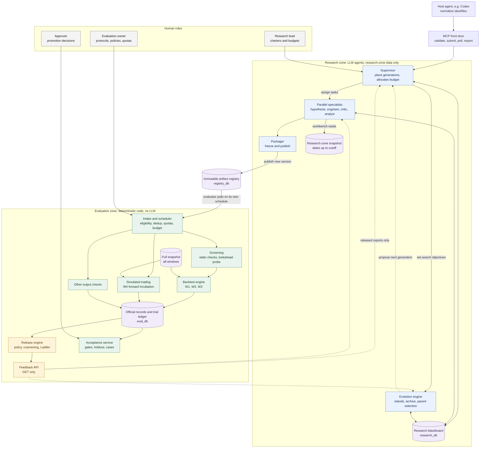
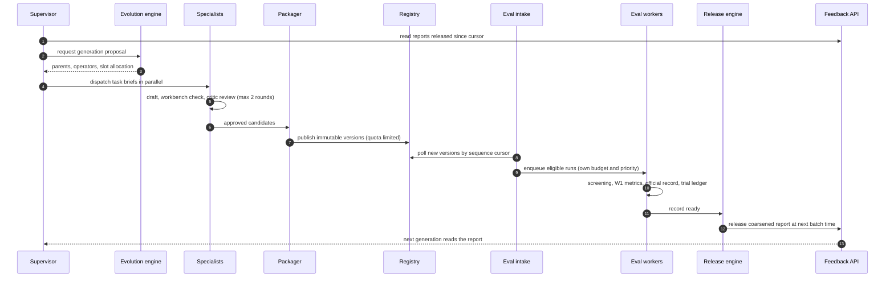
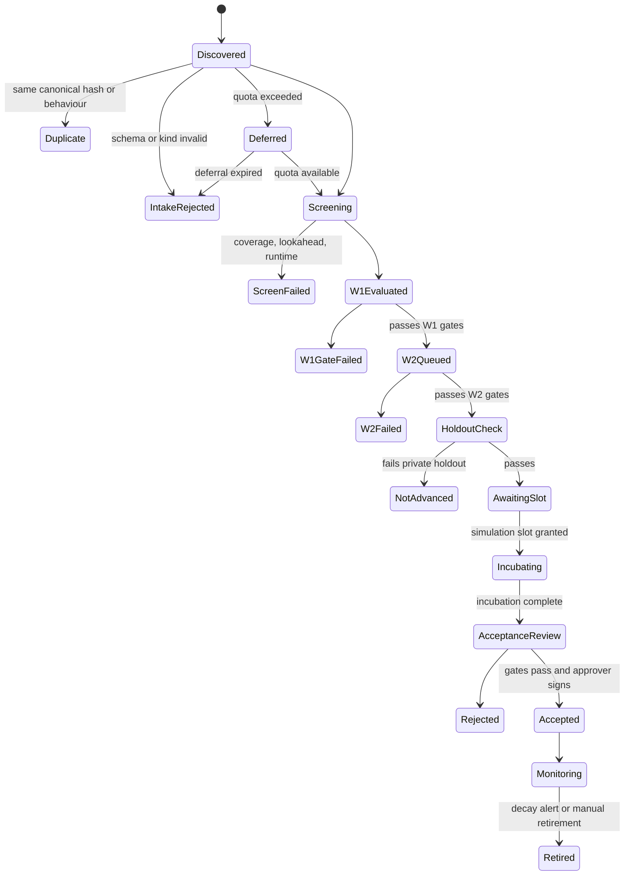

<!-- Generated mirror of aligned local chapters 00–08, in filename order. Edit those chapters and regenerate this mirror; PLAN_ALIGNMENT.md is mirrored separately as local chapter 09. -->

# QFR Implementation Plan: Multi-Agent Quantitative Factor Research and Evolution System

Version 1.1 · Status: aligned planning specification; implementation and acceptance remain pending · Audience: a coding agent and the project owner

This plan turns the hybrid-architecture brainstorm (supervisor–worker coordination, shared research blackboard, evolutionary factor development, strictly independent evaluation) into a buildable specification. It retains detailed contracts, metrics, permissions and testable work packages. The appended Hybrid v1 alignment contract governs the product requirements and reconciles this technical reference with the repository plan; daily-stock values below belong to stock_daily_v1, not every possible input. It deliberately contains no implementation code: the coding agent writes the code, and this document tells it exactly what to build and how to prove it works.

## 0. How to use this plan

1. Use the existing repository. Read docs/PLAN_ALIGNMENT.md and docs/HYBRID_V1_DEVELOPMENT_PLAN.md first. This local reference is mirrored as docs/LOCAL_IMPLEMENTATION_REFERENCE.md; its phase IDs remain stable, with the execution-order crosswalk in the alignment contract. The AGENTS.md block in Section 18.1 is a future coding-session template, not permission to overwrite existing instructions.
2. Give the coding agent one phase at a time from Section 16, using the kickoff prompt in Section 18.2. Each phase lists tasks with IDs (for example P3.2), deliverables and acceptance checks. A phase is done only when every acceptance check passes in CI.
3. Whenever a value is needed (window dates, thresholds, quotas, budgets), use the default in Section 17. Every default MUST live in a config file and never appear as a magic number in code.
4. Keywords: MUST / MUST NOT are hard requirements enforced by tests. SHOULD is a strong default, and any deviation is recorded in docs/decisions.md. MAY is optional.
5. Resolve routine gaps with a recorded decision and preserve the invariants. Notify the owner before any material scope or goal change; do not silently substitute a different architecture, provider foundation or acceptance objective.

| Section | What it defines | Used in phases |
|---|---|---|
| 3. Design invariants | Rules every component must respect, each with the test that proves it | All |
| 4. Architecture | Components, trust zones, flows, key decisions | All |
| 5. Stack and repository | Languages, libraries, services, layout, credentials | 0 |
| 6. Market data | Sources, data zones, windows, timing conventions, synthetic worlds | 1 |
| 7. DSL and artifacts | Factor language, operators, manifest, lifecycle | 1, 2 |
| 8. Evaluation | Intake, screening, metrics, backtests, statistics, gates | 3, 6 |
| 9. Release policy | What feedback is released, how coarse, how often | 3, 6 |
| 10. Acceptance | Holdout, simulated trading, promotion, monitoring, epochs | 6, 8 |
| 11. Research system | Agents, tools, permissions, outputs, generation workflow | 4 |
| 12. Evolution | Islands, archive, fitness, selection, operators, bandit | 5 |
| 13. Data model and APIs | Tables and endpoints for all services | 2 to 7 |
| 14. Security and operations | Threat model, observability, runbook | All |
| 15. Testing | Test suites, invariant tests, benchmarks | All |
| 16. Roadmap | Phases, tasks, acceptance checks, milestones | All |
| 17. Defaults | Every tunable value in one place | All |
| 18. Coding-agent kit | AGENTS.md, kickoff prompt, definition of done | All |
| 19 and 20 | Risks, glossary, references | Reference |

## 1. Executive summary

We are building an on-demand multi-agent research and evolution system. A host agent such as Codex normalizes an idea, factor, model, strategy or mixed package and submits it through standard MCP to the Docker deployment. Internally, configurable online LLM agents propose and revise quantitative research artifacts. An independent, deterministic evaluation service measures them under its own controls. The agents use only the feedback the evaluator chooses to release to evolve the next generation. Promotion into a production factor library happens outside the agents' authority.

The research side combines four patterns:

- Supervisor–worker coordination: a supervisor plans each generation and allocates budget, and specialist agents (hypothesis researcher, factor engineer, critic, report analyst) work in parallel.
- Shared research blackboard: a PostgreSQL store of hypotheses, candidates, reviews, population, lineage, interpretations and links to released reports.
- Evolutionary development: an island-based, quality-diversity population in the style of MAP-Elites, with LLM-guided and syntactic mutation and crossover, budgeted by a multi-armed bandit.
- Standardized artifact preparation: a deterministic packager freezes approved candidates into immutable, content-hashed artifact versions with full provenance.

The evaluation side is deterministic code with no LLM anywhere in the measurement path. It pulls published artifacts on its own schedule, applies its own protocols, run budget and quotas, writes immutable official records, and releases coarsened, delayed and rationed reports through a read-only Feedback API.

Six decisions make the design robust in practice:

1. Physical data zones. Research processes only ever see data up to a research cutoff. All later windows exist only in the evaluation zone.
2. A four-window protocol. W1 gives coarsened feedback, W2 gives rationed pass/fail validation through a Ladder mechanism, W3 is a private holdout that is never released, and W4 is forward simulated trading after publication.
3. The release policy is an anti-overfitting mechanism, not a reporting convenience. Coarsening, batching delays, per-family quotas, the Ladder mechanism and per-window burn meters are grounded in adaptive data analysis research (the reusable holdout, the Ladder leaderboard).
4. Every evaluated version counts. A trial ledger feeds the Deflated Sharpe Ratio, the probability of backtest overfitting and burn accounting, so the cost of searching widely is priced in.
5. Forward incubation guards against possible LLM memorization of historical market outcomes. Record model knowledge exposure and prior human/agent inspection; an access-isolated historical window is not automatically unseen. Prospective evidence is required for the investment-promotion profile, with data/protocol limitations still recorded. Research-delivery completion has its own independent gate and does not require a compulsory live campaign.
6. Factors start as DSL expressions. Factors are written in a typed DSL with no access to dates or tickers and no way to look ahead. This removes arbitrary code execution from the MVP, makes mutation, crossover and deduplication trivial, and closes most evaluation-gaming channels. Safe model/strategy/package runners are required for production v1 under the aligned intake contract; the broader Python-factor extension remains separately scoped.

The optional stock_daily_v1 profile targets China A-shares: daily bars, a point-in-time CSI 300 universe, taken from the free, daily-updated community Qlib-format dataset (chenditc/investment_data). The system reads this format directly and does not depend on the qlib package. A synthetic market generator with planted alphas and a null world is mandatory for testing. The first uploaded-package fixture is P0/P1 industry rotation; its business rules and data are distinct from this stock profile.

## 2. Goals, non-goals and success criteria

### 2.1 Goals

- G1. Automate propose → publish → independently evaluate → release → learn for versioned research inputs, with cross-sectional daily factors as one supported profile.
- G2. Enforce the separation of proposal and measurement technically, not by convention.
- G3. Make every result reproducible and traceable to an exact artifact version, protocol version, data snapshot and evaluator code version.
- G4. Evolve a diverse population of factors under explicit LLM-cost and evaluation budgets.
- G5. Promote only factors that survive multiple-testing-aware gates, a private holdout, forward incubation and human sign-off.
- G6. Give humans clear control surfaces: MCP input/status/export, research charters and budgets, evaluator protocols and independent exit/promotion decisions.
- G7. Support online Kimi, GLM and DeepSeek together, with endpoint/model/settings configurable by role and task.
- G8. Deliver Linux ARM64 and AMD64 Docker variants; durable jobs have no default total-time or generation ceiling and finish only when their chosen exit gate passes.

### 2.2 Non-goals for v1

- Real-money trading or any broker connectivity. Only forward simulation is in scope.
- Intraday, tick or order-book data. Alternative and text data.
- LLM-based judgement anywhere in official measurement.
- Fully automatic investment promotion. A deterministic research-delivery gate may complete a job as authorized in its brief; it cannot promote an investment candidate.
- Portfolio optimization with risk models. v1 uses simple reference strategies.
- Multi-tenant SaaS concerns.

### 2.3 Success criteria for v1

These are stock-profile benchmark targets from Section 15.3, not the complete product exit gate. Production additionally requires AC-01–AC-14 in the alignment contract, including generic input, MCP, mixed providers, recovery and native architecture checks.

| ID | Criterion | Target |
|---|---|---|
| SC1 | Planted-alpha recovery on the synthetic world | A factor whose mean cross-sectional rank correlation with a planted alpha is at least 0.7 gets accepted within 10 generations under the scripted LLM |
| SC2 | Null-world safety | Zero accepted factors after 50 generations of scripted search that publish at least 500 versions |
| SC3 | Boundary integrity | All boundary tests (BND series) pass in CI |
| SC4 | Reproducibility | Re-running any official evaluation reproduces an identical results hash |
| SC5 | Feedback latency | Median time from publication to first released W1 report is at most one release batch interval (default 6 hours) |
| SC6 | Cost control | No generation exceeds its LLM cost cap, and the daily cap acts as a hard stop |
| SC7 | Real-data smoke run | On CN data, 20 generations run unattended without a crash, and every report is linked to the exact version it evaluated |

## 3. Design invariants

Every invariant has an enforcement mechanism and test IDs from Section 15.2. The coding agent MUST NOT relax any of them.

| ID | Invariant | Enforcement | Tests |
|---|---|---|---|
| INV-1 | Separation of proposal and measurement. Research code cannot invoke, configure, prioritize, pause or cancel evaluation, and cannot operate simulated accounts | No such endpoint or agent tool exists. Research services hold no evaluation credentials. import-linter forbids imports between qfr_research and qfr_eval | BND-01 to BND-05 |
| INV-2 | Immutability. A published artifact version never changes, and any change produces a new version | No UPDATE or DELETE grants. Database triggers raise on UPDATE and DELETE. The Registry API exposes no mutation route other than publish | REG-01 to REG-04 |
| INV-3 | Pull-only intake. Only the evaluator decides what to pull, which checks to run and when | The registry has no push or notify path to the evaluator. Intake polls by sequence cursor | EVL-01 |
| INV-4 | Read-only feedback. Research reads only released reports | The Feedback API exposes GET routes only and serves only released reports | BND-03 |
| INV-5 | Version-linked evidence. Each official record and released report references one artifact version id plus its content hash, protocol version, data snapshot id and evaluator code version | NOT NULL foreign keys and schema validation | EVL-02 |
| INV-6 | Holdout isolation. W3 numbers never leave the evaluation zone. Only the acceptance decision and a reason category are released | The release engine has no mapping for W3 metrics. A scan test checks every released report | REL-05 |
| INV-7 | Every evaluated version counts. Each version evaluated on a window is a trial, failures included | The trial-ledger row is written in the same transaction as the official record | EVL-06 |
| INV-8 | Deterministic measurement. Evaluation has no LLM, no network and no wall-clock dependence, and uses fixed seeds | Evaluation workers hold no LLM keys and have no network egress. Re-runs compare results hashes | EVL-04 |
| INV-9 | Physical data zones. Research processes can read only data dated on or before the research cutoff | Research containers mount only the research-zone snapshot, which the zone builder truncates by date | BND-06 |
| INV-10 | Attribution and audit. Every write records the principal, a timestamp and a request id in an append-only event log | The repository layer writes events, and audit tables are insert-only | AUD-01 |
| INV-11 | Human sign-off. Promotion requires an approver decision after the automated gates pass | The Acceptance API requires the approver role, and no code path promotes automatically | ACC-03 |
| INV-12 | Sanitized feedback. Diagnostics are codes from a fixed vocabulary. No free text, stack traces, timings or values produced by executing artifact code are released | The release engine whitelists fields, and reason codes are an enum | REL-04 |

## 4. Architecture

### 4.1 System overview

The brainstorm's Hybrid v1 architecture is kept intact. Standard MCP intake and OpenAI-compatible multi-provider inference are added at their respective boundaries; see the appended alignment contract. What this plan adds are explicit trust zones, named services and the human control surfaces. Solid arrows show work, artifact or data flow. Dashed arrows show read-only released feedback and proposals.



There are two distinct decisions, and they belong to different owners. Evolutionary selection, owned by the research zone, chooses the next research candidates. Acceptance, owned by the evaluation zone plus a human approver, decides promotion. Official records never enter the writable research blackboard. The blackboard stores only cached copies of released reports, links to them and the agents' interpretations.

### 4.2 Components and owners

| Component | Zone | Responsibility | Implemented as | Phase |
|---|---|---|---|---|
| MCP front door and input validation | Research edge | Host-agent intake, upload/mount references, durable job controls and released-only export | Standard Python MCP server | Required before production |
| Research API | Research | Operator controls: programs, charters, start and pause, read-only views of the blackboard | FastAPI service research-api | 4 |
| Research orchestrator | Research | Runs the generation state machine, agent calls and the research job queue | Python worker research-worker | 4 |
| Supervisor | Research | Writes the generation plan. An LLM planner plus a deterministic validator and fallback | PydanticAI agent plus code | 4 |
| Specialists | Research | Hypothesis researcher, factor engineer, critic, report analyst, interpretation reviewer | PydanticAI agents | 4 |
| Evolution engine | Research | Population, islands, archive, fitness, selection, variation operators, bandit | Deterministic Python module plus LLM mutation prompts | 5 |
| Workbench | Research | Computes factor statistics on the research-zone snapshot, using the evaluator's metric definitions | qfr_core library facade | 1, 4 |
| Packager | Research | Final validation, manifest assembly, publication | Deterministic code | 4 |
| Feedback sync | Research | Pulls released reports into the blackboard cache | Research job | 4 |
| Registry API | Shared | Publishes and serves immutable artifact versions | FastAPI service registry-api plus registry_db | 2 |
| Data ingest | Evaluation | Downloads and validates data, builds full and research-zone snapshots | CLI and daily job data-ingest | 1, 3 |
| Intake and scheduler | Evaluation | Polls the registry, checks eligibility, dedups, applies quotas, enqueues work fairly | Worker eval-scheduler | 3 |
| Evaluation workers | Evaluation | Screening and W1, W2, W3 runs. Writes official records and the trial ledger | Worker eval-worker, N replicas | 3, 6 |
| Simulation engine | Evaluation | Daily forward incubation and replay mode | Worker sim-engine | 6 |
| Release engine | Evaluation | Applies the release policy and writes released reports | Worker release-worker | 3 |
| Feedback API | Evaluation edge | Read-only access to released reports and public cards | FastAPI service feedback-api | 3 |
| Eval admin API | Evaluation | Protocols, policies, quotas, runs, records, acceptance cases, library | FastAPI service eval-admin-api | 3, 6 |
| Dashboard | UI | Role-based views for the three human roles | Next.js app dashboard | 7 |

### 4.3 Trust boundaries

| From | To | What crosses | Mechanism | Direction |
|---|---|---|---|---|
| Research | Registry | New artifact versions (manifest plus payload) | POST /v1/artifacts with the publisher token | Write-once |
| Research | Registry | Artifacts, families, lineage | GET routes | Read |
| Evaluation | Registry | Versions published since the intake cursor | GET routes with the evaluator token | Read |
| Evaluation | Research | Released reports, public protocol card, public policy card, library membership | Feedback API GET routes with the research reader token | Read by research |
| Evaluation | Research | Research-zone data snapshot | Read-only volume produced by data ingest | One-way |
| Humans | Research | Charters, budgets, start and pause | Research API with the research-lead token | Write |
| Humans | Evaluation | Protocols, policies, quotas, epochs, acceptance decisions | Eval admin API with the evaluation-owner or approver token | Write |
| Research | Evaluation | Nothing else: no job submission, priority hints, cancellations, configuration or simulation control | None | Forbidden |

### 4.4 End-to-end feedback cycle



Generations may work with already released reports, but the job can await required independent evidence before its delivery gate. Evaluator scheduling stays independent. Generation closure, research pause and successful job completion are distinct states.

### 4.5 Key decisions

| ID | Decision | Choice | Rationale | Rejected alternatives |
|---|---|---|---|---|
| D1 | Core language | Python 3.12 | Numerical ecosystem and the best support in agent libraries | TypeScript, whose numerical stack is weak |
| D2 | Dataframes | Polars plus NumPy | Fast, deterministic grouped and rolling operations with low memory use | pandas as the core (still allowed in tests) |
| D3 | Artifact representation | DSL for factor evolution; declared model/strategy/package runners with tested sandboxing for production v1 | Preserve uploaded semantics and immutable payloads; later broaden Python authoring | Arbitrary unsandboxed code |
| D4 | Agent framework | PydanticAI typed roles over OpenAI-compatible adapters; deterministic durable state machine | Kimi/GLM/DeepSeek with per-role settings; thin OpenAI SDK adapter where needed | Anthropic harness dependency or a free-running supervisor controlling evaluation |
| D5 | Persistence | PostgreSQL 16 with three databases (research_db, registry_db, eval_db) and separate roles | Strong constraints, triggers and grants with a single technology | A different engine per store |
| D6 | Job queue | Postgres job tables using FOR UPDATE SKIP LOCKED, one queue per zone | No extra infrastructure, and transactional with the records | Redis or Celery, Temporal (too much for v1) |
| D7 | Market data storage | Content-addressed Parquet snapshots on read-only mounts | Reproducible, and zones are separated at the filesystem level | Panels stored in the database |
| D8 | Stock-profile market (optional) | CN A-shares daily, CSI 300 point-in-time, from the investment_data Qlib-binary release | Free, updated daily (needed for forward simulation), includes delisted names, and comparable with RD-Agent(Q), AlphaAgent and QuantaAlpha benchmarks | yfinance (survivorship bias), paid US data (cost) |
| D9 | Qlib usage | Read the Qlib binary format directly and do not depend on the qlib package | Avoids Python-version and dependency friction, and keeps full control | The qlib backtest engine |
| D10 | Measurement | Deterministic code only, with no LLM judgement in official records | Reproducible and cannot be gamed by prompting | LLM-scored evaluation |
| D11 | Feedback | Coarsened, batched and quota-limited. Ladder for W2. Nothing released for W3 | Limits adaptive overfitting to the evaluation windows | Instant full-precision feedback |
| D12 | Investment promotion (separate from job delivery) | Automated gates (DSR, PBO, t of at least 3, holdout, forward incubation) plus a human approver | Accounts for multiple testing. LLM memorization makes historical windows insufficient on their own | Acceptance on backtests alone |
| D13 | Optional dashboard | Next.js plus TypeScript, local Phase 7 | Rich UI and role gating, independent of the core | Streamlit (weak authentication and roles) |
| D14 | Deployment | Docker Compose, linux/arm64 and linux/amd64 variants, with separate networks, mounts and credentials per zone | Simple, and the boundaries are still real | Kubernetes, deferred |

## 5. Technology stack and repository layout

### 5.1 Stack

| Concern | Choice |
|---|---|
| Python toolchain | uv workspace, Python 3.12 |
| Numerics | polars 1.x, numpy, pyarrow, scipy |
| Validation and configuration | pydantic v2, pydantic-settings, PyYAML |
| DSL parsing | lark |
| LLM agents | pydantic-ai with OpenAI Chat Completions/Responses adapters, online Kimi/GLM/DeepSeek and per-role/task profiles |
| MCP and intake | maintained Python MCP SDK, typed InputBundle, authenticated mounted-import/upload references |
| Web services | fastapi, uvicorn |
| Database | PostgreSQL 16, SQLAlchemy 2 (sync, psycopg 3), Alembic with one environment per database |
| CLI | typer |
| Logging | structlog (JSON), optional OpenTelemetry |
| Quality | pytest, hypothesis, pytest-xdist, import-linter, ruff, mypy (strict for qfr_core) |
| Containers | Docker, Docker Compose |
| Dashboard | Next.js App Router, TypeScript, Tailwind, TanStack Query, @xyflow/react for lineage graphs, ECharts |

### 5.2 Repository layout

```text
qfr/
  AGENTS.md
  pyproject.toml                  uv workspace root
  justfile                        check, test, up, down, seed, bench
  .importlinter                   boundary contracts
  configs/
    protocols/cn_csi300_daily_v1.yaml
    release_policies/default_v1.yaml
    quotas/default_v1.yaml
    research/charter_default.yaml
    research/models.yaml          provider, endpoint, capability, role and task profiles
    jobs/                         input bundles, authorized spend and exit-gate instances
    epochs/epoch_001.yaml         window dates, mounted into evaluation only
  prompts/                        versioned prompt templates, research only
    supervisor.md hypothesis.md engineer.md critic.md
    analyst.md interpretation_review.md mutation.md crossover.md
  packages/
    qfr_core/                     shared and deterministic: public schemas, DSL,
                                  operators, metrics, data readers, workbench facade
    qfr_registry/                 registry API and database models
    qfr_research/                 agents, tools, blackboard, workflow, evolution,
                                  packager, feedback sync, research API
    qfr_eval/                     ingest, intake, workers, protocols, backtest,
                                  simulation, release, feedback API, acceptance,
                                  admin API, private record schemas
    qfr_mcp/                      host-agent MCP front door and intake contracts
  apps/dashboard/                 optional Next.js, local Phase 7
  infra/
    docker-compose.yml
    postgres/init/                databases, roles, grants
  data/                           gitignored
    raw/
    snapshots/full/<snapshot_id>/
    snapshots/research/<snapshot_id>/
  tests/
    boundary/ e2e/ benchmarks/
  docs/
    PLAN.md
    decisions.md
```

### 5.3 Code boundary contracts

These are enforced with import-linter in CI.

- qfr_research MUST NOT import qfr_eval, and qfr_eval MUST NOT import qfr_research.
- qfr_registry MUST NOT import qfr_research or qfr_eval.
- qfr_core MUST NOT import any other qfr package.
- Official-record schemas live in qfr_eval, not in qfr_core, so research code cannot construct them at all. Released-report schemas live in qfr_core because both sides need them.
- Epoch and window definitions in configs/epochs are mounted only into evaluation containers. Research containers receive only the public protocol card through the Feedback API.

### 5.4 Runtime topology

In v1 a single PostgreSQL instance hosts three databases, and the separation comes from roles and credentials, with private service networks and restricted mounts. A later split into separate database instances is optional; the current boundary must already pass production tests.

| Service | Package | Database role | Can reach | Secrets | Data mounts |
|---|---|---|---|---|---|
| mcp-api | qfr_mcp | None; calls authorized APIs | research-api, registry-api, feedback-api, authenticated upload staging | Project-scoped client and service tokens | Declared import mount only; no full evaluation snapshot |
| research-api | qfr_research | research_rw on research_db | postgres, registry-api, feedback-api | Research DB URL, research-lead token | Research snapshot, read-only |
| research-worker | qfr_research | research_rw on research_db | postgres, registry-api, feedback-api, LLM provider endpoints | LLM API keys, registry publisher token, feedback reader token | Research snapshot, read-only |
| registry-api | qfr_registry | registry_app on registry_db | postgres | Registry tokens | None |
| eval-scheduler | qfr_eval | eval_rw on eval_db | postgres, registry-api | Registry evaluator token | Full snapshot and epochs, read-only |
| eval-worker (N replicas) | qfr_eval | eval_rw on eval_db | postgres only, no egress | None | Full snapshot and epochs, read-only |
| release-worker | qfr_eval | eval_rw on eval_db | postgres | None | None |
| sim-engine | qfr_eval | eval_rw on eval_db | postgres | None | Full snapshot, read-only |
| feedback-api | qfr_eval feedback module | feedback_ro on eval_db, SELECT on feedback views only | postgres | Feedback tokens | None |
| eval-admin-api | qfr_eval | eval_rw on eval_db | postgres | Evaluation-owner and approver tokens | Epochs, read-only |
| data-ingest | qfr_eval ingest module | eval_rw on eval_db | Internet (data source only), postgres | None | Raw and snapshots, read-write |
| dashboard | apps/dashboard | None, calls the APIs only | The APIs | Per-role tokens held server-side | None |

Database roles and grants:

- registry_app: INSERT and SELECT on registry tables. No UPDATE or DELETE. Triggers additionally block UPDATE and DELETE for every role.
- research_rw: full DML on research_db tables, except audit tables, which are INSERT and SELECT only. No CONNECT privilege on eval_db or registry_db.
- eval_rw: DML on eval_db. official_records, trial_ledger, released_reports and audit tables are insert-only and protected by triggers. No CONNECT privilege on research_db.
- feedback_ro: SELECT only on views in the feedback schema (released_reports_v, artifact_status_v, library_v, policy_card_v, protocol_card_v).

No evaluation container receives LLM API keys. Only the data-ingest service has internet egress on the evaluation side.

### 5.5 Configuration and environment variables

| Variable | Used by | Purpose |
|---|---|---|
| RESEARCH_DB_URL, REGISTRY_DB_URL, EVAL_DB_URL, FEEDBACK_DB_URL | Services in each zone | Role-specific connection strings |
| REGISTRY_API_URL, FEEDBACK_API_URL | Research and evaluation services | Service endpoints |
| REGISTRY_PUBLISHER_TOKEN, REGISTRY_READER_TOKEN, REGISTRY_EVALUATOR_TOKEN | Registry clients | Registry authentication |
| FEEDBACK_READER_TOKEN | Research services | Feedback API authentication, mapped to allowed program ids |
| RESEARCH_LEAD_TOKEN, EVAL_OWNER_TOKEN, APPROVER_TOKEN | APIs and dashboard | Human role authentication in v1 |
| QFR_RESEARCH_SNAPSHOT_DIR, QFR_FULL_SNAPSHOT_DIR | Workbench and evaluation | Snapshot mount points |
| QFR_EPOCH_CONFIG | Evaluation only | Path to the epoch window definitions |
| Provider endpoint/model/role/task profiles and secret references | research-worker only | Effective configuration frozen per task; strong/fast aliases are optional convenience labels, never global provider routing |
| QFR_GENERATION_COST_CAP_USD, QFR_DAILY_COST_CAP_USD | research-worker | Budget caps |
| QFR_ENV, QFR_LOG_LEVEL | All services | Environment (dev, test, prod) and log verbosity |

Runtime and Docker lifecycle are governed by PLAN_ALIGNMENT sections F–H. The MCP front door never receives evaluator credentials; only research workers receive online LLM keys. Durable named volumes retain state across shutdown. A Docker image build is not native ARM/AMD64 or sandbox acceptance.

## 6. Market data, data zones and timing conventions

**Profile boundary:** Sections 6.1–6.6 describe stock_daily_v1. Uploaded P0/P1 and other input kinds use their own validated adapters, availability rules and frozen protocols. These dates, daily fields, CSI universe and thresholds are not global defaults; generic intake is defined in PLAN_ALIGNMENT section E.

### 6.1 Sources

- S1. Synthetic market generator (mandatory, Phase 1). Used by every automated test and benchmark.
- S2. China A-share daily data from the chenditc/investment_data GitHub releases: the qlib_bin.tar.gz archive plus its qlib_bin.manifest.json. CSI 300 is the default universe and CSI 500 is optional. These are reported source characteristics that ingest must verify for each pinned release; they do not certify every field or historical vintage as point-in-time. Fetching is opt-in, and the uploaded pilot makes no new supplier requests.
- S3. Later: an industry-classification dataset (for neutralization) and a US-equities adapter interface (which needs a point-in-time vendor). Both are in Phase 8.

### 6.2 Qlib binary format reader

The system reads the format directly and MUST NOT depend on the qlib package.

- calendars/day.txt: one trading date per line, in ascending order.
- instruments/<universe>.txt: tab-separated lines of symbol, start date and end date. A symbol may appear on several lines if it re-entered the index. This file is the point-in-time membership.
- features/<symbol in lowercase>/<field>.day.bin: a little-endian float32 array. Element 0 is the start index into the calendar. The remaining elements are the values for consecutive calendar dates from that index.
- Fields are discovered by listing the files. Required fields: open, high, low, close, volume, amount, factor. Optional fields: vwap, change. Ingest MUST fail with a clear error if a required field is missing.
- Price fields are adjusted. The raw price equals the adjusted price divided by factor. Ingest MUST verify this convention with a sanity check (99% of raw closes fall between 0.5 and 5,000 CNY) and record it in the snapshot manifest.
- The index series SH000300 is used as the CSI 300 benchmark when present. Otherwise the benchmark is the equal-weight universe return, and the manifest says so.
- The archive is validated against the release manifest (SHA-256) before extraction, and the release tag is recorded.
- Ingest sanity checks: non-positive prices or negative volumes are errors, as are duplicate dates. A daily absolute return above 25% on a main-board stock outside its first five trading days is flagged as a likely corporate-action mismatch.

### 6.3 Canonical panel

Snapshot layout: snapshots/<zone>/<snapshot_id>/ containing panel/year=YYYY/part.parquet, membership.parquet, calendar.parquet and manifest.json.

The panel is dense. There is exactly one row per instrument per trading date between the instrument's first and last observation. Missing days carry nulls and is_suspended set to true. Because of this, rolling windows over rows are rolling windows over the market calendar.

| Column | Type | Description |
|---|---|---|
| date | date | Trading date |
| instrument | string | Exchange-prefixed code, for example SH600000 |
| open, high, low, close | float64 | Adjusted prices |
| close_raw | float64 | close divided by factor |
| volume | float64 | Volume, adjusted consistently with prices |
| amount | float64 | Traded value |
| vwap | float64 | VWAP when available, otherwise the mean of high, low and close |
| factor | float64 | Adjustment factor |
| ret_1d | float64 | Adjusted close-to-close return |
| is_suspended | bool | No trade on this day (volume zero or missing) |
| limit_up, limit_down | bool | Raw close at the board-specific price limit relative to the previous raw close. Main board 10%. STAR 20% from listing. ChiNext 20% from 2020-08-24, 10% before. ST names (5%) cannot be detected from this data, which is a documented limitation |
| listed_days | int32 | Trading days since first observation |
| in_csi300, in_csi500 | bool | Point-in-time membership flags |
| adv20 | float64 | 20-day mean traded value, used as the size and liquidity proxy |

Snapshot manifest contents: source, release tag, archive hash, build code version, field list, conventions, date range, row counts, zone, research cutoff (research zone only). The snapshot_id is the SHA-256 of the canonical manifest JSON.

### 6.4 Data zones and evaluation windows

- Research-zone snapshot: every row dated on or before the research cutoff (the end of W0). Built by truncation in the ingest job, mounted read-only into research containers, and never updated within an epoch.
- Full snapshot: all rows. Mounted only into evaluation containers. Rebuilt when authorized data arrives; daily rebuilding belongs only to an explicitly enabled simulation campaign, with a new snapshot id each time. Old snapshots are retained so official records stay reproducible.

Default windows for epoch 1 are stored in configs/epochs/epoch_001.yaml, which only the evaluation side can read.

| Window | Purpose | Default range | Research visibility | What is released |
|---|---|---|---|---|
| W0 Research | Agents explore, fit and pre-screen | 2010-01-04 to 2019-12-31 | Full data | Nothing (research computes its own numbers) |
| W1 Feedback | First independent measurement | 2020-02-04 to 2022-12-30 | No data | Coarsened reports (Section 9) |
| W2 Validation | Rationed confirmation | 2023-02-01 to 2024-06-28 | No data | Pass/fail plus Ladder status |
| W3 Private holdout | Acceptance gate only | 2024-08-01 to the end of the last full month before the epoch starts | No data | Never. Only decisions |
| W4 Forward | Simulated trading after publication | First trading day after admission, until incubation ends | No data | Coarse summary when incubation ends |

Rules:

- An embargo of at least 20 trading days (the longest label horizon) separates consecutive windows.
- A label is computed for window W only if the decision day t and the day t+1+h both lie inside W.
- Exposure warning: record the selected model's documented knowledge cutoff or unknown status and all prior human/agent inspection; do not assume every model has the same training coverage. The DSL's lack of identifiers and dates limits direct exploitation, but period-specific knowledge can still leak into design choices. The investment-promotion profile retains W4. A research-delivery job uses its own independently checked exit gate and does not manufacture unseen evidence by sealing old data.

### 6.5 Timing conventions

The research workbench and the evaluator MUST use identical conventions.

- Decision time: after the close of trading day t. The factor value at t may use only data dated t or earlier.
- Execution: at the close of day t+1 (protocol v2 MAY switch to the VWAP of t+1).
- Forward return label for horizon h, in trading days: the adjusted close at t+1+h divided by the adjusted close at t+1, minus 1. The primary horizon is 1. Decay horizons are 1, 5, 10 and 20.
- Eligible cross-section on day t: in the universe at t (point-in-time), listed for at least 60 days, not suspended at t, and both factor and label non-null. At least 30 names are required, otherwise the date is skipped.
- Tradability in backtests and simulation: no trading on suspended days. No buying at the limit-up price on t+1. No selling at the limit-down price on t+1.
- Cross-sectional preprocessing in the evaluator protocol: winsorize at the 1st and 99th percentiles per day, then z-score per day. A size-neutral variant (OLS residual on a constant and log adv20, per day) is computed as a diagnostic. Industry dummies are added once an industry dataset exists.

### 6.6 Synthetic market generator

Defaults: 300 instruments, 2,600 trading days, 10 industries, fixed seed. It writes the same canonical snapshot format.

- Returns: the next-day return of instrument i equals beta_i times the market return, plus the industry return, plus the sum over planted signals of alpha_k times the cross-sectional z-score of signal k at t, plus idiosyncratic noise.
  - Market return: normal with mean 0.0003 and standard deviation 0.012.
  - Industry returns: normal with mean 0 and standard deviation 0.006.
  - Beta: uniform between 0.6 and 1.4.
  - Idiosyncratic noise: Student-t with 5 degrees of freedom, scaled to a daily volatility drawn between 1.5% and 3.5% per instrument.
- Planted signals are computable in the DSL from past data:
  - A1, short-term reversal: minus the 5-day return. Target RankIC 0.035.
  - A2, volume-shock continuation: the sign of today's return times (today's volume divided by its 20-day mean, minus 1), clipped. Target RankIC 0.025.
  - A3, low-volatility tilt: decay world only. Switched off halfway through W2.
- The generator calibrates each alpha_k numerically (bisection on a calibration sample) to hit its target RankIC.
- Volumes are lognormal, with AR(1) log-volume (coefficient 0.8) and shocks correlated with absolute returns.
- Realism features that exercise the pipeline: 5% of names enter or leave the universe each year, 0.5% of days are random suspensions, and price limits are 10%.
- The benchmark is the equal-weight universe return.
- Three worlds: planted (A1, A2), null (every alpha is 0), decay (A1, A2, A3 with switch-off).
- A ground-truth file listing the planted signals as DSL expressions is written for the evaluation side and the benchmark harness only.

## 7. Factor DSL and artifact contract

### 7.1 Why a DSL first

- No arbitrary code execution in the MVP, and fully deterministic results.
- Lookahead-safe by construction: no negative lags and no access to the future.
- No access to dates or instrument identifiers, which closes the memorization and date-switching gaming channels.
- Canonical forms make exact dedup and AST similarity cheap.
- Syntactic mutation and crossover become trivial tree operations.

### 7.2 Grammar

- An expression is a number, a field, a function call, a binary operation (+, -, *, /), a comparison (>, <, >=, <=, which yields 1.0 or 0.0), or a unary minus.
- Fields: $open, $high, $low, $close, $vwap, $volume, $amount, $ret, $adv20, $close_raw.
- Window arguments MUST be integer literals from the allowed set: 1, 2, 3, 5, 10, 20, 40, 60, 120, 250.
- Other numeric constants: at most 3 per expression, between -10 and 10, with at most 2 decimals. This prevents constant tuning.
- There are no variables, no user-defined functions, no date or identifier access and no string literals.

### 7.3 Operator catalog for v1

Time-series operators run per instrument over the dense calendar. An output is valid if at least ceil(0.8 × d) of the d inputs are valid when d is 5 or more, or if all inputs are valid when d is below 5. Otherwise the output is null.

| Operator | Semantics |
|---|---|
| Ref(x, d) | Value d days ago. d must be at least 1. Negative lags are a parse error |
| Delta(x, d) | x minus Ref(x, d) |
| Pct(x, d) | x divided by Ref(x, d), minus 1 |
| Mean, Sum, Std, Var, Min, Max, Med (x, d) | Rolling statistics. Std and Var use ddof 1 |
| EMA(x, d) | Exponential mean with alpha 2/(d+1), no adjustment, min periods d |
| WMA(x, d) | Linearly decaying weights d down to 1 (decay-linear) |
| TsRank(x, d) | Rank of today's value among the last d values, scaled to 0..1 |
| TsZ(x, d) | (x minus Mean(x, d)) divided by Std(x, d) |
| ArgMax, ArgMin (x, d) | Days since the window maximum or minimum, where 0 means today |
| Corr, Cov (x, y, d) | Rolling Pearson correlation and covariance |
| Slope, Rsq, Resi (x, d) | Rolling regression of x on a time index: slope, R squared, last residual |
| Skew, Kurt (x, d) | Rolling skewness and excess kurtosis |

Cross-sectional operators run per date over the eligible cross-section.

| Operator | Semantics |
|---|---|
| Rank(x) | Percentile rank in 0..1, ties averaged |
| Zscore(x) | (x minus mean) divided by standard deviation |
| Demean(x) | x minus the cross-sectional mean |
| Scale(x) | x divided by the sum of absolute values |
| Neutralize(x) | OLS residual on a constant and log adv20 (industry added when available) |

Element-wise operators: Abs, Sign, Log (null for non-positive input), Sqrt (null for negative input), SignedPower(x, p) with p in 0.5, 2 or 3, Clip(x, lo, hi), Max2(x, y), Min2(x, y), If(condition, a, b).

Numeric rules: division by a denominator whose absolute value is below 1e-12 yields null, and infinities become null. Operators are implemented as Polars expressions over the panel sorted by instrument and date: grouped by instrument for time-series operators and by date for cross-sectional ones. Every operator also gets a naive loop-based reference implementation, used only in tests.

### 7.4 Static constraints

These provide complexity control.

| Constraint | Limit |
|---|---|
| AST nodes | 30 or fewer |
| Depth | 7 or fewer |
| Distinct fields | 4 or fewer |
| Non-window numeric constants | 3 or fewer |
| Total lookback along any root-to-leaf path | 250 days or fewer |
| Nesting of Corr or Cov | 2 levels or fewer |

The complexity score is nodes + 2 × constants + 3 × distinct fields. It is reported in every report and used as a fitness penalty.

### 7.5 Canonicalization, hashing and similarity

- Canonical form: parse, then normalize. Children of commutative operators (+, *, Max2, Min2) are sorted by their canonical string. Double negation is removed, constants are folded, and Rank(Rank(x)) becomes Rank(x). The result is serialized to a compact string. canonical_hash is the SHA-256 of that string.
- AST similarity: the size of the largest common subtree divided by the node count of the larger tree, computed with memoized top-down matching. Originality is 1 minus the maximum similarity against the library and the population.
- Behavioral fingerprint: the factor's cross-sectional ranks on 40 fixed dates, sampled once per epoch from W0 with a fixed seed. Behavioral similarity between two factors is the mean, over those dates, of the absolute Spearman correlation on common names. Both zones compute it with the same qfr_core code because W0 is visible to both.

### 7.6 Artifact kinds

All kinds share immutable publication, lineage and released-only feedback. Semantic kind is separate from implementation. See PLAN_ALIGNMENT section E for the common InputBundle/manifest.

| Kind | Production-v1 contract | Evaluation |
|---|---|---|
| factor | DSL or approved constrained implementation | Type-appropriate factor checks under a named protocol |
| model | Frozen weights/rules, preprocessing, dependencies, data requirements and inference/fit interface | Reproduction and independent predictive/economic checks as applicable |
| strategy | Frozen decision/position/cost/rebalance rules, optional factor/model references | State-aware replay and applicable independent gates |
| research_note | Structured claims and source/released-report references | Deterministic completeness and evidence checks |
| data_product | Immutable schema, lineage, availability/vintage labels and transformations | Reproduction, data quality and temporal checks |

Ideas are accepted for normalization without inventing an executable artifact. Safe baseline/package and model/strategy runners are production requirements; local P8.1/P8.2 retain their IDs for extended authoring support, not permission to omit these input kinds until after release. Autonomous v2 composition remains deferred.

### 7.7 Factor manifest (schema version 1)

This is the stock_daily_v1 DSL payload specialization, not the universal artifact schema. Human-seeded/imported artifacts may have null generation/island/task references with explicit source provenance. Pilot operator aliases must map through a declared DSL version; never change formula semantics during normalization.

| Field | Required | Notes |
|---|---|---|
| schema_version | Yes | The string "1" |
| kind | Yes | "factor" |
| family_id | Yes | Null asks the registry to create a new family. Otherwise the publication becomes the next version of that family |
| name | Yes | Slug of 64 characters or fewer, unique within the program |
| title | Yes | 120 characters or fewer |
| implementation.language | Yes | "qfr-dsl/1" |
| implementation.expression | Yes | 1,000 characters or fewer |
| declared.expected_sign | Yes | +1 or -1. A pre-registered direction |
| declared.horizon_days | Yes | 1, 5, 10 or 20 |
| declared.fields_used | Yes | Must equal the parsed field set (checked) |
| declared.max_lookback_days | Yes | Must equal the computed lookback (checked) |
| rationale.hypothesis_id | Yes | Blackboard hypothesis id |
| rationale.summary | Yes | 1,500 characters or fewer |
| rationale.mechanism | Yes | The economic mechanism, 1,500 characters or fewer |
| rationale.falsification | Yes | The result that would refute the hypothesis, 600 characters or fewer |
| rationale.change_summary | When a parent exists | What changed relative to the parent and why, 600 characters or fewer |
| provenance.program_id, generation_id, island_id | Yes | Research identifiers |
| provenance.operator | Yes | explore, llm_mutation, syntactic_mutation, crossover, repair or human_seed |
| provenance.parent_version_ids | Yes | List, possibly empty |
| provenance.agent_runs | Yes | For each run: role, provider/endpoint/model, effective settings/config hash, prompt template/hash, run id and fallback events |
| provenance.research_snapshot_id | Yes | The research data used during development |
| provenance.qfr_core_version | Yes | Semantic version |
| self_assessment | No | Research-side W0 numbers, labelled non-official. The evaluator never uses them in decisions |
| review.verdict_id, review.rounds | Yes | Critic sign-off |

Fields assigned by the registry: version_id (UUIDv7), version_no (1 to n within the family), content_hash (SHA-256 of the canonical JSON manifest excluding server fields), canonical_hash (DSL), published_at, published_seq (monotonic) and the publisher principal.

Publication rules:

- Publication is idempotent on content_hash: republishing identical content returns the existing version.
- A sign flip, a window change or any other edit creates a new version, and that version counts as a new trial.
- There is no retraction. Research may mark a family as abandoned only inside its own blackboard.

### 7.8 Lifecycle

Research-side candidate states: draft, then in_review, then approved or rejected. Approved candidates become selected or not_selected, and selected ones become published once a version id exists.

Evaluation-side version states for the investment-promotion profile (separate from the on-demand job lifecycle in PLAN_ALIGNMENT section G):



## 8. Independent evaluation system

The independence, provenance and release boundaries are common. Numerical daily metrics, W0–W4 stages, TopK rules and thresholds below are the stock_daily_v1 specialization. Pilot/model/strategy adapters declare compatible metrics and gates; ordinary job-delivery validation is separate from investment promotion (PLAN_ALIGNMENT sections G and I).

### 8.1 Responsibilities

The evaluation zone owns:

- data ingest and snapshots, protocols and epochs;
- eligibility, quotas, run budget and priority;
- official computation, official records and the trial ledger;
- the release policy and the Feedback API;
- simulated trading, acceptance cases, the library and monitoring.

It holds no LLM keys and no research credentials, and nothing on the research side can change its behavior except publishing artifacts.

### 8.2 Protocol definition

A protocol is a versioned YAML file. It becomes immutable once activated, and any change means a new protocol version. Fields:

- protocol_id and version;
- supported artifact kinds and the universe (csi300);
- label definition and horizons, and eligibility rules;
- preprocessing and neutralization diagnostics;
- the epoch reference for window dates;
- the metric list and the reference-strategy parameters;
- the costs, the gate thresholds for every stage, and runtime limits;
- the fingerprint seed.

From each protocol the evaluator derives a public protocol card for research. It includes the universe, label, timing conventions, metric definitions, cost assumptions and the W1 and W2 gates. Window dates, holdout rules and acceptance thresholds stay private.

### 8.3 Intake and eligibility

While an authorized job/campaign is active, the evaluator polls independently (stock-profile default interval 60 seconds). Idle deployment does not create new research, data fetches or provider spend.

1. Fetch up to 100 versions with published_seq greater than the intake cursor, and write an intake row for each (idempotent).
2. Schema and kind check. Failures become IntakeRejected with SCHEMA_INVALID or KIND_UNSUPPORTED.
3. Exact dedup. If the canonical_hash was seen before in any family, mark the version Duplicate with DUPLICATE_OF and the earlier version id.
4. Behavioral dedup. If fingerprint similarity to an already evaluated version is 0.95 or more, mark it Duplicate with NEAR_DUPLICATE_OF. Duplicates are not evaluated and are not trials.
5. Quota check (Section 9.3). If the quota is exceeded, the version becomes Deferred (QUOTA_DEFERRED) and is re-checked as capacity frees up. After 7 days it is rejected with QUOTA_EXPIRED.
6. Enqueue a screening job. Priority is fair round-robin across families and first-in first-out within a family. Research has no way to influence priority.

### 8.4 Screening

- Parse and type check, static constraints (Section 7.4), and declared-versus-parsed consistency for fields and lookback.
- Compute the factor once over the whole full snapshot in a single pass. Code can never tell which segment is being scored. For the DSL this is moot, but it keeps one code path ready for Python factors.
- Coverage: the mean share of the eligible cross-section with a valid value across W1 dates must be at least 0.80. Only pass or fail is released.
- Prefix-invariance probe: for 5 seeded random cut dates inside W1, recompute the factor on data truncated at each cut date. The values at the cut date must match the full-data values within 1e-9, with nulls treated as equal. Failure gives LOOKAHEAD_DETECTED.
- Runtime limits: at most 120 seconds of CPU time and 4 GB of memory for the full computation. Failure gives RUNTIME_LIMIT.
- Degeneracy: if the cross-sectional standard deviation is zero on more than 10% of dates, the result is DEGENERATE.

### 8.5 Factor metrics

These metrics are computed per window W. Notation:

- U(t) is the eligible set on day t.
- f(t) is the preprocessed factor and y(t, h) the label.
- s is the declared expected sign.
- Quintile 5 holds the highest factor values.
- All long-short and portfolio results are sign-adjusted by s.

| Metric | Definition |
|---|---|
| IC(t) | Pearson correlation of f(t) and y(t, h) over U(t) |
| RankIC(t) | Spearman correlation, computed as Pearson on ranks with ties averaged |
| RankIC_mean, RankIC_std | Mean and standard deviation (ddof 1) of RankIC(t) over the window |
| RankIC_IR | RankIC_mean divided by RankIC_std, per period and not annualized |
| RankIC_t_NW | RankIC_mean divided by its Newey–West standard error (Bartlett kernel). The lag is the larger of h and floor(4 × (T/100)^(2/9)) |
| Hit ratio | Share of dates on which s × RankIC(t) is positive |
| Sign consistency | s times the sign of RankIC_mean. Must be +1 to pass any gate |
| Decay profile | RankIC_mean for h = 1, 5, 10, 20 |
| Quantile returns | Each day U(t) is split into 5 equal-count groups by f(t), with ties broken by instrument id. A group's return is the equal-weight mean of y(t, 1) |
| LS(t) | s × (quintile 5 return minus quintile 1 return) |
| LS gross Sharpe | mean(LS) / std(LS) × sqrt(252) |
| Top and bottom turnover | For the sign-adjusted top quintile set S(t): 1 minus size(S(t) ∩ S(t−1)) / size(S(t)). The same for the bottom set. Averaged over the window |
| LS net return and Sharpe | LS_net(t) = LS(t) − 2 × c × (top turnover(t) + bottom turnover(t)), with c = 10 bps per side. Sharpe as above |
| Monotonicity | s × the Spearman correlation between group index (1 to 5) and mean group return |
| Rank autocorrelation | Mean over t of Spearman(f(t), f(t−1)) on common names |
| Coverage | Mean share of the universe with a valid factor value |
| Library correlation | For each library or baseline factor g, the mean over t of Spearman(f(t), g(t)). The maximum absolute value and its argmax are reported |
| Size-neutral RankIC | RankIC_mean of the size-neutralized factor (diagnostic) |
| Yearly RankIC | RankIC_mean per calendar year (stability) |
| Reference strategy | Annualized net return, volatility, Sharpe, information ratio versus benchmark, maximum drawdown, Calmar ratio, turnover, average holding period (Section 8.6) |

Golden tests: every metric gets a hand-computed fixture of 3 to 5 instruments over 6 to 10 days, with expected values stored in the test.

### 8.6 Reference backtest

The reference backtest is deterministic. It is implemented as a daily loop over dates on NumPy arrays: correctness comes first, and vectorization is not required.

- Long-only top-k, equal weight at entry, with k = 50 over CSI 300 and dropout n = 5 (TopK-dropout style). The score is s × f.
- Each day:
  - Rank eligible names by score, breaking ties by instrument id.
  - Sell up to n holdings, choosing the lowest-scored among those ranked outside the top k.
  - Buy the highest-ranked names not already held, until there are k holdings again.
  - Buys are sized at current NAV divided by k from available cash.
  - Retained positions drift and are not rebalanced.
- Trades execute at the close of t+1. A blocked sell (suspended or limit-down) is retried the next day. A blocked buy moves on to the next candidate.
- Costs: 5 bps on buys and 15 bps on sells. The sell cost includes the CN stamp duty of 5 bps plus commission and slippage. Both are configurable.
- The backtest is weight-based: no lot sizes, notional capital 1.
- Outputs: a daily series of NAV, gross and net returns, turnover and holdings count, plus the metrics in Section 8.5.
- Golden test: 3 stocks over 6 days with a hand-computed NAV path, including one blocked sell and one blocked buy.

### 8.7 Multiple-testing and overfitting statistics

Probabilistic Sharpe Ratio (Bailey and López de Prado):

- `PSR(SR*) = Φ( (SR − SR*) × sqrt(T − 1) / sqrt(1 − g3 × SR + ((g4 − 1) / 4) × SR²) )`
- SR is the per-period, non-annualized Sharpe of daily returns. T is the number of returns. g3 is skewness and g4 is raw (Pearson) kurtosis, which equals 3 for a normal distribution, not excess kurtosis.

Deflated Sharpe Ratio:

- `DSR = PSR(SR0)`, where `SR0 = sqrt(V) × ( (1 − γ) × Φ⁻¹(1 − 1/N) + γ × Φ⁻¹(1 − 1/(N × e)) )`.
- γ ≈ 0.5772 is the Euler–Mascheroni constant.
- V is the variance of per-period Sharpe ratios across all trials on that window, taken from the trial ledger.
- N is N_eff, the number of behavioral clusters among those trials. Clusters are built by single-linkage grouping at fingerprint similarity 0.7 in a nightly job. If there are more than 20,000 trials, use the number of families instead.
- DSR is reported with both N_eff and the raw N. The gate uses N_eff.

Probability of Backtest Overfitting, by combinatorially symmetric cross-validation (Bailey, Borwein, López de Prado and Zhu):

- Cohort: all versions in the version's family evaluated on W1. If there are fewer than 4, use the version's generation cohort. If still fewer than 4, skip the gate and record a note.
- Build the T × N matrix of daily W1 LS net returns.
- Split the rows into S = 16 contiguous blocks.
- For every combination of S/2 blocks used as in-sample (12,870 combinations), do the following:
  - Pick the version with the best in-sample Sharpe.
  - Compute its relative out-of-sample rank ω among the N versions, with ω strictly between 0 and 1.
  - Compute λ = ln(ω / (1 − ω)).
- PBO is the share of combinations with λ ≤ 0.

Harvey–Liu–Zhu hurdle:

- The Newey–West t-statistic of the mean daily LS net return over W1, W2 and W3 combined, with embargo gaps excluded, must be at least 3.0.

Each statistic gets a test against a published worked example or an independently computed fixture.

### 8.8 Gates

All thresholds are evaluator-owned config. W1 and W2 gates are published in the protocol card. Holdout and acceptance gates are private.

| Gate | Default rule |
|---|---|
| W1 (public) | Sign consistency +1. s × RankIC_mean ≥ 0.02. RankIC_IR ≥ 0.12. RankIC_t_NW ≥ 2.5. Maximum absolute library correlation ≤ 0.70. Top turnover ≤ 0.60. Coverage passes |
| W2 (public) | Sign consistency +1. s × RankIC_mean ≥ 0.015. RankIC_IR ≥ 0.08. LS net Sharpe ≥ 0.5 |
| Holdout W3 (private) | s × RankIC_mean ≥ 0.01. LS net Sharpe ≥ 0.3. Reference-strategy information ratio ≥ 0.3 |
| Acceptance (private) | See Section 10.3 |

When several versions of one family pass W1 within the same W2 quota period, the evaluator (not research) picks the one with the best W1 RankIC_IR. The others wait, and expire after 4 weeks.

### 8.9 Official records and the trial ledger

- Every run pins its inputs:
  - artifact version id and content hash;
  - protocol id and version;
  - epoch id and data snapshot id;
  - evaluator git SHA, container image digest and seed.
- A run writes metric rows at full precision, series files (Parquet in the evaluation artifact store: daily IC, LS returns, NAV) and exactly one immutable official record. The record holds a JSON summary and a results hash, which is the SHA-256 of the canonical metrics JSON.
- The trial-ledger row is written in the same transaction. It holds the window, version id, family id, program id, daily LS net Sharpe, number of observations, skewness, raw kurtosis and a fingerprint reference.
- `qfr eval reproduce <record_id>` re-runs a record with its pinned inputs and compares the results hash.

### 8.10 Other output quality checks

Each artifact kind implements a plugin interface:

- eligibility for a manifest;
- the ordered list of stages;
- a run function per stage that produces an official record payload;
- a release mapping that turns a record into whitelisted released fields.

Production v1 implements factor, model, strategy and deterministic research-note/data-product checks through type-specific adapters; the broader extensions retain their local Phase 8 IDs. The research_note checks are: schema completeness; every cited report id exists and was released; numeric claims match the released values within their rounding granularity; no references to undisclosed windows; length limits. These checks are deterministic. Any later LLM interpretation belongs to the research annotation layer; official measurement and output-quality gates remain deterministic and hold no LLM credentials.

## 9. Feedback release policy and anti-overfitting controls

### 9.1 Principles

Feedback is necessary for learning, but every released number leaks information about the evaluation windows. Adaptive data analysis research shows that repeatedly querying a holdout and acting on full-precision answers overfits it. It also shows that thresholding, coarsening and noise preserve validity: see the reusable holdout (Thresholdout) and the Ladder leaderboard mechanism. The release engine is therefore a first-class, versioned and tested component owned by the evaluator.

### 9.2 Release levels for the stock_daily_v1 policy

These fields match the stock-profile fitness formula. The pilot uses its own single-scalar/flags policy; choosing that policy requires its matching selector. Re-released lineage bests include their originating version ID and are not the current child's measurements.

| Report type | Trigger | Released content | Precision | Timing |
|---|---|---|---|---|
| intake | Intake decision | Status and reason code | Not applicable | Next W1 batch |
| screening | Screening finished | Pass or fail and reason codes | Not applicable | Next W1 batch |
| w1 | W1 official record | RankIC_mean, RankIC_IR, NW t bucket, hit ratio, decay profile, LS net Sharpe, monotonicity, top turnover, rank autocorrelation, maximum library correlation with the library factor id, yearly RankIC, coverage bucket, size-neutral RankIC, complexity, diagnostic flags | RankIC values to 0.005. IR to 0.02. t in buckets: below 1, 1 to 2, 2 to 3, above 3. Sharpe to 0.25. Shares and correlations to 0.05 | Batches every 6 hours |
| w2 | W2 official record | PASS or FAIL. Ladder status for the family. When the family best improved by at least η = 0.005, the new family best RankIC rounded to 0.01 | Coarse | Weekly batch, Monday 00:00 UTC |
| advancement | Holdout check | ADVANCED or NOT_ADVANCED, with no numbers | 1 bit | Weekly batch, at least 7 days after the check |
| sim | Incubation finished | Completion status. Forward RankIC bucket: negative, 0 to 0.01, 0.01 to 0.03, above 0.03. Forward Sharpe bucket | Coarse | Only when incubation ends |
| decision | Approver decision | ACCEPTED or REJECTED with a reason category: gate failed (gate name), approver rejected, or incubation failed | Not applicable | Immediately |
| library | Promotion or retirement | Library membership change | Not applicable | Immediately |

Never released:

- any W3 metric;
- any daily or periodic series beyond the yearly W1 aggregates;
- W2 and W3 window dates;
- raw error text, run timings and queue positions;
- reports belonging to other programs.

Diagnostic flags (fixed enum):

| Flag | Meaning |
|---|---|
| HIGH_TURNOVER | Top turnover too high |
| LOW_MONOTONICITY | Quintile returns are not monotone |
| SIGN_MISMATCH | Realized sign is opposite to the declared sign |
| CROWDED_WITH_LIBRARY | Too correlated with a library factor |
| UNSTABLE_YEARLY | Yearly sign flips |
| DECAYS_FAST | RankIC at h = 5 is below 40% of RankIC at h = 1 |
| LOW_COVERAGE | Coverage too low |
| WEAK_SIGNAL | Signal too weak |
| COST_DOMINATED | Net Sharpe below 50% of gross |

Reason codes (fixed enum):

| Group | Codes |
|---|---|
| Schema and parsing | SCHEMA_INVALID, KIND_UNSUPPORTED, PARSE_ERROR, TYPE_ERROR, COMPLEXITY_LIMIT, FORBIDDEN_CONSTRUCT, DECLARATION_MISMATCH |
| Dedup and quotas | DUPLICATE_OF, NEAR_DUPLICATE_OF, QUOTA_DEFERRED, QUOTA_EXPIRED |
| Screening | LOW_COVERAGE, LOOKAHEAD_DETECTED, RUNTIME_LIMIT, DEGENERATE |
| Internal | INTERNAL_ERROR (retried first, then released without detail) |

### 9.3 Quotas and pacing

All quotas are owned by the evaluator.

| Scope | W1 | W2 | W3 and simulation |
|---|---|---|---|
| Per family | 3 per rolling 24 hours | 1 per 7 days | W3 once per version |
| Per program | 60 per day | 10 per week | |
| Global | 200 per day (worker capacity) | 400 per epoch (the W2 query budget) | 100 W3 per epoch. 40 concurrent simulation slots |

Reports become visible only at batch times: every 6 hours for W1, weekly for W2 and advancement. Sequential probing is therefore slow and batched.

### 9.4 Burn accounting

For each window in each epoch, the evaluator tracks the trial count, the number of released numeric values, W2 queries used against budget, and W3 queries used. Burn-meter thresholds:

- W1 turns amber at 3,000 trials and red at 6,000.
- W2 turns red when its budget is exhausted.

A red meter prompts the evaluation owner to schedule an epoch rollover (Section 10.6). Meanwhile W1 feedback continues, and the DSR gate automatically gets stricter as N grows.

### 9.5 Optional Thresholdout mode for W2 (Phase 8)

This follows Dwork et al.

- The query statistic is s × RankIC_mean. The evaluator computes it on W0 itself, and on W2.
- Parameters: threshold T = 0.01, noise scale σ = 0.002, overfitting budget B = 50.
- Initialization: the noisy threshold is T plus Laplace(2σ) noise.
- Per query:
  1. Draw Laplace(4σ) noise.
  2. If the absolute difference between the W2 and W0 values exceeds the noisy threshold plus that noise, release the W2 value plus Laplace(σ) noise. Then decrement B and redraw the noisy threshold.
  3. Otherwise release the W0 value, which means "consistent with in-sample".
- When B falls below 1, W2 answers nothing until the next rollover.
- The random generator is seeded and every draw is logged for audit.

### 9.6 What research is told

The Feedback API serves two public cards:

- The policy card: what is released, at what precision, when, and under which quotas.
- The protocol card: universe, label, costs, metric definitions, and W1 and W2 gates.

Agents can plan with both. Window dates, W3 rules and acceptance thresholds stay private.

## 10. Investment acceptance, simulated trading and promotion

These stages are retained for jobs explicitly requesting investment promotion. They do not impose a 24/7 service or 60-day wait on an ordinary research-delivery job. Forward tracking can resume on newly imported data; missing historical decisions are replay rather than prospective predictions.

### 10.1 Flow after W2

1. W2 pass leads to the holdout check: W3, run once per version, with private results.
2. A pass enters AwaitingSlot, then forward incubation (W4) once a simulation slot is free.
3. When incubation completes, an acceptance case is opened and the automated gates run.
4. The approver decides.
5. Accepted versions join the library and enter monitoring.

### 10.2 Simulated trading engine

- Inputs: a version (a factor runs through the reference strategy, and a strategy artifact uses its own rules) and a start date: the first trading day after the later of the publication date and the admission date. There is no backfill. Simulation uses only data that arrived after the artifact was published.
- For an explicitly enabled forward campaign, process newly available data after an authorized snapshot build; a daily schedule around 18:30 Asia/Shanghai is optional. For new day d:
  1. Fill the orders created at d−1 at the raw close of d. Apply tradability rules, 100-share lots and costs, then update positions and cash.
  2. Compute factor values at d and create target orders for d+1.
  3. Mark to market at the close of d and write NAV.
- This matches the decision-at-t, execute-at-t+1 convention.
- Capital: 100,000,000 CNY notional. Splits and dividends are approximated by scaling shares with the ratio of consecutive adjustment factors.
- Modes:
  - forward: production.
  - replay: tests and benchmarks only. It replays a reserved historical tail as if it were live and is never valid for real acceptance.
- Data revisions: if a new release revises past values, the engine continues from its recorded state without recomputing history and logs a DATA_REVISION event.
- Incubation lasts 60 trading days by default. Checkpoints every 20 days are recorded but released only when incubation ends.
- Staleness: if no new data arrives for 2 trading days, raise an alert and pause the simulation clocks.

### 10.3 Acceptance case and gates

| Gate | Default rule |
|---|---|
| G-W1, G-W2 | The respective gates passed |
| G-HOLDOUT | The holdout gate passed |
| G-DSR | DSR on W1 LS net returns with N_eff ≥ 0.90 |
| G-PBO | PBO (CSCV, S = 16) on the cohort ≤ 0.30, or skipped with a recorded reason |
| G-HLZ | Newey–West t of LS net returns over W1, W2 and W3 ≥ 3.0 |
| G-FWD | Incubation of at least 60 days. Forward s × RankIC_mean above 0. Consistency z ≥ −1.645 (see below). Forward maximum drawdown ≤ 15% |
| G-NOVELTY | Maximum absolute correlation with the active library on W3 ≤ 0.60 |
| G-OPS | No simulation errors, and at least 98% of days with complete data |

The consistency z for G-FWD is the forward RankIC mean minus the historical RankIC mean, divided by (the historical daily RankIC standard deviation divided by the square root of the number of forward days). Historical values are taken over W1 to W3.

- The recommendation is ACCEPT if every gate passes. Otherwise it is REJECT, listing the failing gates.
- The approver MAY reject an ACCEPT recommendation, with a written rationale.
- In v1 a failed gate can never be accepted. Phase 8 adds an override that requires a written rationale and a second approver (two-person rule).
- Gate values are visible to the evaluation owner and the approver only.

### 10.4 Library and monitoring

- Library entries have one of three statuses:
  - baseline: classic reference factors seeded by the evaluation owner after W1 evaluation, used only for correlation and novelty checks.
  - active: accepted.
  - retired.
- The Feedback API exposes library version ids and statuses. Expressions are already public in the registry.
- An explicitly enabled monitoring campaign keeps forward simulation running for active entries and tracks rolling 60-day s × RankIC_mean; completion of a research job does not automatically enable it.
  - v1 alarm rule: the rolling mean stays below 0 for 20 consecutive days.
  - Phase 8 adds a one-sided CUSUM detector.
- An alarm creates an alert for the evaluation owner, who may retire the factor. Retirement is released as a library change.

### 10.5 Human roles and separation of duties

| Role | Can do | Cannot see |
|---|---|---|
| Research lead | Charters, budgets, start and pause programs, read the blackboard and released reports | Official records, gate values, window dates |
| Evaluation owner | Protocols, policies, quotas, epochs, baseline library, runs, records, retirement | Nothing hidden in the evaluation zone |
| Approver | Acceptance decisions with rationale | Research internals beyond published artifacts |

The same person SHOULD NOT hold the research-lead and approver roles. The system logs a warning when one principal holds both.

### 10.6 Epoch rollover (Phase 8)

Rollover is manual and owner-approved. It happens when W1 or W2 burn meters go red, or once a year.

- Create a new epoch id. The new research cutoff is the end of the old W2, so the old W1 and W2 become research-visible.
- The old W3 becomes the new W1, and the new W2 and W3 come from data accumulated since, with embargoes.
- Fingerprint dates are resampled.
- The trial ledger restarts for each new window.
- The library is unaffected, old official records stay linked to their epoch, and the blackboard keeps its history tagged by epoch.
- A dry run on the synthetic world MUST show that every record link is preserved.

## 11. Research system

### 11.1 Research program and charter

A program stores reusable research context. Execution happens in explicit durable jobs governed by a frozen brief/charter and independent exit gate. Jobs may be long-running, without compulsory always-on operation. The research lead sets the charter as YAML, and it is versioned on every change. Charter fields:

- Objective in plain language, for example: discover daily price–volume factors for CSI 300 with low correlation to the library.
- Enabled islands (themes) and optional extra guidance per island.
- Budgets: LLM cost per generation and per day, publications per generation (default 12) and maximum concurrent tasks (default 4).
- Constraints: allowed subsets of fields and operators, and complexity caps no looser than the evaluator's.
- Cadence: an explicit submission starts a job; subsequent generations follow its state and released feedback. A six-hour/ten-report cadence is an optional stock campaign profile. Default total wall-clock and generation limits are unset; spend and evaluator limits remain enforced.

### 11.2 Agent roster

| Role | Type | Model tier | Inputs | Output | Run limits |
|---|---|---|---|---|---|
| Supervisor | LLM plus deterministic validator and fallback | Strong | Charter, budget state, island statistics, digests of new reports, evolution proposal, open hypotheses | GenerationPlan | 1 run per generation, 8 requests at most |
| Hypothesis researcher | LLM | Strong (fast is allowed for bulk brainstorming) | Task brief, island theme, similar existing hypotheses, relevant knowledge items | 1 to 3 Hypothesis objects | 6 requests |
| Factor engineer | LLM | Fast | Hypothesis or mutation brief, parent manifests with their released report digests, DSL reference card | 1 to 3 CandidateDraft objects | 12 requests, 20 tool calls |
| Critic | LLM | Strong | Candidate, hypothesis, workbench summary, most similar factors | ReviewVerdict | 4 requests |
| Report analyst | LLM | Strong | New released reports, their manifests, parent reports | ReportInterpretation and KnowledgeItem objects | 4 requests |
| Interpretation reviewer | LLM (critic prompt in interpretation mode) | Strong | Interpretation plus the reports it cites | InterpretationChallenge | Samples 30% of interpretations |
| Evolution engine | Deterministic code. LLM variation goes through the engineer | Not applicable | Population, fitness, archive, bandit state | GenerationProposal | Not applicable |
| Packager | Deterministic code | Not applicable | Approved and selected candidate | Manifest, then publication | Not applicable |
| Feedback sync | Deterministic code | Not applicable | Feedback API | Cached reports and report links | Not applicable |

Strong/fast are descriptive capability tiers, not fixed providers. configs/research/models.yaml resolves provider endpoint, model capability profile, role settings and task overrides. Online Kimi, GLM and DeepSeek are all mandatory production providers. Temperature, reasoning effort, context/output budgets, tools, retries and fallback are per profile, validated before a paid call; requested/effective settings and actual provider/model are recorded. See PLAN_ALIGNMENT sections C–D.

### 11.3 Tools and permission matrix

Each tool is a typed Python function registered with an allow-list of roles. The tool layer checks the calling role on every invocation and logs the call.

| Tool | Purpose | Supervisor | Hypothesis | Engineer | Critic | Analyst | Evolution | Packager |
|---|---|---|---|---|---|---|---|---|
| blackboard.read | Read entities by id or query | yes | yes | yes | yes | yes | yes | yes |
| blackboard.write | Write the role's own entity types only (see below) | yes | yes | yes | yes | yes | yes | yes |
| kb.search | Search failure modes and insights | yes | yes | yes | yes | yes | no | no |
| dsl.validate, dsl.explain | Parse, type-check, constraints, canonical form, deterministic plain-language explanation | no | no | yes | yes | no | yes | yes |
| workbench.evaluate | W0-only metrics using the evaluator's definitions | no | no | yes | yes | no | yes | no |
| similarity.search | AST and behavioral similarity against library and population | no | yes | yes | yes | no | yes | yes |
| feedback.read | Released reports, public cards, library | yes | no | yes | no | yes | yes | no |
| registry.read | Manifests of published versions | yes | yes | yes | yes | yes | yes | yes |
| registry.publish | Publish an artifact version | no | no | no | no | no | no | yes |
| budget.read | Remaining budgets | yes | no | no | no | no | yes | no |

Write scopes for blackboard.write:

| Role | May write |
|---|---|
| Supervisor | Plans and task assignments |
| Hypothesis researcher | Hypotheses |
| Engineer | Candidates |
| Critic | Reviews and interpretation challenges |
| Analyst | Interpretations and knowledge items |
| Evolution engine | Population, archive and bandit state |
| Packager | Publication links and lineage edges |

There is deliberately no tool that touches evaluation scheduling, protocols, simulations or official records, and test BND-02 snapshots the tool registry to prove it.

### 11.4 Structured outputs

All outputs are Pydantic models, and every field is required unless noted.

| Model | Fields |
|---|---|
| Hypothesis | title. observation (a generic pattern, never tickers, dates or events). mechanism (why it should persist: risk premium, behavioral bias, liquidity provision, slow information diffusion, and so on). expected_sign. horizon_days. fields_required. falsification. novelty_note relative to the similar hypotheses shown. risks. island_id. tags |
| CandidateDraft | hypothesis_id. expression. description (one paragraph mapping each part of the expression to the mechanism). expected_sign. horizon_days. parameter_rationale (why these windows). operator. parent_version_ids. change_summary (when a parent exists) |
| ReviewVerdict | verdict: approve, revise or reject. Scores from 0 to 1: c1 (hypothesis-to-description alignment), c2 (description-to-expression alignment), plausibility, parsimony, originality, and lookahead or snooping risk (higher means riskier). required_changes (mandatory for revise). rationale |
| ReportInterpretation | report_ids. what_was_tested. observed (restates only released values). diagnosis (likely causes, labelled as conjecture). implications (hypothesis ids supported or weakened). next_steps (at most 3, concrete). confidence: low, medium or high. caveats (must acknowledge coarsening and multiple testing) |
| InterpretationChallenge | interpretation_id. issues (overclaiming, narrative fallacy, ignoring coarsening, regime stories without evidence, and so on). verdict: accept or amend. amended_text (optional) |
| GenerationPlan | objectives. allocations: island id to slots, taken from the bandit, adjustable by at most 1 per island with a reason. tasks: type (explore, llm_mutation, crossover, repair or syntactic_batch), island_id, brief, parent_version_ids, hypothesis_id, max_candidates (3 or fewer). islands_to_pause with reasons. rationale |
| KnowledgeItem | kind: failure_mode, insight or anti_pattern. statement. evidence_report_ids. tags |

### 11.5 Prompting rules

These apply to every research prompt. Prompt templates are versioned files under prompts/, and their template id and hash go into provenance.

- State the separation explicitly: the agent cannot run official evaluations, released numbers are coarsened, and results must never be invented.
- Never use tickers, company names, specific dates or historical events as justification. Mechanisms must be generic and plausibly persistent. This limits designs driven by memorized history.
- Prefer simple expressions. Justify every window choice. No constant tuning.
- Use workbench.evaluate on W0 to sanity-check ideas, and treat W0 numbers as in-sample and optimistic.
- Return only the output schema, and include uncertainty.
- Provide a DSL reference card (operators, fields, constraints, examples) generated automatically from the operator registry, which is the single source of truth.
- Context assembly, a prompt sampler in the AlphaEvolve style, includes:
  - parent manifests and their released report digests;
  - the top 3 elites of the island and 2 diverse archive members;
  - relevant knowledge items;
  - the charter objective.

  Use each role's tested context budget; 12,000 tokens is only an initial lightweight-task example. Preserve the brief, decisions and evidence references in durable memory. Compact older material with retrieval links instead of blindly dropping task-critical evidence; long-context supervisors can use larger configured allocations.

### 11.6 Generation workflow

The workflow is a deterministic state machine whose states are PENDING, SYNCING, PROPOSING, PLANNING, DEVELOPING, SELECTING, PUBLISHING and CLOSED. FAILED and ABORTED are terminal. State is persisted after every step, and every step is idempotent and resumable.

1. SYNCING:
   - Feedback sync pulls reports released since the program's cursor and stores cached copies and links.
   - The report analyst interprets new W1, W2, simulation and decision reports.
   - The interpretation reviewer challenges a 30% sample.
   - Knowledge items are updated, and hypothesis statuses are updated (supported or weakened) from final interpretations.
2. PROPOSING: the evolution engine updates fitness, the archive and the bandit, then emits a GenerationProposal. The proposal contains the slot allocation, parent sets, the operator mix and ready-made syntactic candidates.
3. PLANNING: the supervisor writes a GenerationPlan. A deterministic validator enforces these rules:
   - total candidate slots at most 3 times the publication quota;
   - exploration share at least 25%;
   - at least 1 slot for each active island;
   - remaining budget respected.

   An invalid plan gets one repair attempt, then falls back to the proposal's default plan.
4. DEVELOPING: tasks run in parallel (asyncio, concurrency 4). Each task runs this pipeline:
   - explore tasks start with the hypothesis researcher;
   - the factor engineer drafts, using tools;
   - automated checks run (dsl.validate, workbench pre-screen);
   - the critic reviews. On revise, the engineer revises, for at most 2 review rounds.

   Approved candidates are stored.
5. SELECTING: the evolution engine applies the publication pre-screen and dedups against the registry and the population (canonical and behavioral). It then ranks by provisional fitness plus novelty and selects at most the publication quota, with per-island fairness.
6. PUBLISHING: the packager assembles manifests and publishes them, then stores version ids and lineage edges.
7. CLOSED: write a generation summary note, close the cost ledger and emit metrics.

Failure handling:

- Retry limits/backoff are per provider/task profile (three attempts is an example). Persist ambiguous provider outcomes and prevent duplicate local effects; retrying cannot guarantee zero repeated provider billing.
- A failed task never fails the generation.
- Budget exhaustion checkpoints available work and enters budget_paused at job level. It never satisfies the delivery gate; publication of already prepared candidates follows the authorized job policy.
- After a crash, the generation resumes from its last persisted state.

### 11.7 Budget control

- Every agent run uses PydanticAI usage limits (requests, tool calls, tokens and cost) taken from config.
- The budget ledger uses atomic reservations across concurrent calls, followed by usage reconciliation. The old 3 USD/generation and 30 USD/day values are configuration examples, not authorization. A job needs an explicit total-spend policy and pricing snapshot; unknown usage/prices are never treated as zero.
- Hitting an authorized cap stops new paid calls and sets budget_paused. A closed generation is not a completed job; daily reset does not silently authorize indefinite new spend.
- Every LLM call is logged with role, model, prompt template id and hash, input and output tokens, cost, latency, run id and task id.
- Tests run with real model requests disabled and use TestModel or FunctionModel.

## 12. Evolutionary engine

### 12.1 Population structure

- Islands: 6 themes by default. Each island holds up to 60 members.
  - I1 momentum and trend
  - I2 reversal and mean reversion
  - I3 volatility and risk
  - I4 liquidity and volume
  - I5 price–volume interaction
  - I6 open exploration
- A member is either:
  - official: a published version with at least one released W1 report; or
  - provisional: an approved but unpublished candidate with W0 statistics. A provisional member may parent at most 1 child per generation and expires after 3 generations.
- Global MAP-Elites archive: 64 cells, each keeping its best official elite. The cell descriptors are:
  - horizon bucket: the best decay horizon among 1, 5, 10 and 20;
  - turnover bucket: below 0.2, 0.2 to 0.4, 0.4 to 0.6, 0.6 and above;
  - field group: price only, volume only, price and volume, range or volatility.

### 12.2 Fitness

The formula below requires the stock_daily_v1 released metric set. A pilot/single-scalar policy uses its own bound selection profile; unavailable fields cannot be fetched from private reports, substituted with zeros, or inferred from a lineage-best score belonging to another version.

Official fitness uses released W1 values, which are already coarsened. pct(·) is the percentile rank among official members of the same island. If an island has fewer than 5 official members, global percentiles are used instead.

`F = 0.40·pct(RankIC_IR) + 0.25·pct(LS net Sharpe) + 0.15·pct(1 − max library corr) + 0.10·pct(monotonicity) + 0.10·pct(1 − top turnover) − 0.01·max(0, nodes − 15)`

- Multipliers:
  - 0 if screening failed or SIGN_MISMATCH was flagged;
  - 1.1 after a W2 PASS;
  - 0.5 after a W2 FAIL.
- An ACCEPTED version joins the library. It remains a valid parent, but its descendants must pass novelty checks against the library.
- Coarsening produces ties. They are broken by originality, then by lower complexity.
- Provisional fitness uses the same formula on W0 workbench metrics, multiplied by 0.5. It is used only to choose which candidates to publish, and never enters the archive.

### 12.3 Selection

- For each slot: with probability 0.7, exploit, using a tournament of size 3 among the island's top 10 by fitness. With probability 0.3, explore: pick a uniformly random archive cell from any island and take its elite.
- Crossover pairs one parent from the island with a second parent from another island or archive cell, with behavioral similarity of 0.5 or less.

### 12.4 Variation operators and default mix

| Operator | Share | Mechanism |
|---|---|---|
| explore | 25% | New hypothesis from the hypothesis researcher, implemented by the engineer |
| llm_mutation | 35% | Targeted revision of the parent's weakest decision, in the style of QuantaAlpha trajectory mutation. The engineer gets the parent, its report digest, its flags and a targeted instruction. HIGH_TURNOVER: smooth, or lengthen windows. CROWDED_WITH_LIBRARY: orthogonalize, or add novel conditioning. DECAYS_FAST: change horizon. SIGN_MISMATCH: revisit the mechanism, never just flip the sign |
| crossover | 15% | The engineer merges two parents' mechanisms into one coherent expression with a merged rationale. When the LLM budget is low, deterministic subtree exchange is used instead |
| syntactic_mutation | 20% | Deterministic, no LLM. Window jitter of one step within the allowed set. Operator swap within a class (Mean, EMA, WMA, Med; Std, Var, max minus min). Wrapping with Rank, TsZ or EMA. Replacing a subtree with a random depth-2 subtree. Field substitution within a group (close and vwap) |
| repair | 5% | Fix screening failures (LOW_COVERAGE, DEGENERATE) of promising hypotheses |

Syntactic mutants get an auto-generated change summary, inherit the parent's rationale, and count as trials like any other version.

### 12.5 Inner loop and outer loop

- The inner loop is free apart from LLM and compute cost. Engineers iterate on W0 through the workbench inside a task, and most of the search happens here.
- Publication pre-screen thresholds:
  - W0 coverage of at least 0.85;
  - s × RankIC_mean on W0 of at least 0.015, and RankIC_IR on W0 of at least 0.10;
  - maximum behavioral similarity to population and library of 0.90 or less;
  - AST originality of at least 0.2;
  - complexity within caps.
- The outer loop is rationed. Only the best 12 or fewer candidates per generation are published, so the official evaluation budget and the trial counts grow slowly.

### 12.6 Budget allocation across islands

- Each island has a Beta-Bernoulli Thompson-sampling arm.
  - Success means a published child whose official fitness is at or above the island's 75th percentile when its report arrives.
  - The posterior is Beta(1 + successes, 1 + failures), with exponential forgetting (factor 0.95 per generation).
- Publication slots are split in proportion to sampled values, with a floor of 1 slot per active island and a cap of 40% per island.
- Stagnation: if an island's best fitness has not improved for 8 generations, the supervisor must either reseed it with at least 2 explore tasks or pause it, and the choice is logged.
- Migration: every 5 generations, each island's best member is copied into the next island in a ring, as a parent candidate.
- Diversity guardrails: the exploration share rises to 40% for the next generation when either:
  - archive coverage drops below 25% of cells; or
  - mean behavioral similarity among the top 20 members exceeds 0.6.

### 12.7 Lineage and trajectories

- Lineage edges link each child version to its parent versions, with a relation (mutation, crossover, revision or inspiration) and operator details.
- Full trajectories can be queried: hypothesis, candidate, version, released reports, interpretations and children.
- They feed the dashboard, and prompts use them to answer "what has already been tried in this lineage", so the system does not repeat failed attempts.

## 13. Data model and APIs

Common intake/job/provider/delivery records supplement these original tables. The standard MCP front door wraps the authorized research/registry/feedback interfaces; it has no evaluator-admin capabilities. JSON schemas and implementation adapters cover factor, model and strategy payloads, not only expression text.

Conventions for all databases:

- Primary keys are UUIDv7 (time-ordered). All timestamps are timestamptz in UTC.
- JSONB columns hold flexible payloads, and those payloads are validated by Pydantic models before insert.
- Every row records the principal that created it.
- Insert-only tables are protected by triggers that raise on UPDATE and DELETE.
- Migrations use Alembic, with one environment per database.

### 13.1 registry_db

| Table | Key columns | Notes |
|---|---|---|
| artifact_families | family_id, kind, program_id, name, created_at, created_by | One row per lineage family |
| artifact_versions | version_id, family_id, version_no, kind, manifest (JSONB), payload_ref, payload_digest, implementation_kind, content_hash (unique), canonical_hash, published_seq (bigserial, unique), published_at, publisher | Insert-only. Unique on (family_id, version_no) |
| artifact_parents | version_id, parent_version_id, relation | Insert-only. Primary key on the pair |
| registry_events | event_id, at, principal, action, version_id, request_id, payload | Insert-only audit |

### 13.2 research_db (blackboard)

| Table | Key columns | Notes |
|---|---|---|
| programs | program_id, name, status (context container, independent of job lifecycle), charter, charter_version, created_by | |
| islands | island_id, program_id, key, theme, status | |
| generations | generation_id, program_id, seq, state, proposal, plan, started_at, ended_at, cost_usd, summary | State machine row |
| tasks | task_id, generation_id, type, island_id, brief, parent_version_ids, hypothesis_id, state, attempts, error_code | |
| hypotheses | hypothesis_id, program_id, island_id, payload, status (open, supported, weakened or retired), parent_hypothesis_id | |
| candidates | candidate_id, task_id, hypothesis_id, island_id, expression, canonical_hash, payload, workbench, state, provisional_fitness, version_id | version_id is set after publication |
| reviews | review_id, candidate_id, round, verdict, payload | |
| population_members | member_id, program_id, island_id, version_id, status (official, provisional or archived), fitness, descriptors, updated_at | |
| archive_cells | program_id, cell_key, elite_version_id, fitness, updated_at | |
| lineage_edges | child_version_id, parent_version_id, relation, operator | Mirror of the registry lineage plus research details |
| report_cache | report_id, version_id, report_type, released_at, content, content_hash, fetched_at | Read-only copy of released reports. Never edited |
| report_links | link_id, report_id, entity_type, entity_id | Links reports to hypotheses, candidates and members |
| feedback_cursor | program_id, last_released_at, last_report_id | |
| interpretations | interpretation_id, report_ids, version_id, payload, status (draft, challenged or final) | |
| interpretation_challenges | challenge_id, interpretation_id, payload, verdict | |
| knowledge_items | item_id, program_id, kind, statement, tags, evidence_report_ids | |
| bandit_state | program_id, island_id, alpha, beta, updated_generation | |
| budget_ledger | entry_id, program_id, generation_id, task_id, role, model, tokens_in, tokens_out, cost_usd, at | Insert-only |
| agent_runs | run_id, role, model, prompt_template_id, prompt_sha256, status, latency_ms, usage, output | |
| jobs | job_id, queue, payload, state, run_after, attempts, locked_by, locked_at | Postgres queue using SKIP LOCKED |
| events | event_id, at, principal, action, entity_type, entity_id, request_id, payload | Insert-only audit |

Additional research/service records required before production:

| Record | Purpose |
|---|---|
| input_bundles / source_assets | input kind, immutable import/upload refs, physical hashes, validation, provenance and unresolved requirements |
| research_jobs | input/brief/profile/config refs, job state, exit-gate spec, authorized spend, checkpoints and completion receipt ref |
| provider_profiles / role_profiles | endpoint/API dialect/model capability and per-role/task settings, immutable revisions and secret references |
| llm_attempts | reservation, request/config hashes, actual endpoint/model/usage, retry/fallback and outcome_unknown status |
| delivery_refs | references to independently issued, immutable delivery receipts; no research-authored pass decisions |

### 13.3 eval_db

This database has two schemas. The eval schema is private. The feedback schema holds only the views granted to feedback_ro.

| Table | Key columns | Notes |
|---|---|---|
| protocols | protocol_id, version, yaml, sha256, status (draft, active or retired) | Unique on (protocol_id, version). Immutable once active |
| release_policies | policy_id, version, yaml, sha256, status | Same pattern |
| epochs | epoch_id, config, status, started_at | Window dates live here |
| data_snapshots | snapshot_id, zone, manifest, created_at | |
| intake | version_id, content_hash, family_id, program_id, discovered_at, state, reason_code, duplicate_of | |
| intake_cursor | last_published_seq | Single row |
| jobs | job_id, queue, payload, state, run_after, attempts, locked_by, locked_at | Evaluation queue |
| runs | run_id, version_id, stage, window, protocol_ref, epoch_id, snapshot_id, code_version, image_digest, seed, status, started_at, finished_at, error_code | |
| metrics | run_id, name, horizon, value | Full precision |
| series_files | run_id, kind, uri, sha256 | Parquet files in the evaluation artifact store |
| official_records | record_id, version_id, content_hash, stage, window, run_ids, summary, results_hash, created_at | Insert-only |
| trial_ledger | window, epoch_id, version_id, family_id, program_id, sharpe_daily, n_obs, skew, kurt_raw, fingerprint_ref, counted_at | Insert-only |
| fingerprints | version_id, epoch_id, uri | |
| trial_clusters | epoch_id, window, version_id, cluster_id, computed_at | Nightly N_eff job |
| quota_usage | scope, key, period_start, count | |
| burn_meters | epoch_id, window, trials, released_values, queries_used, budget, status | |
| release_queue | record_id, report_type, due_at, state | |
| released_reports | report_id, version_id, content_hash, family_id, program_id, report_type, policy_ref, protocol_card_ref, content, released_at | Insert-only |
| ladder_state | family_id, best_value, updated_at | |
| sim_accounts | sim_id, version_id, mode (forward or replay), start_date, status, capital | |
| sim_orders, sim_fills, sim_positions, sim_nav | sim_id, date and per-table fields (instrument, shares, price, cost, NAV, cash, turnover) | |
| delivery_receipts | job_id, gate_spec_hash, artifact/report/config refs, result, reason_codes, signer, created_at | Independent immutable job-delivery checks, separate from promotion |
| acceptance_cases | case_id, version_id, gate_results, recommendation, state, decision, decided_by, decided_at, rationale | |
| library | version_id, status (baseline, active or retired), accepted_at, retired_at, reason | |
| monitoring_alerts | alert_id, version_id, kind, at, details, state | |
| events | event_id, at, principal, action, entity_type, entity_id, request_id, payload | Insert-only audit |

Views in the feedback schema: released_reports_v (filtered by the token's program ids), artifact_status_v (latest released status per version), library_v, policy_card_v, protocol_card_v.

### 13.4 Registry API (registry-api)

| Method | Path | Roles | Behavior |
|---|---|---|---|
| POST | /v1/artifacts | Publisher | Publish. The body holds the manifest and a client publish_key for retry safety. The service validates the schema, checks declared fields against the parsed expression, computes hashes server-side, assigns family and version, and records parents. Returns 201 for a new version, or 200 with the existing version for identical content |
| GET | /v1/artifacts/{version_id} | Reader, evaluator, publisher | Manifest plus server fields |
| GET | /v1/artifacts?since_seq=&limit= | Evaluator, reader | Versions ordered by published_seq |
| GET | /v1/families/{family_id} | Any role | Family plus its versions |
| GET | /v1/artifacts/{version_id}/lineage?depth= | Any role | Parents and children |
| GET | /healthz | None | Liveness |

Errors: 400 with field-level validation messages, 401 or 403 for authentication and authorization, 409 when the kind conflicts with the family. There are no PUT, PATCH or DELETE routes.

### 13.5 Feedback API (feedback-api, GET only)

| Method | Path | Behavior |
|---|---|---|
| GET | /v1/reports?after_id=&since=&version_id=&family_id=&type=&limit= | Released reports in release order for the token's programs |
| GET | /v1/reports/{report_id} | One released report |
| GET | /v1/artifacts/{version_id}/status | Latest released state and the released timeline |
| GET | /v1/library | Library version ids and statuses |
| GET | /v1/cards/policy | Public release policy card |
| GET | /v1/cards/protocol | Public protocol card |
| GET | /healthz | Liveness |

Test BND-03 asserts that the generated OpenAPI document contains only GET operations.

### 13.6 Research API (research-api, research-lead role)

| Method | Path | Behavior |
|---|---|---|
| POST | /v1/programs | Create a program with a charter |
| POST | /v1/programs/{id}/start and /v1/programs/{id}/pause | Control the program |
| PUT | /v1/programs/{id}/charter | New charter version, applied from the next generation |
| POST | /v1/programs/{id}/generations | Start a generation now |
| GET | /v1/programs/{id}/generations and /v1/generations/{gid} | Generation history and details |
| GET | /v1/programs/{id}/population?island= | Population view |
| GET | /v1/programs/{id}/archive | Archive cells and elites |
| GET | /v1/hypotheses, /v1/candidates/{id}, /v1/interpretations | Blackboard entities |
| GET | /v1/lineage/{version_id} | Trajectory view |
| GET | /v1/costs?from=&to= | Cost ledger aggregates |

None of these routes reaches the evaluation zone. The research API reads the blackboard and cached released reports only.

The Research API also exposes typed input admission, durable job submit/status/pause/resume/cancel, checkpoint answers and delivery export for the MCP wrapper. These operations follow PLAN_ALIGNMENT sections E–G; no API may mark a job completed without its independent passing receipt.

### 13.7 Eval admin API (eval-admin-api, evaluation-owner and approver roles)

| Method | Path | Roles | Behavior |
|---|---|---|---|
| POST | /v1/protocols and /v1/protocols/{id}/{version}/activate | Owner | Create and activate protocol versions |
| POST | /v1/policies and /v1/policies/{id}/{version}/activate | Owner | Same for release policies |
| GET | /v1/intake, /v1/runs, /v1/records/{version_id} | Owner | Operations and official records |
| GET and PUT | /v1/quotas | Owner | Quota configuration (versioned) |
| GET | /v1/burn | Owner | Burn meters |
| POST | /v1/library/baseline | Owner | Add an evaluated version as a baseline library entry |
| POST | /v1/library/{version_id}/retire | Owner | Retire with a reason |
| GET | /v1/sim/{sim_id} | Owner | Simulation state and NAV |
| GET | /v1/acceptance/cases | Owner, approver | Open and decided cases with gate values |
| POST | /v1/acceptance/cases/{id}/decision | Approver | Decision plus a mandatory rationale |
| POST | /v1/epochs/rollover | Owner | Phase 8 |

### 13.8 Authentication

- v1 uses static bearer tokens per principal, supplied through environment variables and mapped to roles.
- Every request logs the principal and a request id, and every write emits an audit event.
- Phase 8 adds OIDC for humans and mutual TLS between services.

## 14. Security, observability and operations

### 14.1 Threat model

| Threat | Example | Defense |
|---|---|---|
| Evaluation gaming | A factor behaves differently on evaluation periods | The DSL has no access to dates or identifiers. Computation is one pass over the full history. A prefix-invariance probe runs at screening |
| Covert channels | Holdout information encoded into errors or timings | Only sanitized enum codes are released. No timings or free text. Every production executable-artifact sandbox has no network |
| Adaptive overfitting | Sequential probing of W1 or W2 | Coarsening, batching, quotas, the Ladder, burn meters, and a trial ledger feeding DSR and PBO |
| LLM memorization | Factors designed around remembered market episodes | No tickers or dates in the DSL or prompts. The critic flags period-specific narratives. Forward evidence is mandatory for the investment-promotion profile; exposure labels remain required for all deliveries |
| Boundary erosion | A developer adds a convenience endpoint that crosses zones | Invariant tests in CI, import-linter contracts, code owners on qfr_eval |
| Silent mutation | Editing a published artifact or record | Triggers, grants, and server-computed hashes |
| Research-zone leakage | Research reads post-cutoff data | Physically truncated snapshot plus a test on the maximum date |
| Cost runaway | An agent loops on tool calls | Per-run usage limits, generation and daily caps, and a hard stop |
| Prompt injection through feedback | Malicious text reaches prompts through reports | Reports are structured JSON with numbers and enum codes only. No evaluator free text reaches prompts |

### 14.2 Observability

- Structured JSON logs carrying request, run, generation and record ids, so a single artifact can be traced across services.
- Counters and gauges exposed on /metrics in Prometheus format (optional in v1):
  - generations completed and tasks by outcome;
  - publications per generation and intake outcomes by reason code;
  - W1 and W2 pass rates, burn meters and queue depth;
  - evaluation run durations and simulation status;
  - LLM tokens and cost by role and model;
  - cost per published version and cost per W2 pass.
- Optional OpenTelemetry traces for agent runs through PydanticAI instrumentation.
- The Phase 7 dashboard reads everything through the APIs.

### 14.3 Operations runbook

Default operation is on demand. Start the Docker bundle, validate configuration/readiness, submit a job, preserve checkpoints while it runs, retrieve a passing delivery receipt, then idle or stop without deleting named volumes. Startup performs no autonomous research or licensed-data fetch. Client disconnects do not terminate jobs. Native ARM64/AMD64 recovery and sandbox checks are production gates (PLAN_ALIGNMENT AC-01–AC-14).

- While a research job is active, process its authorized registry intake, evaluation, release batches, fingerprints, trial clustering and burn accounting. Release delays remain policy-controlled; on-demand operation does not skip them.
- Only for an explicitly enabled continuous/forward campaign: recurring data ingest/full-snapshot builds, prospective simulation cycles and nightly maintenance schedules. Otherwise these steps run on authorized job/data events as needed.
- Backups: consistent database dumps and content-addressed artifacts at job/checkpoint boundaries, with a restore drill before production; nightly scheduling is optional while a continuous campaign is active. Copies on the same physical device do not establish independent recovery.
- Reproduce a result: `qfr eval reproduce <record_id>` re-runs with pinned inputs and compares the results hash.
- Boundary incident: if any boundary test fails against a deployed environment, pause all research programs until it is fixed and documented.
- Data staleness: if no new data arrives for 2 trading days, simulation clocks pause and the evaluation owner is alerted.

## 15. Testing strategy and benchmarks

### 15.1 Test layers

| Layer | Scope |
|---|---|
| Unit | Each DSL operator against its naive reference implementation on random panels. Metrics against golden fixtures. PSR, DSR and PBO against worked examples |
| Property-based | Using hypothesis: random valid DSL expressions satisfy prefix invariance. Canonicalization is idempotent and invariant to reordering commutative children. Parsing round-trips |
| Integration | Registry API with its database. The evaluation pipeline on a synthetic snapshot. The release engine schedules. Feedback sync |
| End to end | The whole loop with a scripted LLM (PydanticAI FunctionModel) on synthetic worlds, with real model requests forbidden |
| Boundary and security | Run in CI against a real Postgres with the production role setup |
| Benchmarks | Nightly planted, null and decay worlds |

### 15.2 Named test suites

These IDs are referenced by the invariants in Section 3.

| ID | Test |
|---|---|
| BND-01 | The research database role cannot connect to eval_db, and the eval role cannot connect to research_db |
| BND-02 | A snapshot test of the research tool registry contains no tool that can affect evaluation |
| BND-03 | The Feedback API OpenAPI document contains only GET operations, and its responses come only from released reports |
| BND-04 | import-linter contracts pass |
| BND-05 | Research configuration contains no evaluation-admin URL or token, and the research API makes no outbound calls to evaluation services |
| BND-06 | The research snapshot's maximum date is on or before the cutoff, and research containers have no full-snapshot mount (compose configuration test) |
| REG-01 | UPDATE and DELETE on artifact_versions raise at the database level, even as registry_app |
| REG-02 | Republishing identical content returns the same version id |
| REG-03 | Any manifest change produces a new version_no and content_hash |
| REG-04 | The server recomputes content_hash and ignores any client-supplied hash |
| EVL-01 | The evaluator discovers versions only through since_seq polling, and no inbound trigger endpoint exists |
| EVL-02 | Every official record and released report has non-null references to version id, content hash, protocol, snapshot and code version |
| EVL-03 | The prefix-invariance probe catches an injected test-only lookahead operator |
| EVL-04 | Re-running an official record reproduces its results hash |
| EVL-05 | Exact and behavioral duplicates are never evaluated or counted as trials |
| EVL-06 | A trial-ledger row exists for every version evaluated on W1, W2 or W3 |
| REL-01 | W1 values are rounded to the policy granularity |
| REL-02 | Reports become visible only at or after their batch time |
| REL-03 | Quotas defer excess intake, and deferrals expire after 7 days |
| REL-04 | Every released report validates against the public JSON schema, which contains only whitelisted fields and enum codes |
| REL-05 | No released report contains any W3-derived field. This is a scan test, plus a property test over random policies |
| REL-06 | The Ladder releases a new family best only when it improves by at least η |
| ACC-01 | DSR uses N_eff computed from the trial ledger |
| ACC-02 | No acceptance case can be opened before incubation completes |
| ACC-03 | No code path sets a library entry to active without an approver decision |
| AUD-01 | Every write produces an audit event with a principal and a request id |

### 15.3 Benchmarks

| ID | Setup | Pass condition |
|---|---|---|
| BM-PLANTED | Planted world. The scripted LLM draws from a pool of 300 expressions: variants of A1 and A2 at several windows plus many noise expressions. Incubation runs in replay mode | At least one accepted factor with mean rank correlation of 0.7 or more to A1 or A2 within 10 generations. Generations to discovery are recorded |
| BM-NULL | Null world, same pool, 50 generations | Zero acceptances. The W1 pass rate and W2 pass count are recorded |
| BM-DECAY | Decay world with an accepted A3-like factor | A monitoring alert fires within 60 forward days after the switch-off |
| BM-REAL-SMOKE | CN data, real LLM, 20 generations, run manually | No crashes, costs within caps, every report linked to the exact version it evaluated. A cost and stability report is written |

These are declared fixed-seed regression benchmarks, not universal proofs that noise can never pass. Calibration rule: if BM-NULL accepts anything, the evaluation owner tightens the gates before any real-data campaign and records the change in docs/decisions.md. Benchmarks run nightly in CI with fixed seeds, and their results are stored as artifacts.

## 16. Implementation roadmap

These original local IDs are retained as technical work packages. The repository plan supplies the primary execution order, with the exact crosswalk in PLAN_ALIGNMENT section J. Complete applicable dependency gates before dependent implementation; do not require optional dashboard/forward campaigns for every research-delivery job. Tasks are written as checklist items so progress can be tracked. The order within a phase is the recommended implementation order.

### Phase 0 — Foundation and contracts

Goal: the repository, tooling, infrastructure and a boundary skeleton that later phases cannot accidentally break. Include InputBundle, provider/role profiles, job/exit-gate schemas and the ARM64/AMD64 Docker strategy from the alignment contract.

- [ ] **P0.1** Create the uv workspace with packages qfr_core, qfr_registry, qfr_research and qfr_eval. Configure ruff, mypy (strict for qfr_core) and pytest, and add a justfile with check, test, up and down targets.
- [ ] **P0.2** Add the import-linter contracts from Section 5.3 and wire them into the check target.
- [ ] **P0.3** Write docker-compose with Postgres 16. Its init SQL creates research_db, registry_db and eval_db, the roles registry_app, research_rw, eval_rw and feedback_ro, and the grants from Section 5.4.
- [ ] **P0.4** Implement configuration loading (pydantic-settings plus YAML) for protocols, release policies, quotas, charters, models and epochs, and commit the Section 17 defaults under configs/.
- [ ] **P0.5** Define the public Pydantic schemas in qfr_core (manifest, released report, reason-code and flag enums), and the private official-record schemas in qfr_eval.
- [ ] **P0.6** Set up CI (GitHub Actions) running lint, type checks, import-linter and tests against a Postgres service container.
- [ ] **P0.7** Add docs/PLAN.md, docs/decisions.md and AGENTS.md to the repository.

Acceptance checks:

- The check and test targets pass in CI.
- The up target starts Postgres with all three databases, and BND-01 passes.
- BND-04 passes.

### Phase 1 — Data layer, DSL and metrics core

Goal: trustworthy data, a lookahead-safe factor language and exact metric definitions, shared by both zones.

- [ ] **P1.1** Implement the dense canonical panel format, the snapshot manifest and content-addressed snapshot ids (Section 6.3).
- [ ] **P1.2** Implement the synthetic market generator with planted, null and decay worlds, and calibrate each alpha to its target RankIC (Section 6.6).
- [ ] **P1.3** For the optional stock_daily_v1 profile, implement the Qlib binary reader and authorized CN ingest from investment_data releases: checksum validation, point-in-time membership, tradability flags, raw-price derivation and sanity checks (Section 6.2).
- [ ] **P1.4** Add uploaded-package adapters and the generic as-of data contract, then implement the zone builder, which writes a date-truncated research snapshot and a full snapshot, plus the CLI command qfr data build with source synthetic or cn.
- [ ] **P1.5** Implement the DSL: Lark grammar, type checker, static constraints, canonicalizer, canonical hash, complexity score and AST similarity (Sections 7.2 to 7.5).
- [ ] **P1.6** Implement the operator library in Polars with the calendar-based validity rule, plus naive reference implementations for tests (Section 7.3).
- [ ] **P1.7** Implement the metrics library: preprocessing, IC, RankIC, IR, Newey–West t, decay, quantiles, long-short gross and net, turnover, autocorrelation, coverage, library correlation and behavioral fingerprints (Section 8.5).
- [ ] **P1.8** Implement PSR, DSR and PBO (CSCV) with tests against worked examples (Section 8.7).
- [ ] **P1.9** Implement the reference TopK-dropout backtester with tradability rules and costs, plus golden tests (Section 8.6).
- [ ] **P1.10** Implement the workbench facade that computes W0-only metrics on the research snapshot, using exactly the evaluator's definitions.

Acceptance checks:

- Every operator matches its reference implementation, and prefix-invariance property tests pass for all operators.
- On the planted world, the computed RankIC of A1 and A2 is within 0.005 of the calibrated target.
- Golden tests pass for metrics, PSR, DSR, PBO and the backtester.
- BND-06 passes for a built research snapshot.

### Phase 2 — Artifact registry

Goal: immutable, content-addressed, provenance-rich publication.

- [ ] **P2.1** Create the registry_db schema with Alembic, insert-only grants and triggers that block UPDATE and DELETE.
- [ ] **P2.2** Implement the publish endpoint: schema validation, declared-versus-parsed checks, server-side content and canonical hashes, family and version assignment, lineage parents and idempotency.
- [ ] **P2.3** Implement the read endpoints, since_seq listing and lineage queries (Section 13.4).
- [ ] **P2.4** Add role-based token authentication, request-id logging and registry audit events.
- [ ] **P2.5** Add human seed/import publication. Preserve P0/P1 as the required package fixtures; the 20 classic price–volume expressions remain an optional stock-profile seed set. Add standalone factor/model/strategy fixtures with declared runners.

Acceptance checks:

- REG-01 to REG-04 pass.
- The OpenAPI document contains no mutation route other than POST /v1/artifacts.
- AUD-01 passes for the registry.

### Phase 3 — Independent evaluation: intake, screening, W1, release and feedback

Goal: the measurement side works end to end on its own schedule, and research can only read released results.

- [ ] **P3.1** Create the eval_db schema (Section 13.3) with Alembic, insert-only protections, feedback views and the Postgres job queue.
- [ ] **P3.2** Implement the scheduler: since_seq polling, schema and kind checks, exact and behavioral dedup, quotas with deferral, and fair round-robin enqueueing.
- [ ] **P3.3** Implement screening: static constraints, single-pass computation, coverage, the prefix-invariance probe, runtime limits and degeneracy checks.
- [ ] **P3.4** Implement W1 evaluation runs that write runs, metrics, series files, official records and trial-ledger rows in a single transaction, with results hashes.
- [ ] **P3.5** Implement the release engine for the default_v1 intake, screening and W1 report types: whitelisted fields, rounding, batching, reason codes and diagnostic flags.
- [ ] **P3.6** Implement the read-only Feedback API with the policy and protocol cards.
- [ ] **P3.7** Implement the eval admin API for protocols, policies, quotas, intake, runs, records and baseline library entries, plus the qfr eval reproduce command.
- [ ] **P3.8** Implement authorized on-demand data ingest/snapshot builds, with an optional daily forward-campaign schedule and a synthetic replay source for tests. Ingest is inactive by default.

Acceptance checks:

- End to end on the synthetic world: 30 published seed factors are pulled, evaluated and released at batch time with rounded values.
- EVL-01, EVL-02, EVL-04, EVL-05, EVL-06 and REL-01 to REL-04 pass.
- BND-03 passes.

### Phase 4 — Research system v1: multi-agent loop without evolution

Goal: autonomous generations that publish reviewed candidates and learn from released reports.

- [ ] **P4.1** Create the research_db schema (Section 13.2) with Alembic and the research job queue.
- [ ] **P4.2** Implement the tool layer with role allow-lists, call logging and the tools from Section 11.3.
- [ ] **P4.3** Implement feedback sync into report_cache and report_links, with a per-program cursor.
- [ ] **P4.4** Implement the PydanticAI agents: supervisor, hypothesis researcher, factor engineer, critic, report analyst and interpretation reviewer. Use versioned prompts and provider/endpoint/model/role/task profiles through OpenAI-compatible adapters; Kimi, GLM and DeepSeek conformance is required.
- [ ] **P4.5** Generate the DSL reference card for prompts automatically from the operator registry.
- [ ] **P4.6** Implement the packager and the publishing path with full provenance.
- [ ] **P4.7** Implement the generation state machine: persistence, resumability, retries, parallel tasks, and plan validation with a deterministic fallback.
- [ ] **P4.8** Implement the budget ledger, with usage limits on every agent run and generation and daily caps.
- [ ] **P4.9** Implement the research API and standard MCP front door: typed import/upload, durable submit/poll, pause/resume/cancel, checkpoint answers and released-only export. Demonstrate Codex and a second client, including disconnect/restart recovery.
- [ ] **P4.10** Build scripted LLM scenarios with FunctionModel for offline end-to-end tests, and disable real model requests in the test suite.

Acceptance checks:

- In an offline end-to-end run, one generation produces hypotheses, candidates, reviews and at most 12 publications. Reports sync back, interpretations are written and costs are recorded.
- BND-02 and BND-05 pass.
- No generation exceeds its cost cap in tests.

### Phase 5 — Evolutionary engine

Goal: a diverse population that improves across generations under explicit budgets.

- [ ] **P5.1** Implement islands, population members, the MAP-Elites archive and lineage edges.
- [ ] **P5.2** Implement official and provisional fitness exactly as specified in Section 12.2.
- [ ] **P5.3** Implement parent selection, deterministic syntactic mutation and subtree crossover.
- [ ] **P5.4** Implement LLM-guided mutation and crossover prompts with flag-targeted instructions, plus the context assembler.
- [ ] **P5.5** Implement the publication pre-screen and selection with per-island fairness.
- [ ] **P5.6** Implement the Thompson-sampling slot allocator, stagnation rules, migration and diversity guardrails.
- [ ] **P5.7** Build the benchmark harness for BM-PLANTED and BM-NULL at W1 level.

Acceptance checks:

- On the planted world with the scripted LLM, the best island fitness improves over 10 generations.
- A factor with rank correlation of 0.7 or more to A1 or A2 passes W1.
- Archive coverage stays at or above 25% of cells.
- The null-world W1 pass rate is recorded and documented.

### Phase 6 — Validation, holdout, simulated trading and acceptance

Goal: trustworthy investment promotion under the selected profile. Research-delivery jobs still require applicable evaluator/delivery checks, but do not inherit a live-incubation prerequisite unless their frozen gate requires it.

- [ ] **P6.1** Implement W2 runs, the Ladder release, and W2 quota and burn accounting.
- [ ] **P6.2** Implement the private W3 holdout check (one shot per version) and the delayed advancement release.
- [ ] **P6.3** Implement nightly fingerprint clustering for N_eff and the DSR, PBO and HLZ gate computations.
- [ ] **P6.4** Implement the simulation engine with forward and replay modes: orders, fills, tradability, lots, costs, positions and NAV.
- [ ] **P6.5** Implement acceptance cases, automated gates, approver decisions, and decision and library releases.
- [ ] **P6.6** Implement library monitoring with decay alerts and retirement.
- [ ] **P6.7** Run BM-PLANTED, BM-NULL and BM-DECAY end to end with replay incubation, and calibrate gates if needed.

Acceptance checks:

- REL-05, REL-06 and ACC-01 to ACC-03 pass.
- BM-NULL accepts zero factors.
- BM-PLANTED accepts at least one planted factor.
- BM-DECAY raises an alert.

### Phase 7 — Dashboard and operator experience (optional)

Goal: humans can steer research, operate evaluation and make acceptance decisions without the command line.

- [ ] **P7.1** Scaffold the Next.js dashboard with server-side token handling and role-based routing for the research lead, evaluation owner and approver.
- [ ] **P7.2** Build the research views: programs, generation timeline, islands and archive heatmap, population table, lineage graph, artifact detail with released reports and interpretations, and costs.
- [ ] **P7.3** Build the evaluation console: intake, runs, official records, quotas, burn meters and simulation NAV charts.
- [ ] **P7.4** Build the acceptance view with gate results and a decision form that requires a rationale.
- [ ] **P7.5** Build the library and monitoring views.

Acceptance checks:

- Role-gating tests prove that research-lead sessions never receive official-record fields.
- The core flows work end to end on the synthetic world.

### Phase 8 — Hardening and extensions

Goal: extensions beyond the production baseline. Safe execution for required factor/model/strategy inputs, dual-architecture deployment and core boundary/recovery checks must already pass before the first production release; retain the task IDs below for their broader extensions.

- [ ] **P8.1** Extend Python-factor authoring beyond the required v1 package/model/strategy runners, using the already accepted Docker sandbox: no network, read-only filesystem, CPU, memory and time limits, an AST import allow-list, and bans on date and identifier access. Prefix invariance is mandatory.
- [ ] **P8.2** Extend strategy/composition and research-note capabilities beyond the required v1 imported strategy/model and deterministic quality-check contracts; do not defer acceptance of standalone strategy input to this extension.
- [ ] **P8.3** Add the optional Thresholdout mode for W2.
- [ ] **P8.4** Add epoch rollover tooling with a synthetic dry run.
- [ ] **P8.5** Split Postgres into separate research and evaluation instances on separate networks, hash-chain the audit logs and automate backups.
- [ ] **P8.6** Add an industry-classification adapter for neutralization and a US-equities data adapter interface.
- [ ] **P8.7** Add CUSUM decay monitoring and the two-person override rule for acceptance.

Acceptance checks:

- Sandbox escape tests (network, filesystem, fork bomb, timeout) fail safely.
- EVL-03 passes for Python factors.
- A rollover dry run preserves every record link.

### 16.1 Milestones

| Milestone | After phase | Demonstration |
|---|---|---|
| M1 Measurable factors | 3 | Publish seed factors and watch coarsened reports get released on schedule |
| M2 Agents in the loop | 4 | One autonomous generation end to end, with a scripted LLM and with a real LLM |
| M3 Evolving system | 5 | Multi-generation improvement on the synthetic world, plus a smoke run on CN data |
| M4 Trustworthy promotion | 6 | Full gates, incubation and an approver decision |
| M5 First production-ready product | Repository Phase 7; alignment crosswalk | MCP, all input kinds, Kimi/GLM/DeepSeek together, native ARM64/AMD64, recovery and passing delivery gates; dashboard optional |
| M6 Hardened platform | 8 | Sandbox, strategy artifacts and epoch rollover |

Sizing guidance: Phases 0 to 3 are the critical path and produce a useful system on their own (M1). Phases 4 and 5 add autonomy. The promotion work preserves its original stricter evidence requirements. The first production research release additionally satisfies the shared alignment acceptance checklist; it does not claim profitable alpha from software acceptance.

## 17. Defaults

This table preserves the stock_daily_v1 example values. They are not universal pilot/input defaults or paid-run authorization. The common configuration contract in PLAN_ALIGNMENT governs provider/role/task settings, on-demand jobs and exit gates. Every setting is tunable by its authorized owner and versioned; evaluation settings cannot be changed by research agents.

| Area | Parameter | Default | Owner |
|---|---|---|---|
| Protocol | Universe | CSI 300, point-in-time | Evaluation |
| Protocol | Eligibility | Listed at least 60 days, not suspended, at least 30 names per date | Evaluation |
| Protocol | Label | Close t+1 to close t+1+h. Horizons 1, 5, 10, 20. Primary horizon 1 | Evaluation |
| Protocol | Preprocessing | Winsorize 1% and 99%, then z-score. Size-neutral diagnostic | Evaluation |
| Protocol | Quantiles | 5 | Evaluation |
| Protocol | Long-short cost | 10 bps per side | Evaluation |
| Protocol | Reference strategy | Top 50, dropout 5, daily, buy cost 5 bps, sell cost 15 bps | Evaluation |
| Protocol | Fingerprint | 40 dates from W0, fixed seed | Evaluation |
| Windows | Epoch 1 | W0 2010-01-04 to 2019-12-31. W1 2020-02-04 to 2022-12-30. W2 2023-02-01 to 2024-06-28. W3 2024-08-01 to the last full month before the epoch. Embargo 20 trading days | Evaluation |
| DSL | Complexity caps | 30 nodes, depth 7, 4 fields, 3 constants, 250-day path lookback, 2 levels of Corr or Cov nesting | Evaluation (research may be stricter) |
| DSL | Allowed windows | 1, 2, 3, 5, 10, 20, 40, 60, 120, 250 | Evaluation |
| Screening | Thresholds | Coverage at least 0.80. Prefix probe on 5 dates at 1e-9 tolerance. 120 s CPU. 4 GB memory. Degenerate above 10% of dates | Evaluation |
| Dedup | Behavioral threshold | Similarity at least 0.95 | Evaluation |
| Gates | W1 | Sign +1. RankIC at least 0.02. IR at least 0.12. NW t at least 2.5. Library correlation at most 0.70. Turnover at most 0.60 | Evaluation |
| Gates | W2 | RankIC at least 0.015. IR at least 0.08. LS net Sharpe at least 0.5 | Evaluation |
| Gates | Holdout | RankIC at least 0.01. LS net Sharpe at least 0.3. Reference IR at least 0.3 | Evaluation |
| Gates | Acceptance | DSR at least 0.90 with N_eff (clusters at 0.7). PBO at most 0.30 with S = 16. HLZ t at least 3.0. Incubation at least 60 days. Consistency z at least −1.645. Forward max drawdown at most 15%. Library correlation at most 0.60 | Evaluation |
| Release | Batching | W1 every 6 hours. W2 and advancement weekly. Advancement delayed at least 7 days | Evaluation |
| Release | Rounding | RankIC 0.005. IR 0.02. Sharpe 0.25. Shares and correlations 0.05. t buckets below 1, 1 to 2, 2 to 3, above 3. Ladder η 0.005 | Evaluation |
| Quotas | Per family | 3 W1 per 24 hours. 1 W2 per 7 days | Evaluation |
| Quotas | Per program | 60 W1 per day. 10 W2 per week | Evaluation |
| Quotas | Global | 200 W1 per day. 400 W2 per epoch. 100 W3 per epoch. 40 simulation slots. Deferral expiry 7 days | Evaluation |
| Burn | W1 meter | Amber at 3,000 trials. Red at 6,000 | Evaluation |
| Simulation | Incubation | 60 trading days. 20-day checkpoints. Capital 100,000,000 CNY. 100-share lots. Staleness alert after 2 days | Evaluation |
| Monitoring | Decay alarm | Rolling 60-day RankIC mean below 0 for 20 consecutive days | Evaluation |
| Research | Cadence | On demand; optional stock campaign cadence of 6 hours/10 reports | Research lead |
| Job | Runtime | max_wall_clock and max_generations unset; frozen independent exit gate; pauses are not success | Operator |
| LLM | Routing | Per endpoint/model/role/task; online Kimi, GLM, DeepSeek required; no local deployment | Operator |
| Research | Throughput | 12 publications per generation. 36 candidate slots at most. Concurrency 4. At most 2 review rounds | Research lead |
| Research | Budget | 3 USD per generation. 30 USD per day. Engineer runs limited to 12 requests and 20 tool calls | Research lead |
| Research | Context | Per role/model; 12,000 is a lightweight-task example, not a supervisor-wide ceiling | Research lead |
| Research | Sampling/reasoning | Per role/task and provider capabilities; 0.7/0.2 are examples only when supported. Unsupported settings fail preflight | Research lead |
| Evolution | Population | 6 islands, 60 members each, archive of 4 by 4 by 4 cells | Research lead |
| Evolution | Selection | Exploit probability 0.7, tournament size 3 among the top 10 | Research lead |
| Evolution | Operator mix | Explore 25%, LLM mutation 35%, crossover 15%, syntactic 20%, repair 5% | Research lead |
| Evolution | Pre-screen | W0 coverage at least 0.85. RankIC at least 0.015. IR at least 0.10. Similarity at most 0.90. Originality at least 0.2 | Research lead |
| Evolution | Bandit | Forgetting 0.95. Floor 1 slot. Cap 40%. Stagnation after 8 generations. Migration every 5 generations | Research lead |
| Evolution | Diversity guardrail | Coverage below 25% or top-20 similarity above 0.6 raises exploration to 40% | Research lead |

## 18. Coding-agent kit

### 18.1 AGENTS.md

Use this aligned block when creating coding-session instructions; reconcile with existing repository instructions instead of overwriting them.

```markdown
# AGENTS.md: rules for every coding session

Project: Multi-Agent Quantitative Factor Research and Evolution System (QFR).
Sources: docs/PLAN_ALIGNMENT.md (requirements), docs/HYBRID_V1_DEVELOPMENT_PLAN.md (build order), docs/LOCAL_IMPLEMENTATION_REFERENCE.md (profile detail). Decision log: docs/decisions.md.

## Non-negotiable invariants (each one has tests; never weaken them)
1. Research code never invokes, configures, prioritizes or cancels evaluation, and never touches simulated accounts. No such tool, endpoint or credential may exist on the research side.
2. Published artifact versions are immutable. Any change creates a new version.
3. The evaluator pulls artifacts on its own schedule. There is no push or trigger from research.
4. Research reads feedback only through the GET-only Feedback API, which serves released reports only.
5. Every official record and released report references the artifact version id, content hash, protocol version, data snapshot id and evaluator code version.
6. W3 holdout numbers are never released. Only decisions and reason categories leave the evaluation zone.
7. Every evaluated version is written to the trial ledger, including failures.
8. Official measurement has no LLM, no network and no wall-clock dependence. Results reproduce within the pinned runtime; cross-architecture numerical checks follow predeclared tolerances and exact structural invariants.
9. Research processes read only the research-zone snapshot (dates on or before the cutoff).
10. Every write is attributed to a principal and logged in an append-only event table.
11. Promotion requires an approver decision after the automated gates pass.
12. Released diagnostics are enum codes only. Never release free text produced by executing artifact code.

## Engineering rules
- Python 3.12 in a uv workspace with packages qfr_core, qfr_registry, qfr_research and qfr_eval. import-linter contracts must pass.
- Every tunable lives in configs/*.yaml with the defaults from PLAN Section 17. No magic numbers.
- Every cross-boundary payload is a Pydantic v2 model, validated before it is persisted.
- Timing is frozen per protocol: stock daily and P0/P1 industry cycles have different execution and label conventions. Never substitute one profile for another.
- Write tests together with each feature. Tests never call real LLMs: disable model requests and use FunctionModel or TestModel.
- Use deterministic seeds everywhere. Hashed outputs use canonical JSON with sorted keys and no unordered iteration.
- Schema changes go through Alembic only. Insert-only tables are protected by triggers.
- Official-record schemas live in qfr_eval and must never be imported by research code.
- Resolve routine ambiguity without weakening invariants and record it. Notify the owner before a material scope/goal shift. No mandatory Claude runtime, local LLM or always-on operation may be introduced.
- A task is done when code, tests and docs are updated and the check and test targets are green.
```

### 18.2 Phase kickoff prompt

Use this template to start each phase. Replace the placeholders.

```text
You are implementing repository Phase <N> for the QFR system using the crosswalk in docs/PLAN_ALIGNMENT.md and the applicable local work-package IDs.
1. Read AGENTS.md, then PLAN Sections <list from the table below>, then the Phase <N> task list in Section 16.
2. Implement tasks <Pn.1 ... Pn.k> in order. For each task: implement it, add tests, run the check and test targets, and fix until green.
3. Preserve invariants and existing evidence. Record routine resolutions; surface material goal/scope changes to the owner before proceeding.
4. At the end, run every Phase <N> acceptance check and report each as PASS or FAIL with evidence (test names and command output summaries).
5. List any follow-ups that belong to later phases instead of implementing them now.
```

| Phase | Sections to read |
|---|---|
| 0 | 3, 4, 5, 17, 18 |
| 1 | 6, 7, 8.5 to 8.7, 15 |
| 2 | 7.6 to 7.8, 13.1, 13.4 |
| 3 | 8, 9, 13.3, 13.5, 13.7 |
| 4 | 11, 13.2, 13.6 |
| 5 | 12 |
| 6 | 8.7, 8.8, 9, 10 |
| 7 | 10.5, 13, 14.2 |
| 8 | 7.6, 8.10, 9.5, 10.6, 14.1 |

### 18.3 Global definition of done

- Every phase acceptance check passes in CI, and all invariant tests are green.
- docs/decisions.md lists every deviation from the plan, with its reason.
- No TODO comments remain in boundary-related code (tool registry, APIs, grants, release engine).
- At least one official record per phase that touches evaluation has been reproduced with qfr eval reproduce.

## 19. Risks and mitigations

| Risk | Likelihood | Impact | Mitigation |
|---|---|---|---|
| Overfitting to W1 through the sheer volume of search | High | High | Quotas, coarsening, trial ledger, DSR with N_eff, W2 Ladder, private W3, mandatory incubation |
| LLM memorization inflates historical results | High | High | DSL without identifiers or dates, prompt rules, critic checks for period narratives, mandatory forward incubation |
| The community data source breaks or contains errors | Medium | Medium | Manifest and checksum validation, pinned snapshots, ingest sanity checks, synthetic fallback, adapter interface for other sources |
| Mode collapse and low diversity | Medium | Medium | Islands, MAP-Elites archive, novelty in fitness, diversity guardrails, exploration floor |
| LLM cost overrun | Medium | Medium | Per-run usage limits, generation and daily caps, hard stop, cheap model for bulk work |
| Redundant factor zoo | Medium | Medium | Library-correlation gates, behavioral dedup, novelty gate at acceptance |
| Slow W2 and acceptance feedback frustrates progress | Medium | Low | Most learning comes from W0 and W1. The slowness is intentional |
| Simplified cost and tradability model misstates capacity | Medium | Medium | Conservative costs. Capacity is flagged out of scope in every acceptance case |
| Survivorship or point-in-time errors | Low to medium | High | Point-in-time index files, delisted names retained, tests with synthetic universe churn |
| Boundary erosion over time | Medium | High | Invariant tests in CI, code owners on qfr_eval, separation of duties |
| Coarsening hides genuine small improvements | Medium | Low | Intended. Fine-grained iteration happens on W0 |

## 20. Glossary and references

### 20.1 Glossary

| Term | Meaning |
|---|---|
| Artifact version | An immutable published factor, model, strategy, research note or data product, with a version ID and separate content hash |
| Family | All versions descending from one artifact, sharing a family id |
| Trial | One artifact version evaluated on one window, counted in the trial ledger |
| Official record | The evaluator's immutable, full-precision result for one version and stage |
| Released report | The coarsened, policy-filtered view of official records that research may read |
| Protocol card / policy card | Public summaries of the evaluation protocol and the release policy |
| Burn meter | Per-window accounting of how much information has been spent through trials and releases |
| Island | A themed sub-population in the evolutionary engine |
| Archive cell | A MAP-Elites niche defined by horizon, turnover and field group |
| Incubation | Forward simulated trading after publication (W4) |
| RankIC and IR | Daily Spearman correlation between factor and forward return, and its mean divided by its standard deviation |
| DSR | Deflated Sharpe Ratio: the probabilistic Sharpe ratio against the expected maximum Sharpe of N unskilled trials |
| PBO and CSCV | Probability of backtest overfitting, estimated by combinatorially symmetric cross-validation |
| Ladder | A leaderboard mechanism that releases a new best score only when it improves by a margin |
| Thresholdout | A reusable-holdout mechanism that answers from training data unless the holdout disagrees beyond a noisy threshold |
| Point-in-time (PIT) | Using only information as it was known on each historical date |
| Embargo | A gap between windows that prevents labels from straddling two windows |

### 20.2 References

- Li et al. (2025). R&D-Agent-Quant: A Multi-Agent Framework for Data-Centric Factors and Model Joint Optimization. NeurIPS 2025. https://arxiv.org/abs/2505.15155 — Research and development stages, Co-STEER, and a contextual Thompson-sampling scheduler for choosing directions.
- Tang et al. (2025). AlphaAgent: LLM-Driven Alpha Mining with Regularized Exploration to Counteract Alpha Decay. KDD 2025. https://arxiv.org/abs/2502.16789 — AST originality, hypothesis–factor alignment and complexity control.
- QuantaAlpha: An Evolutionary Framework for LLM-Driven Alpha Mining (2026). https://arxiv.org/abs/2602.07085 — Trajectory-level mutation and crossover, consistency and complexity gates.
- AlphaAgentEvo: Evolution-Oriented Alpha Mining via Self-Evolving Agentic Reinforcement Learning. ICLR 2026 — Structural-similarity constraints and the diversity of evolved alphas.
- Novikov et al. (2025). AlphaEvolve, Google DeepMind white paper, and the open-source OpenEvolve implementation: https://github.com/algorithmicsuperintelligence/openevolve — Program database with islands and MAP-Elites, prompt sampler, evaluator cascades.
- Dwork, Feldman, Hardt, Pitassi, Reingold and Roth (2015). The reusable holdout, Science; Generalization in adaptive data analysis and holdout reuse, NeurIPS. https://arxiv.org/abs/1506.02629
- Blum and Hardt (2015). The Ladder: A Reliable Leaderboard for Machine Learning Competitions. ICML. https://arxiv.org/abs/1502.04585
- Bailey and López de Prado (2014). The Deflated Sharpe Ratio. https://www.davidhbailey.com/dhbpapers/deflated-sharpe.pdf
- Bailey, Borwein, López de Prado and Zhu (2017). The Probability of Backtest Overfitting. Journal of Computational Finance.
- Harvey, Liu and Zhu (2016). … and the Cross-Section of Expected Returns. Review of Financial Studies.
- López de Prado (2018). Advances in Financial Machine Learning: purged cross-validation and embargo.
- Newey and West (1987). A simple, positive semi-definite, heteroskedasticity and autocorrelation consistent covariance matrix. Econometrica.
- Glasserman and Lin (2023). Assessing Look-Ahead Bias in Stock Return Predictions Generated by GPT Sentiment Analysis. https://arxiv.org/abs/2309.17322
- Lopez-Lira et al. (2025). The Memorization Problem: Can We Trust LLMs' Economic Forecasts? https://arxiv.org/abs/2504.14765
- Gao, Jiang and Yan (2025). Detecting Lookahead Bias in LLM Forecasts. https://arxiv.org/abs/2512.23847
- chenditc/investment_data (community A-share dataset in Qlib format). https://github.com/chenditc/investment_data
- Microsoft Qlib. https://github.com/microsoft/qlib
- Pydantic AI documentation: agents, usage limits, testing with TestModel and FunctionModel. https://ai.pydantic.dev
- import-linter. https://import-linter.readthedocs.io
