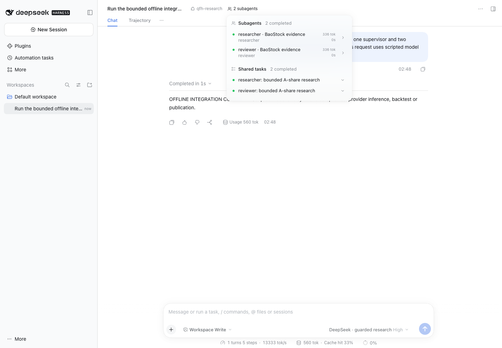

# Native-team integration verification — 12 November 2026

The guarded desktop workflow passes offline integration. Live DeepSeek + BaoStock
validation remains pending the 18:00 Beijing window. No scripted response is
counted as real inference or evidence of research quality.

| Check | Result | Evidence and limits |
|---|---|---|
| Harness lint, format, JavaScript and MIT notices | Pass | `just harness-check`; three JavaScript entrypoints and all package notices |
| Harness offline regressions | 82 passed | Original 75 plus seven per-agent measurement/balance-observation regressions; actual token weighting, rolling boundaries, unknown usage, tariff boundaries, activity attribution and secret-safe non-replay |
| Legacy checks | Pass | Ruff, mypy, import contracts, schemas/cards and package license checks |
| Legacy tests | 862 passed, 54 skipped | No PostgreSQL integration credentials; one existing deprecation warning |
| Native DSH chat/team loop | Pass with fixtures | Actual pinned DSH runtime, one root and two spawned children, 11 scripted requests, two completed native Team tasks, one validated draft |
| Desktop persistence | Pass | 1440×1000 Chrome via Playwright; draft and both native workers/tasks survive reload; no browser console errors |
| Local workspace placement | Pass | Fresh profile stores its default workspace under the private Work-volume directory |
| Actual UI window refusal | Pass after display fix | Two closed-window attempts added zero provider calls, data queries or trial allocations; fixed UI shows the window reason |
| Research settings | Pass after display fix | BaoStock selected and locked, bounded-trial instructions visible, paid credential fields masked; no credentials changed and no provider query occurred |
| Package and secret scan | Pass | Packed plugin includes `research.js`, MIT license and notices; 341 publishable files checked against the actual authorized key, with zero matches |
| Mobile conversation | Known limitation | 390×844 view clips content horizontally; capture retained, mobile not accepted |
| Live inference/data/resource result | Pending | One combined trial at 18:00 Beijing; original shared 200 CNY ledger and owner-reported 20.35 CNY baseline |

The browser plugin was unavailable, so the existing installed Chrome was driven
with the bundled Playwright runtime. Both offline model transport and market data
are synthetic; the offline driver rejects any uncached provider read. The model
request fixture's token/cache values are not model-performance measurements.
The 1.06-second fixture loop fell between two-second resource samples, so its
resource values are null. The separate live run must capture resource samples.

The later per-agent export was replayed on the retained offline trace without
running new model/data calls. It separates role usage, shared-process activity
observations and file sizes. A versioned public tariff supports a reporting cost;
the original conservative budget debit remains unchanged. Account-balance helpers
were tested with synthetic responses only before the authorized live window.

## Retained failures and corrections

- A first browser script matched both search and chat textboxes. It failed before
  dispatch; the corrected script identifies the chat editor by its full label.
- In a fresh profile, initial workspace creation reset the editor after an early
  fill. No model call or trial was allocated. Reload and submission succeeded;
  later runners wait for the configured model and verify editor text before send.
  If this happens manually, wait for the workspace to finish loading and re-enter
  the brief. Do not retry a submitted trial without first checking its state.
- The first loopback regression attempt ran in a sandbox that forbids socket bind.
  Its four transport tests failed before dispatch. The authorized local-socket
  rerun passed all 75 tests. This was an environment failure, not a provider result.
- One `just harness-check` invocation used a root-relative environment path where
  uv required a path relative to `harness/`. It failed before running checks; the
  corrected existing Work-volume environment passed. No interpreter was downloaded.
- A potential accounting race was fixed before live testing: terminal response
  delivery now follows ledger settlement. Browser disconnection, including before
  response headers, drains the admitted upstream request and captures its usage.
- An actual closed-window UI probe exposed a misleading invalid-key message.
  DSH classifies HTTP 403 as authentication failure and suppresses its message.
  The guard now returns HTTP 409 for policy conflicts and HTTP 401 for invalid
  local credentials. A browser rerun shows the actual admission-window reason;
  both attempts retain zero dispatched provider requests and zero trial allocations.
- The research settings test initially failed because a static profile field is
  absent from DSH's editable-settings projection. The panel consequently showed
  its setup selector, although the server still enforced BaoStock-only access.
  A non-secret boolean now uses DSH's native page-bootstrap hook. The rerun verifies
  the locked BaoStock selector, correct trial instructions and masked credential
  fields. An initially premature validation-table entry was corrected immediately;
  only the successful rerun establishes this result.
- The earlier desktop-to-mobile screenshot was captured during a sidebar
  transition. A stable-state retest exposed the native horizontal clipping and
  changed the mobile conclusion to a known limitation.

Private logs preserve both failures and reruns under `.qfh-private/integration/`.
Frozen snapshots and SHA-256 manifests preserve raw requests, native sessions,
worker outputs and mutable-ledger states. Public evidence contains only the
synthetic verification summary and screenshots; live raw vendor rows stay private.

[Offline result](evidence/interactive-2026-11-12/OFFLINE_RESULTS.json)
· [Actual-window refusal](evidence/interactive-2026-11-12/WINDOW_REFUSAL_RESULTS.json)
· [Research settings](evidence/interactive-2026-11-12/RESEARCH_SETTINGS.json)

## Acceptance boundary

This is a bounded prototype, not full Hybrid v1 completion. A valid draft proves
schema/provenance and recorded contribution decisions. It does not establish
economic merit, executable factor semantics, collaboration superiority, evaluator
acceptance or production capacity. Mixed-provider routing, broader market context,
news, paid data tests and independent gate integration remain staged work.
