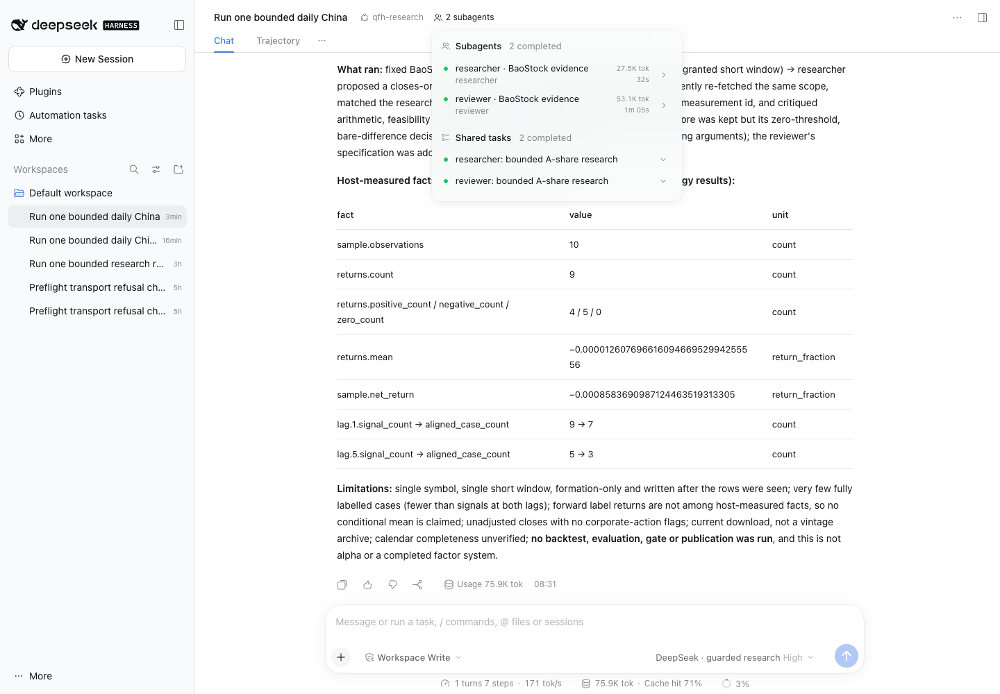

# Arithmetic repair and real three-role rerun — 12 November 2026

The fresh full round **passed bounded workflow integration** at **21:29:22–21:31:49
Beijing** (13:29:22–13:31:49 UTC), lasting 147.52 seconds. A real DeepSeek-flash
supervisor and two real native DSH workers completed, both reports validated,
both Agent Teams tasks completed, and one immutable cited draft was recorded.
All sixteen provider requests settled. This is an integration result, not scientific
acceptance of the proposed factor. The post-run review below identifies unresolved
statistical/specification problems in the agents' arguments.

Source: `69053ae157eb27c692c1c70b2819ee502ae8bf0d`.
Trial: `session-2e6e3c32-921f-4b1c-a416-342068b93c8e`.
Draft: `eac8bfac04f573eadc391023803e1983ee8ed04ed7ee74af0b70d0a0724338de`.
DSH SDK/runtime: 0.2.2rc2; BaoStock: 0.9.4; host: macOS arm64, 18 logical CPUs,
36 GiB RAM. All model IDs on the retained wire are exactly `deepseek-flash`.

The [first attempt](LIVE_TRIAL_2026-11-12.md) remains a failed historical record.
The owner subsequently authorized arithmetic/reporting fixes and a fresh full rerun.
Two attempts were necessary in this work package:

| Attempt | Beijing time | Actual model calls / tokens | Outcome | Tariff estimate CNY | Conservative debit CNY |
|---|---|---:|---|---:|---:|
| Second pilot session | 21:15:50–21:18:21 | 16 / 124,364 | Researcher accepted; reviewer returned nine findings against an eight-item limit; no draft | 0.09852844 | 0.359878 |
| Third pilot session | 21:29:22–21:31:49 | 16 / 156,549 | Both workers and draft accepted; workflow pass | 0.11078532 | 0.427794 |

Both attempts and every charge are retained. Combined new usage in this repair
package was 32 actual model calls, 280,913 tokens, a 0.20931376 CNY tariff estimate
and 0.787672 CNY conservative debit. No failed worker was restarted and no fourth
pilot session was created. The original three-session allowance is now exhausted.

The fixes move empirical arithmetic into a deterministic calculator. Workers cite
measurement IDs and fact keys observed in their own tool calls; the host attaches
values and units. This prevents model-authored numbers from replacing the recorded
facts. The calculator supplies returns, moments, counts and explicit signal,
execution and label dates. Draft prose remains qualitative and parameters belong
in the formula. All proposals are marked as post-observation exploration.

The second session exposed a further report-lifecycle defect: validation happened
only after the native worker had finished. The repaired `submit_worker_report` tool
validates inside the active turn, returns precise field-level errors, and freezes
an accepted report before normal native completion. Schema bounds remain intact;
the host never truncates the model's list. A final worker failure blocks further
research operations except status and settlement. See the
[measurement/report contract](MEASUREMENT_CONTRACT.md).

The third session exercised that repair with real inference: the reviewer again
submitted nine findings, received the exact eight-item-limit error, and submitted
eight findings in the same native session. One additional model call was used,
within its existing six-call limit. The accepted report was immutable; the final
acknowledgment did not replace it. This was an in-turn correction, not a completed
worker replay or silent report repair.

## What each agent actually did

| Role | Recorded work and contribution | Calls | Tokens | Input cache hit | Tariff estimate CNY | Conservative debit CNY |
|---|---|---:|---:|---:|---:|---:|
| Supervisor | Read scope, fetched the fixed evidence and calculated metrics; delegated researcher then reviewer with proposal/hash; resolved both contributions and recorded the draft | 7 | 75,880 | 70.99% | 0.04365040 | 0.185144 |
| Researcher | Independently fetched the evidence and ran metrics; proposed a closes-only reversal contrast with next-close execution; submitted one valid report | 4 | 27,526 | 72.63% | 0.02310648 | 0.079580 |
| Reviewer | Independently fetched the same evidence and ran metrics; challenged threshold, sample support and test specification; corrected one oversized findings list and completed | 5 | 53,143 | 87.62% | 0.04402844 | 0.163070 |
| Whole round | Two completed workers/tasks, one draft with 28 attributed fact references, no terminal tool failures | 16 | 156,549 | 76.56% | 0.11078532 | 0.427794 |

The supervisor retained the researcher's signal/execution structure but rejected
its original decision rule as stated. It adopted the reviewer's alternative
specification. These are recorded model judgments, not independently accepted
scientific conclusions. Both workers referenced measurement
`1e767e2b83f5428d749793915dfb6de508490b04e500647cfda089582d2b62cf`.

| Role | Uncached input | Cached input | Output | Peak dispatch RPM / TPM | Peak completion RPM / TPM |
|---|---:|---:|---:|---:|---:|
| Supervisor | 20,396 | 49,920 | 5,564 | 5 / 45,303 | 5 / 45,303 |
| Researcher | 6,414 | 17,024 | 4,088 | 4 / 27,526 | 4 / 27,526 |
| Reviewer | 5,407 | 38,272 | 9,464 | 4 / 49,474 | 4 / 45,044 |
| Whole round | 32,217 | 105,216 | 19,116 | 11 / 76,963 | 10 / 90,347 |

RPM/TPM are peak rolling sixty-second totals attributed to request dispatch or
completion. They are not per-token streaming rates, capacity measurements or an
account limit. Cache hit rate is cached input divided by total input, weighted
across calls; no cache-creation tokens were reported. DSH's selected-session footer
shows 75.9K tokens for the supervisor; the complete team used 156,549 tokens.
Workers ran sequentially so the reviewer could inspect the actual proposal.

The sample stayed at one symbol (`000001.XSHE`), ten unadjusted daily closes over
19–30 October. The three data fetch operations all reused the exact immutable
BaoStock evidence already obtained in the first live trial. **No new vendor query
or login occurred in either rerun.** Cached real market data is distinct from the
synthetic data used by offline tests. Each agent had its own evidence grant and
metrics result; all referenced the same source hash.

## Machine and accounting record

| Activity window | Wall seconds | Samples | Shared peak RSS MiB | Mean / peak sampled CPU cores | Request-wire bytes | Native-session bytes |
|---|---:|---:|---:|---:|---:|---:|
| Supervisor, excluding worker waits | 48.72 | 24 | 597.77 | 0.0597 / 0.1491 | 1,766,791 | 72,796 |
| Researcher | 32.87 | 16 | 568.31 | 0.0639 / 0.0868 | 1,186,055 | 31,477 |
| Reviewer | 65.92 | 33 | 583.73 | 0.0609 / 0.1092 | 2,741,280 | 56,614 |
| Whole round | 147.52 | 73 | 597.77 | 0.0610 / 0.1491 | 5,694,126 | 160,887 |

These are observations of the shared guard/DSH/data process tree during each
role's activity, not separately allocated worker machines. Browser and Codex
processes are outside that tree. Two-second sampling can miss short-lived children;
intervals crossing role boundaries are excluded from role CPU averages. Host CPU
peaked at 9.7%, swap remained zero, and no resource-measurement error was recorded.
Frozen evidence totals 6,657,105 bytes, including shared ledger/log snapshots;
file lengths do not measure filesystem block allocation. This small, sequential
round does not establish VM sizing or performance at 500 concurrent requests.

The immutable owner-reported official baseline remains **20.35 CNY**. Adding all
subsequent conservative charges yields **21.253244 CNY accounted**, leaving
**178.746756 CNY** beneath the original **200 CNY** ceiling. There are no unknown
charges or unsettled reservations. The original 10 CNY harness-package ceiling,
per-role limits and Beijing windows remain unchanged; every dispatch occurred
within the evening window.

Tariff estimates use actual provider token counts and the dated
[official Flash pricing](https://api-docs.deepseek.com/zh-cn/quick_start/pricing/)
record. They are not invoices. The separate before/after account observations
showed CNY decreases of 0.05 for the failed rerun and 0.01 for the successful
rerun; these did not reconcile to the token-based estimates. Account-wide timing,
credits or other usage may affect those observations. Four administrative balance
GETs are recorded separately from the 32 inference calls. No balance observation
was used to replace the baseline or reduce the conservative debit.

## Verification and remaining limits

All **108 offline tests** pass, together with Ruff, formatting, JavaScript syntax
and MIT notices. Both GitHub workflows passed on the live source revision:
[harness checks](https://github.com/VegarGG/Evolutionary-Supervised-ShareInfo-Quant-Factor-Research-Agent-Team/actions/runs/43227652084)
and [Phase 0 acceptance](https://github.com/VegarGG/Evolutionary-Supervised-ShareInfo-Quant-Factor-Research-Agent-Team/actions/runs/43227652072).
The native synthetic test exercised rejected-then-corrected reports for both
workers before the live rerun. An initial local-socket sandbox test failure and
two read-only/pre-submit browser-driver errors remain in the private logs.

The independent post-run audit verified all 77 frozen file hashes and all sixteen
wire model IDs. Exact rational arithmetic, with a sixty-digit square root for
dispersion, checked all 44 numerical/date facts in each of the three metrics
results. Maximum absolute rounding difference was approximately 4.29e-28, below
the recorded 1e-26 tolerance. Every alignment row and all 28 draft fact references
matched the source. The five-observation lookback correctly has five signals and
three fully aligned cases. Report and draft content hashes also matched.

Desktop Chrome checks passed at 1440×1000: completion rendered, history persisted
after reload, both native workers and both Team tasks displayed completed, and
no console errors appeared. The native 390px layout still clips horizontally;
mobile is not accepted. The browser plugin was unavailable, so installed Chrome
was driven through the bundled Playwright runtime.

Three research-quality issues remain visible in the immutable draft and its audit:

1. The reviewer and supervisor describe the original one-observation forward
   labels as overlapping. Their adjacent intervals share an endpoint but have no
   positive overlap; serial dependence is a separate question. Longer horizons
   in the later generic proposal may overlap. The independent interval check
   records zero overlapping adjacent pairs for the actual measured horizon.
2. The draft treats failure to reject a null as disconfirmation of the proposed
   effect. It needs an inconclusive outcome and a pre-specified uncertainty/power
   criterion. Statistical significance alone does not establish a scientific
   conclusion. [ASA statement](https://www.amstat.org/asa/files/pdfs/P-ValueStatement.pdf).
3. The formula leaves alternatives and parameters unresolved: threshold type,
   minimum bucket size, significance level, margin, horizon and test choice.
   It is a research sketch, not an executable factor specification. No forward
   conditional-mean test, strategy P&L, independent evaluation or publication ran.

The desktop workflow is usable for bounded research experiments, but this tested
campaign has consumed all three configured sessions. Viewing its history makes
no model call. Further trials require an explicit allowance amendment preserving
the same ledger, rather than a reset or automatic quota increase. Broader data,
mixed providers, news/context tools, executable artifacts and independent gate
integration remain later work. A workflow pass does not establish alpha quality
or a collaboration advantage.

[Successful result](evidence/interactive-2026-11-12/LIVE_RERUN_003_RESULTS.json) ·
[Independent audit](evidence/interactive-2026-11-12/LIVE_RERUN_003_AUDIT.json) ·
[Browser checks](evidence/interactive-2026-11-12/LIVE_RERUN_003_BROWSER.json) ·
[Retained failed rerun](evidence/interactive-2026-11-12/LIVE_RERUN_002_RESULTS.json) ·
[Its failure audit](evidence/interactive-2026-11-12/LIVE_RERUN_002_AUDIT.json) ·
[Native offline correction test](evidence/interactive-2026-11-12/REPORT_SUBMISSION_OFFLINE.json).

Raw requests/responses, native sessions, market rows, balance observations,
source/resource manifests, prompts and frozen ledgers remain private under
`.qfh-private/integration/live-trial-002-summary/`, `live-trial-003-summary/`,
`rerun-002/`, `rerun-003/` and `.qfh-private/research/exports/`. The reproducible
independent audit script is `.qfh-private/integration/audit_live_trial_003.py`.
Earlier failures and the prior deployment archive are preserved.

