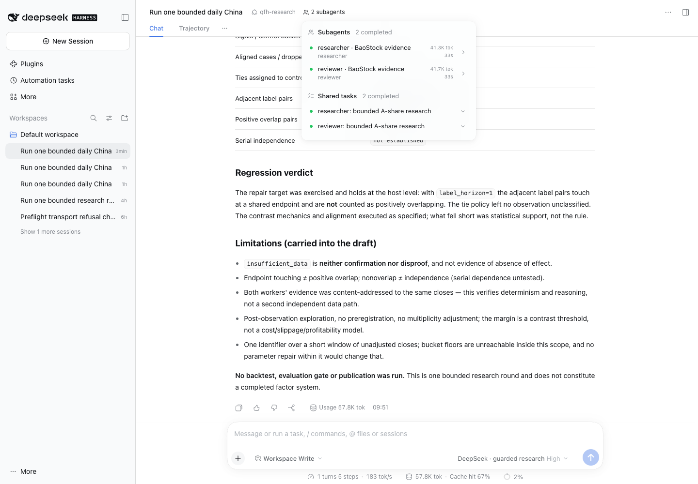

# Statistical/specification repair and real trial — 12 November 2026

The fresh full trial **passed bounded workflow and specification verification** at
**22:49:31–22:51:15 Beijing** (14:49:31–14:51:15 UTC), lasting **103.92 seconds**.
A real Flash supervisor and two real native DSH workers completed, both reports
were accepted, both Team tasks completed, and one immutable draft was recorded.
All **15 Flash requests** settled, with no retry, report rejection, worker replay
or terminal tool failure. No new BaoStock query was needed: both workers fetched
the existing real cached evidence. This was actual model inference, distinct from
the synthetic offline tests.

The three prior statistical/specification blockers are resolved for this run.
The scientific outcome is **`insufficient_data`**: this small pilot establishes
execution and reporting behavior, not a successful factor or profitable strategy.
One unsupported qualitative speculation remains flagged below; acceptance of a
report schema does not validate every sentence.

The desktop is ready for **two further small owner trials**, using a **New Session**
for each, within the existing sample, Flash-only route and Beijing windows. The
original budget has **178.391810 CNY remaining**. The owner-authorized amendment
raised cumulative pilot sessions from three to six; four are now used. No spending,
data or per-trial allowance was increased.

## Frozen source and repaired behavior

Source: `ef71f3f9c17b157136093f635688f611510decd6`, clean at launch.
Trial: `session-915990c7-dc82-4bb5-b152-87ad882bb558`.
Draft: `9ab146456a86ec7c97f00a57db5ff17cb30d36fe73407eb4866317bf628f26d2`.
Specification: `7e17282889186a991f6e04470173f50cd9d6977b7769634a0c3d246a8304e5ec`.
DSH SDK/runtime: 0.2.2rc2; BaoStock: 0.9.4; Python: 3.12.13.
Host: macOS arm64, 18 logical CPUs, 36 GiB RAM.
Every retained wire request uses exactly `deepseek-flash`.

The [new contract](STATISTICAL_SPECIFICATION.md) fixes the three findings in the
[previous real rerun](LIVE_RERUN_2026-11-12.md):

| Prior finding | Implementation and observed verification |
|---|---|
| Touching endpoints called overlapping labels | Host calculates actual interval geometry. Both workers independently obtained six touching adjacent pairs and zero positive-overlap pairs; neither infers independence. |
| Failure to establish an effect called disconfirmation | Explicit insufficient/inconclusive states replace that interpretation. Both reports, the draft and final recap describe insufficient support without claiming absence of effect. |
| Alternative tests and unresolved parameters | Researcher supplies one typed definition; reviewer executes it independently; supervisor selects its hash. The host renders formula, timings and inference from the complete definition and fixed protocol. |

The regression brief fixed label horizon at one to exercise the original overlap
error. The model selected the remaining candidate choices: lookback one, trailing
return strictly below zero, ties to control, expected direction **lower**, and
effect margin **0.001 return fraction**. This is a recorded model-authored contrast
for this test, not a default production factor. Signal is known at close i;
execution is at the next returned close; label is the following close-to-close
return. The oriented effect is the control mean minus the signal mean.

The fixed protocol requires twenty cases per group and at least eight blocks;
the nominal moving-block percentile procedure has base block length five, 95%
coverage, 2,000 replicates and seed 20261112. The actual sample supplied nine
candidate signal dates, seven fully aligned cases, five signal cases, two controls,
two dropped tail cases and zero exact-threshold ties. Consequently **no effect
estimate, interval or bootstrap replicate was produced**. Synthetic tests exercise
the sufficient-data and tie branches; the live run does not.

This procedure is an exploratory development contrast. Nominal coverage depends on
assumptions not established here, and the sample/parameter selection is not
preregistered or adjusted for multiple testing. The margin is not a cost model.
The compatibility field `next_trading_day_close` denotes the next returned
observation in this profile; the canonical formula and recorded dates are
authoritative, and exchange-calendar completeness remains explicitly unverified.

## Each agent's actual work and usage

| Role | Recorded work | Calls | Total tokens | Input cache hit | Tariff estimate CNY | Conservative debit CNY |
|---|---|---:|---:|---:|---:|---:|
| Supervisor | Read scope; assigned researcher then reviewer with the concrete definition; reconciled both accepted reports and selected the independently executed specification; recorded the draft and completion recap | 5 | 57,781 | 66.57% | 0.03659412 | 0.142682 |
| Researcher | Fetched its permitted evidence; ran metrics; chose and executed the concrete contrast; submitted one valid report with ten host-resolved fact references | 5 | 41,288 | 77.23% | 0.02442556 | 0.105550 |
| Reviewer | Fetched its own grant of the same evidence; ran metrics; independently executed the unchanged definition; checked timing, geometry, support and limits; submitted one valid report with seven fact references | 5 | 41,738 | 81.47% | 0.02312596 | 0.106714 |
| Whole round | Two workers/tasks completed, one draft with seventeen attributed fact references | 15 | 140,807 | 74.06% | 0.08414564 | 0.354946 |

Each worker actually called bars, metrics, specification and report-submission
tools. The supervisor relied on their host-validated outputs; it did not make its
own data fetch or numerical calculation. Both contributions were adopted, with no
unresolved disagreement recorded. The reviewer correctly noted that executing on
the same content hash verifies reproducibility, not independent data validation.

| Role | Uncached input | Cached input | Output | Peak dispatch RPM / TPM | Peak completion RPM / TPM |
|---|---:|---:|---:|---:|---:|
| Supervisor | 17,805 | 35,456 | 4,520 | 3 / 49,895 | 3 / 49,895 |
| Researcher | 8,531 | 28,928 | 3,829 | 5 / 41,288 | 5 / 41,288 |
| Reviewer | 7,017 | 30,848 | 3,873 | 5 / 41,738 | 5 / 41,738 |
| Whole round | 33,353 | 95,232 | 12,222 | 11 / 103,576 | 11 / 93,156 |

Rates are peak rolling sixty-second request totals attributed at dispatch or
completion, not streaming token arrival rates or capacity estimates. Input cache
hit is weighted across calls; no cache-write tokens were reported. The DSH footer
shows the selected supervisor's 57.8K tokens; the complete team used 140,807.
Workers ran sequentially. No inference about collaboration superiority, cache
optimization gains or throughput capacity follows from this single run.

The evidence is `000001.XSHE`, ten unadjusted daily closes over 19–30 October 2026,
hash `58ff3df0eba5ef29122a7846347bb0128f15ccce5e10053b87175e5f59042108`.
Both reads were exact-cache hits on the real BaoStock download retained from the
first trial. **Zero new vendor queries/logins; zero iFind/RQData calls.** No data
scope, source allowance, evaluator privilege or publication access was expanded.

## Local machine observations and accounting

| Activity | Wall seconds | Samples | Shared peak RSS MiB | Mean / peak sampled CPU cores | Wire bytes | Native-session bytes |
|---|---:|---:|---:|---:|---:|---:|
| Supervisor, excluding worker waits | 36.44 | 18 | 604.52 | 0.0541 / 0.1124 | 1,442,943 | 67,423 |
| Researcher | 33.43 | 16 | 588.73 | 0.0645 / 0.0964 | 1,168,261 | 37,392 |
| Reviewer | 34.05 | 17 | 581.20 | 0.0514 / 0.0738 | 1,182,094 | 37,278 |
| Whole round | 103.92 | 51 | 604.52 | 0.0562 / 0.1124 | 3,793,298 | 142,093 |

These readings cover the shared guard/DSH/data process tree during role activity,
not isolated agent allocations. Browser/Codex are outside the tree. Two-second
sampling can miss brief children; intervals crossing role boundaries are excluded
from per-role CPU means. Whole-round CPU coverage is 101.18 seconds. Host CPU peaked
at 8.8%, swap stayed zero, minimum available host RAM was 11.36 GiB, and minimum
Work-volume free space was 336.63 GiB. No sampling errors were recorded.
Frozen evidence totals 4,975,555 bytes, including shared ledgers and logs. File
lengths are not allocated disk blocks; this is not a VM-sizing or concurrency test.

The official owner-reported **20.35 CNY** baseline is unchanged. Four interactive
trials now add **1.258190 CNY** in conservative debits, giving **21.608190 CNY
accounted** and **178.391810 CNY remaining** under the original **200 CNY** cap.
All 78 harness calls in the retained ledger are settled. No unknown reservation
exists. The 10 CNY harness-package ceiling and role limits remain unchanged:
eight supervisor, six researcher, six reviewer, twenty total per trial. Every
dispatch was inside the authorized 18:00–24:00 Beijing window; the other allowed
window remains 12:00–14:00.

The **0.08414564 CNY tariff estimate** uses measured usage and the dated
[official Flash rates](https://api-docs.deepseek.com/zh-cn/quick_start/pricing/).
It is not an invoice; **0.354946 CNY** is the separate conservative budget debit.
Two administrative balance GETs observed a CNY account decrease of 0.02, which
does not reconcile to this trial's estimate. Account-wide activity, credits and
billing timing can affect that reading. It is not allocated by agent and does
not reset the ledger or reduce the debit. Absolute balances stay private.

## Verification, remaining caveat and owner readiness

Before live execution, all **135 offline tests** and Ruff/format/JavaScript/MIT
checks passed. The native synthetic DSH run completed both workers and a draft,
including rejected-then-corrected reports within the active worker. Initial lint
failures and their repaired verification logs are retained. Both GitHub workflows
passed on the frozen live source: [harness checks](https://github.com/VegarGG/Evolutionary-Supervised-ShareInfo-Quant-Factor-Research-Agent-Team/actions/runs/43241043072)
and [Phase 0 acceptance](https://github.com/VegarGG/Evolutionary-Supervised-ShareInfo-Quant-Factor-Research-Agent-Team/actions/runs/43241042655).

The independent audit verified all **73 frozen-file hashes**, fifteen wire model
IDs, report/draft/specification hashes, each worker's forty-four measurement facts,
all alignment rows and the seventeen draft references. Exact rational arithmetic
reconstructed the actual buckets and label geometry without importing the
production calculator. Maximum Decimal difference was about 4.29e-28, below
1e-26 tolerance. Separate recomputation verified tokens, cache ratio, tariff,
conservative debit, rolling RPM/TPM and remaining budget. The reviewer executed
the selected definition independently; no parameter or method alternative remained.

The researcher nevertheless speculated that an interval on a larger supported
sample might straddle the margin, based on observed dispersion. It labels that
as an expectation, but the available evidence cannot justify the counterfactual
interval. The reviewer did not challenge it. Audit **Q4** records this as unsupported
qualitative speculation, excluded from verified conclusions. It does not appear
in the host inference, canonical formula or final recap. Preserve the immutable
report and the caveat; do not interpret the workflow pass as universal prose accuracy.

Desktop Chrome at 1440×1000 passed completion, history/reload and Team-board checks:
two completed workers and two completed tasks, no console errors. Installed Chrome
was driven with Playwright because the browser plugin was unavailable. The known
390px mobile clipping remains; mobile is not accepted.

The [append-only allowance amendment](evidence/interactive-2026-11-12/PILOT_EXTENSION_004.json)
preserved budget/data table hashes, original policy and all prior trial/member/event
records. Exactly one operator event was added. After this trial, two new sessions
remain. Use **New Session → qfh-research → DeepSeek · guarded research** with Agent
Teams enabled. Keep the same tiny evidence scope. Viewing history needs no model
call. Do not continue an old completed research round as a new trial.

This is ready for bounded desktop workflow trials, not full Hybrid v1 operation.
Broader research evidence, calibrated confirmatory statistics, point-in-time data,
mixed-provider routing, market/news context and independent evaluator integration
remain separate work. No strategy P&L, official gate, publication or alpha
acceptance ran. A larger research scope needs its own controlled validation.

[Per-agent results](evidence/interactive-2026-11-12/LIVE_SPECIFICATION_004_RESULTS.json) ·
[Independent audit](evidence/interactive-2026-11-12/LIVE_SPECIFICATION_004_AUDIT.json) ·
[Browser checks](evidence/interactive-2026-11-12/LIVE_SPECIFICATION_004_BROWSER.json) ·
[Offline verification](evidence/interactive-2026-11-12/SPECIFICATION_OFFLINE.json).

Raw requests/responses, native sessions, market rows, balance observations and
frozen ledgers stay private in `.qfh-private/integration/live-trial-004-summary/`,
`live-trial-004-qa/`, `rerun-004/` and `.qfh-private/research/exports/`.
The independent script is `.qfh-private/integration/audit_live_trial_004.py`;
prompt, check-log and script hashes are in `rerun-004/DELIVERY_RECORD.json`.
Earlier failed and successful attempts remain unchanged.

