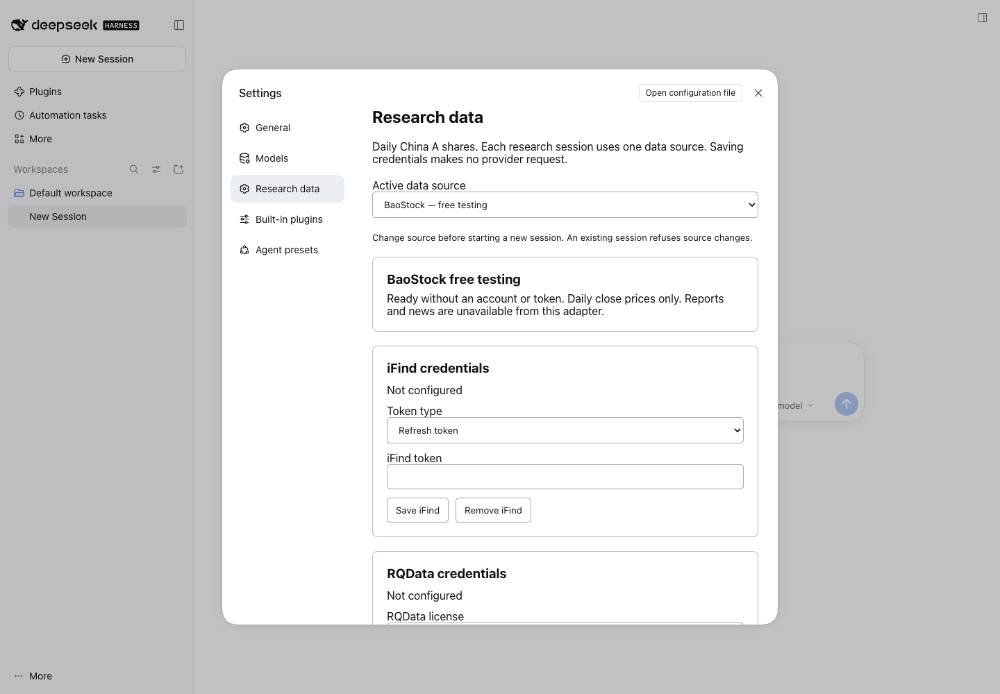
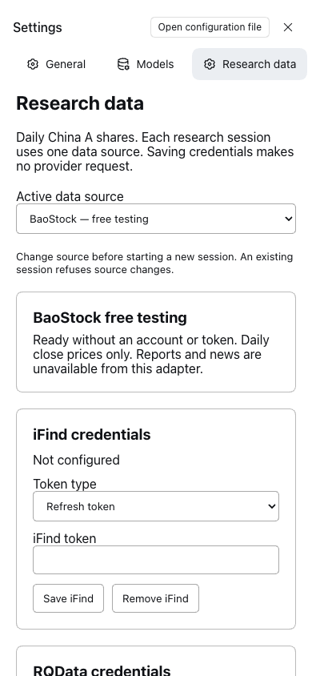

# Work-package verification — 12 November 2026

This is the initial data/settings package record. The later native-team integration
has its own [validation record](INTERACTIVE_VALIDATION.md) and
[trial guide](INTERACTIVE_TRIAL.md); its live trial is tracked separately.

The prototype's bounded checks pass. This record distinguishes software checks
from real inference, data acquisition and research acceptance. Full outputs remain
in `.qfh-private/`; public result indexes retain measurements and evidence hashes.

| Check | Final result | Scope and limits |
|---|---|---|
| `just harness-check` | Pass | Ruff, formatting and both plugin JavaScript syntax checks |
| `just harness-test` | 62 passed | Offline budget, wire accounting, data quotas, source pinning, evidence, redaction and BaoStock regressions |
| `just check` | Pass after notice synchronization | Existing repository Ruff, mypy (59 source files), four import contracts, generated schemas/cards and all five package license copies |
| `just test` | 862 passed, 54 skipped | Existing main-baseline tests. PostgreSQL/registry integration credentials were not configured; skipped tests are not claimed passed. One existing Starlette/httpx deprecation warning |
| DSH runtime smoke | Pass | Real 0.2.2rc2 executable with a synthetic SSE model response |
| DSH data tool smoke | Pass | Actual plugin/child process/evidence path; synthetic model replies. Both fixture evidence and real BaoStock cached evidence tested |
| Live diagnostic models | 10 runs / 24 real requests | DeepSeek only; one synthetic known-answer case; no measured collaboration advantage |
| Live data transport | Pass after two retained adapter failures | BaoStock anonymous query, separate Eastmoney comparison, bounded adapter and zero-request cache reuse |
| DSH desktop/mobile settings | Pass | Provider choice persists; masked credential save/reload/remove with dummy values; no console errors |
| Secret scan | Pass | Compared tracked and unignored files against the authorized actual DeepSeek key without printing it. Real keys, credential stores and raw vendor rows remain excluded |
| Previous PR audit | No open old PRs | PRs 14–19 closed without merge; branches retained |

The first root static check caught that an updated third-party notice needed to be
mirrored into all five packages. The retest passed after those copies were
synchronized. That initial work package did not change the project license.
The later owner-directed MIT transition has a separate
[licensing record](../LICENSING_REVIEW.md).

Native DSH smoke failures were retained before their fixes: missing credentials
service in sdk-minimal; package resolution when loading an absolute plugin entry;
and treating a volatile setting as a string rather than calling `.get()`. Final
tool-smoke results are private `tool-smoke-final/RESULT.json` (fixture) and
`tool-smoke-baostock/RESULT.json` (real cached data). Neither is described as real
LLM inference. The 24 live diagnostic requests have their own wire records.

The original mobile QA attempt used the desktop Account menu locator before
opening the mobile sidebar. Its failure is retained in the
[UI record](evidence/ui-2026-11-12/attempt1.json). The corrected navigation passed
in fresh 1440×1000 and 390×844 browser contexts. The bundled Browser plugin was
unavailable; installed Chrome was controlled with the bundled Playwright runtime.
Both stored dummy credentials were removed; the local DSH credential file is
mode 0600 and neither paid data credential is configured.

The successful guarded BaoStock request took 6.17 seconds with 12 resource samples,
sampled process-tree peak RSS 88.39 MiB and maximum host CPU 8.0%. Its cached replay
took 0.010 seconds, too short for a useful CPU utilization estimate. Earlier cache
check 001 has no resource samples because the sandbox denied process enumeration;
missing measurements are not reported as zero. The sampler now records access
errors instead of letting its sampling thread terminate silently.

[Diagnostic metrics](evidence/diagnostic-2026-11-12/RESULTS.json) ·
[Data metrics](evidence/data-2026-11-12/RESULTS.json) ·
[UI assertions](evidence/ui-2026-11-12/RESULT.json).
There was no new VM deployment, production load test, full paid-provider test,
or scientific acceptance in this work package.

## Screenshots

